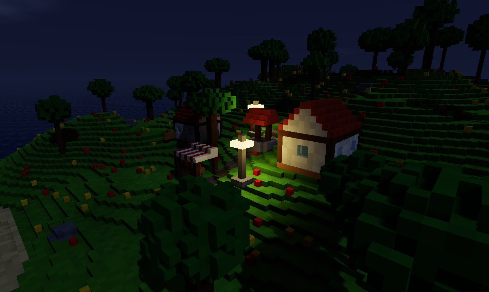

# Historial de versiones

Foxy Engine se construye por fases. Cada fase deja el motor funcionando.

La versión que sale al abrir el editor, como `0.0.1-PR15`, junta la versión
del motor con el número del último cambio (*pull request*) incorporado.

## 0.0.1-PR27: Juegos 2D

- **[Juegos 2D](../guia/juegos-2d.md)**: escenas 2D en casillas con cámara
  *pixel perfect*, capas de casillas y de imagen con paralaje, luces 2D y
  física 2D con salto variable, *coyote time*, escaleras, plataformas de un
  sentido y agua. Se juega también con mando.
- **[Mapas de casillas](../guia/casillas.md)**: paneles **Casillas** y
  **Capas**, con pincel, relleno, rectángulo, goma y cuentagotas, choques
  por casilla y autocasillas que ponen solas sus bordes.
- **[Sprites](../guia/sprites.md)**: panel para cortar hojas en rejilla o a
  mano, poner el punto de anclaje y montar animaciones. **Retocar** abre la
  imagen en Pixel art. El jugador elige solo su animación.
- Componentes nuevos [Recogible](../referencia/componentes/recogible.md) y
  [Partículas](../referencia/componentes/particulas.md) (también en 3D), y
  cámara **Ortográfica** para cubitos vistos de lado.
- Espacio de trabajo **2D**, nodos de la categoría **2D**, evento **Al
  recoger** y funciones nuevas de Lua.
- Plantillas **Vacío 2D**, **Plataformas 2D**, **Aventura cenital** y
  **Plataformas vóxel**.

## 0.0.1-PR26: Código

- **[Panel Código](../interfaz/codigo.md)** nuevo: pestañas, vista dividida,
  colores de Lua, números de línea, plegado, buscar y reemplazar,
  autocompletado de toda la API, errores al escribir e ir a la definición.
- **[Guiones de entidad](../guia/guiones-entidad.md)**: el componente Guion
  elige un archivo de `guiones/`, cada entidad tiene su copia y sus
  **propiedades** se ajustan en el inspector. Módulos propios con
  `require`. Plantillas de entidad vacía, enemigo, puerta, recogible y
  módulo.
- **[Recarga en caliente](../guia/lua-depurar.md#recargar-sin-reiniciar)**:
  al guardar con el juego en marcha, sin reiniciar y sin perder las
  variables.
- **[Consola](../interfaz/consola.md)** que ejecuta Lua contra el juego y
  **[Depurador](../interfaz/depurador.md)** con puntos de parada, paso a
  paso y variables. Ventana **Código** con <kbd>F7</kbd> mientras se juega.
- **[Editores externos](../guia/lua-editor-externo.md)**: VS Code y Zed con
  el mismo autocompletado, y los cambios de fuera se recargan solos.
- [Referencia de la API de Lua](../referencia/api-lua.md) generada a partir
  del motor (`--referencia-lua`).

## 0.0.1-PR25: Nodos 2.0

- **[Nodos 2.0](../guia/nodos.md)**: grafos del juego, de cada escena y de
  entidad (con el componente
  [Grafo de nodos](../referencia/componentes/grafo-de-nodos.md)). Cables de
  ejecución y cables de datos con tipo y color, con conversión automática.
- **Variables** del grafo, de la entidad (con su valor en el Inspector) y
  del juego (que se guardan con la partida y se ven en las interfaces).
- **[Eventos y flujo](../guia/nodos-flujo.md)** nuevos: cada fotograma, al
  pulsar una acción, al chocar, zonas, daño, temporizadores y eventos
  propios; si, elegir, repetir, para cada, mientras, secuencia, esperar sin
  parar el juego, solo una vez y puerta.
- **[Funciones y bibliotecas](../guia/nodos-funciones.md)**: *Pasar a
  función* convierte una selección en un nodo nuevo; las funciones se
  importan de otros proyectos. **Nodos escritos en Lua** con una cabecera.
- **Lienzo**: buscador al soltar un cable, comentarios, puntos de paso,
  alinear y repartir, minimapa, copiar y pegar entre grafos y deshacer.
- **[Depuración](../guia/nodos-depurar.md)** jugando: <kbd>F8</kbd> enseña
  el grafo con los cables encendidos y los valores; puntos de parada con
  <kbd>F9</kbd> y <kbd>F6</kbd>. *Ver el Lua* y *Pasar a código*.
- Elemento **[Barra](../guia/interfaces.md#barras)** en las interfaces.
- Funciones nuevas de Lua para entidades, vectores, esperas y eventos
  (ver [API de Lua](../referencia/lua.md)).
- La [referencia de nodos](../referencia/nodos.md) y las definiciones de
  Lua para el autocompletado se generan desde el propio motor.
- Los nodos de la versión anterior se convierten solos al abrirlos.

## 0.0.1-PR24: núcleo general

- **Entidades y componentes**: cualquier cosa de una escena puede llevar
  [componentes](../referencia/componentes/index.md) (Colisión, Cuerpo
  físico, Controlador de jugador, Cámara, Luz, Sonido, Zona y Guion) que se
  añaden y se quitan en el [Inspector](../interfaz/inspector.md). Nuevo
  objeto *Entidad vacía*.
- **[Prefabricados](../guia/entidades.md#prefabricados)** cuyas copias
  siguen al original, con cambios propios por copia.
- **[Generadores de terreno](../guia/generadores.md)**: vacío, plano, isla,
  colinas y cuevas, con sus parámetros y materiales a la vista.
- **Rejilla y materiales por proyecto**: cubito de 1 m, 50 cm o 25 cm. Los
  proyectos vacíos empiezan con materiales propios.
- Los objetos de ejemplo (casa, árbol, farola…) son ahora **archivos
  `.ron`** que se pueden editar, y hay una **puerta** nueva.
- **Controladores**: primera y tercera persona, cenital, isométrico,
  plataformas 2D y cámara libre.
- **[Acciones de entrada](../guia/acciones-entrada.md)** por proyecto, con
  teclado, ratón y mando, y acciones propias para los guiones.
- **[Módulos](../referencia/modulos/index.md)** por proyecto y por escena.
- **[Sonidos](../guia/sonidos.md)** WAV y OGG, con el componente Sonido.
- Acciones nuevas: **Mover**, **Ocultar**, **Mostrar** y **Tocar un sonido**.
- **Formato 3**: los proyectos anteriores se actualizan solos, con una
  [copia de seguridad](../referencia/archivos.md#actualizar-el-formato).
- El manual estrena [Conceptos básicos](../conceptos/basicos.md) y una
  página de referencia por componente y por módulo.

## 0.0.1-PR23: espacio de trabajo

- El editor es ahora un **espacio de trabajo con paneles** que se mueven,
  se juntan en pestañas, se maximizan y se separan en **ventanas propias**,
  también en otro monitor (la Vista incluida). Ver
  [Personalizar el espacio de trabajo](../editor/espacio-de-trabajo.md).
- **Espacios** *Construir*, *Programar* y *Pixel art*, que recuerdan cómo
  los dejaste en cada proyecto, y espacios propios.
- **Paleta de comandos** (<kbd>Cmd</kbd>/<kbd>Ctrl</kbd>+<kbd>K</kbd>).
- **Tema claro u oscuro** y **color de acento** en las preferencias.
- **Barra de estado** con el último aviso y el panel
  [Registro](../interfaz/registro.md) con todos.
- Menús nuevos: *Ventana*, *Proyecto* y *Herramientas*, con las teclas al
  lado de cada cosa.
- El manual tiene [una página por panel](../empezar/editor.md#los-paneles).

## 0.0.1-PR22: pantalla de inicio

- **[Pantalla de inicio](../empezar/pantalla-de-inicio.md)** al abrir el
  motor: proyectos recientes con miniatura, búsqueda, orden, proyectos
  fijados, renombrar, duplicar y quitar de la lista; plantillas; accesos al
  manual y novedades.
- **[Asistente de proyecto nuevo](../empezar/crear-proyecto.md)** con tipo,
  plantilla (Vacío 3D, Isla vóxel e Isla de ejemplo), nombre y carpeta.
- Los proyectos pueden estar **en cualquier carpeta**: se abren con
  **Abrir…** o soltando la carpeta sobre la ventana.
- **[Ajustes del proyecto](../editor/ajustes-proyecto.md)** y
  **Archivo → Cerrar proyecto**.
- La miniatura del proyecto se actualiza al guardar.
- El manual adopta su nueva estructura (Empezar, Manual del editor,
  Conceptos, Referencia y Apéndices) y un tono de documentación oficial.

## 0.0.1-PR21: rendimiento

- **[Detalle de lejos](../guia/rendimiento.md#detalle-de-lejos)**: los
  trozos lejanos se dibujan con menos detalle (la isla de prueba, vista desde
  fuera, pasa de 304 000 a unos 77 000 triángulos).
- Las texturas de los bloques llevan **mipmaps**: de lejos ya no parpadean.
- Ventana **[Rendimiento](../guia/rendimiento.md)** (*Ver → Rendimiento*),
  con una gráfica de los fotogramas, lo que se dibuja y cómo iría en otros
  ordenadores. Con **Notar cómo va**, el editor se pone a su ritmo.

## 0.0.1-PR20: nodos

- **[Nodos](../guia/nodos.md)**: guiones sin código, con cajas *Cuándo*,
  *Si* y *Hacer* unidas por cables. Se convierten en Lua y se cargan junto
  a `mundo.lua`.

## 0.0.1-PR19: romper bloques, derrumbes y agua

- **[Romper bloques](../guia/jugar.md#romper-bloques)** jugando, según los
  golpes de cada material.
- Lo que se queda sin apoyo **se derrumba** y cae con física (Rapier); al
  pararse, deja ruinas.
- El **agua corre** por los huecos que se abren y se retira si se tapan.
- Ajuste **Romper bloques** en la vida de la escena.

## 0.0.1-PR18: mundos más ligeros

- Las caras iguales que están juntas se dibujan como un solo rectángulo: la
  isla de prueba pasa de 746 000 a 304 000 triángulos y se ve igual.
- Al abrir otra escena, regenerar el terreno o cambiar los materiales, el
  mundo nuevo se prepara en segundo plano (los trozos más cercanos primero)
  mientras se sigue viendo el de antes. Abajo a la derecha sale
  **Preparando el mundo…** con su barra.

## 0.0.1-PR17: importar modelos, extruir y simetría

- **[Importar modelos](../guia/importar.md)** de MagicaVoxel (`.vox`) y
  Qubicle (`.qb`), como objeto propio o directamente en la escena, con un
  material propio para cada color.
- Herramienta **[Extruir](../guia/mundo.md#extruir)** (<kbd>X</kbd>): saca o
  mete una capa de toda una cara.
- **[Simetría](../guia/mundo.md#simetría)** en X, Y y Z al poner, quitar,
  pintar y extruir, en el mundo y en el creador de objetos.
- Los objetos propios pueden medir hasta 64 cubitos (32 m) de lado.

## 0.0.1-PR16: materiales, luces y archivos

- **[Paleta de materiales](../guia/materiales.md)**: materiales propios con
  color, textura y atributos (luz propia, metálico, pulido, transparencia,
  atravesable, golpes y peso). Plantillas de oro, hierro, lava, neón, hielo y
  mármol.
- **Usar como textura** desde cualquier imagen de pixel art, y **Dibujar…**
  desde un material.
- Los materiales que brillan **iluminan alrededor**; sombras más finas cerca
  de la cámara; el cristal es transparente.
- **[Gestor de archivos](../guia/archivos.md)**: carpetas, mover, renombrar,
  papelera e importar (también arrastrando archivos sobre la ventana).
- **[Preferencias](../guia/preferencias.md)** con sincronía vertical (adiós a
  los tirones de la cámara) y asignación de teclas.
- **Ayuda → Manual de Foxy Engine** abre este manual.

## 0.0.1-PR15: Windows

- En Windows, los gráficos se prueban uno a uno: primero **DirectX 12**,
  después Vulkan y por último OpenGL. Arregla el motor que se cerraba sin
  avisar al abrirse en algunos ordenadores.
- [Registro](problemas.md#el-registro-registrotxt) en
  `Documentos/Foxy Engine/registro.txt` y una ventana de aviso si el motor
  se cierra por un error.
- El `.exe` de Windows ya no abre la ventana negra de consola.

## 0.0.1-PR14: el editor, ordenado

- **Barra de menús** (*Archivo*, *Editar*, *Crear*, *Ver* y *Ayuda*), panel
  **«Proyecto»** a la izquierda con todo el proyecto, **tira de
  herramientas** dentro de la vista e **inspector** a la derecha. Las
  pestañas son solo de lo que está abierto.
- **Ayuda → Teclas y ratón…**, con todas las teclas.
- **Proyecto vacío**: un llano de hierba, el punto de inicio y un guion con
  las funciones vacías. Nuevo terreno **Llano vacío**, también para escenas.
- **Al usarlo (E)**: cualquier casa u objeto propio puede llevar a otra
  escena, abrir una interfaz o llamar al guion.
- Las escenas nuevas pueden quedar **ya conectadas**, con zonas de ida y
  vuelta.
- Las pantallas pueden abrirse con **su propia tecla**, y cada interfaz dice
  **cómo se abre en el juego**.
- Avisos <i class="fx fx-aviso"></i> de escenas a las que no se llega y de
  interfaces que nada abre.
- El editor gasta menos: las sombras solo se redibujan si cambia algo, y
  dibuja más despacio cuando nadie lo toca.

## 0.0.1-PR13: la marca

- El editor se abre con el logo horizontal y la versión; los juegos enseñan
  *Powered by Foxy Engine*.
- Identidad visual: el zorro, los iconos de la app y la pantalla *Powered by
  Foxy Engine*.

## Escenas e interfaces

- Varias escenas por proyecto, mapa de escenas, puntos de entrada y zonas de
  cambio.
- Editor de interfaces: menús, marcadores y carteles, con acciones sin código.
- Valores del guion que se enseñan en las interfaces y se guardan con la
  partida.
- Editor de pixel art: imágenes, paletas, texturas para los materiales e
  imágenes que se estiran en nueve partes.

## Extras del editor

- Proyectos, cada uno en su carpeta.
- Creador de objetos en su propia pestaña.
- Carpetas en la escena y modo cursor.

## Fase 4: vida

- Guiones en Lua, con consola y *Comprobar*.
- Vecinos que pasean, miran y hablan.
- Día y noche, estaciones y clima con lluvia, nieve y tormentas.
- Música y efectos de sonido.

## Fase 3: se puede jugar

- Primera persona con física: escalones, agacharse, saltar.
- Teclado, ratón y mando.
- Menú principal, pausa, opciones y partidas guardadas.
- Pelotas con física.

## Fase 2: editor

- Paneles, pincel de bloques, objetos, deshacer y guardar.
- *Jugar aquí*.

## Fase 1: mundo de bloques

- Rejilla fina de cubitos, trozos, luz, sombras, agua y niebla.
- Isla de prueba generada y cámara libre.

## Fase 0: cimientos

- Ventana, modo sin ventana para capturas e integración continua para Mac,
  Windows y Linux.

## Lo que viene

- **Fase 5**: la mudanza de Maxycraft al motor, y sonidos grabados.
- **Fase 6**: exportar y publicar juegos para Mac, Windows y Linux.
