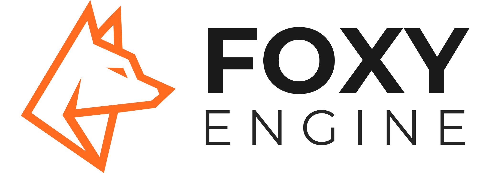
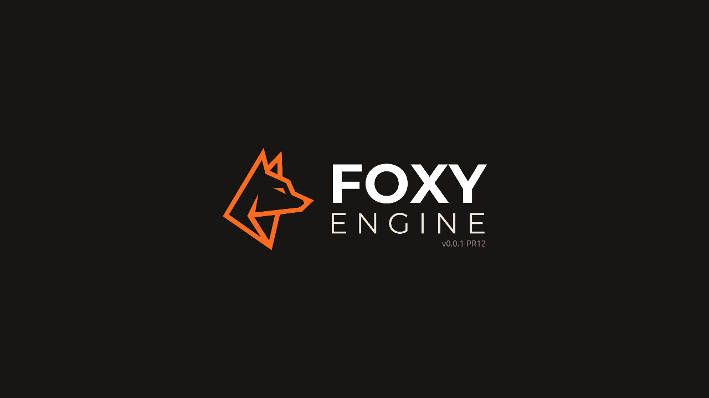

# La marca

El zorro naranja de líneas y el nombre **FOXY ENGINE**.

<div class="portada">
  
  
</div>

## Colores

| Color | Hex | Uso |
|---|---|---|
| <span class="muestra" style="--c:#FF6B1F"></span>Naranja | `#FF6B1F` | El zorro y los acentos |
| <span class="muestra" style="--c:#171615"></span>Fondo | `#171615` | Fondos oscuros |
| <span class="muestra" style="--c:#FFFFFF"></span>Blanco | `#FFFFFF` | FOXY sobre oscuro |
| <span class="muestra" style="--c:#EDE6DC"></span>Crema | `#EDE6DC` | ENGINE sobre oscuro |
| <span class="muestra" style="--c:#1A1A1A"></span>Tinta | `#1A1A1A` | Texto sobre claro |

## Letra

Montserrat: **FOXY** en 700 y ENGINE en 400, convertidas en trazos.
Licencia SIL Open Font License.

## Al abrir el motor

El editor se abre con el logo horizontal sobre fondo negro y la **versión**
del motor (por ejemplo `0.0.1-PR15`). Un clic o una tecla lo salta.



## Powered by Foxy Engine

Los juegos hechos con el motor (`foxy-engine --juego`, y en el futuro los
juegos exportados) enseñan unos segundos esta pantalla. Un clic o una tecla
la salta.


Los archivos originales (SVG y PNG, versiones clara y oscura, horizontal y
vertical) están en la carpeta `assets/marca` del repositorio del motor.

## Iconos

Este manual usa su propio juego de iconos, con las reglas de la marca:
**trazo de línea** como el zorro, rejilla de 24 × 24, grosor 2, esquinas
limpias y el **naranja** `#FF6B1F` como acento. Siguen al texto: en el modo
oscuro se ven claros y en el claro, oscuros, salvo en los títulos y los
botones, donde van en naranja.

{{#include iconos.html}}

Los SVG están en `src/imagenes/iconos/` del
[repositorio del manual](https://github.com/TheMaxymuzZ/foxy-engine-manual).
Se generan con `python3 herramientas/generar-iconos.py`; para añadir uno,
se escribe en ese script y se vuelve a ejecutar. En una página se ponen así:

```html
<i class="fx fx-mundo"></i>
```
