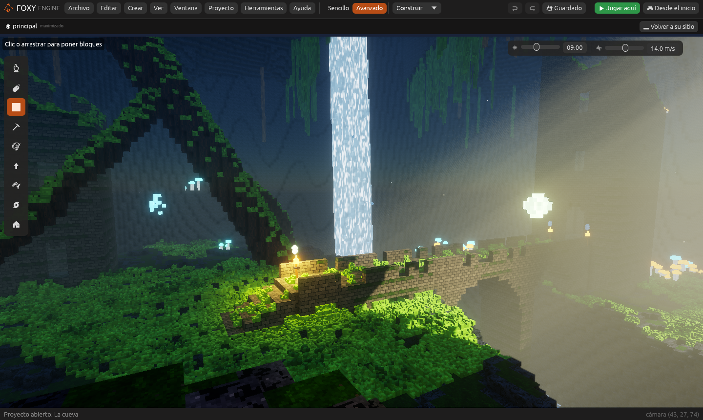
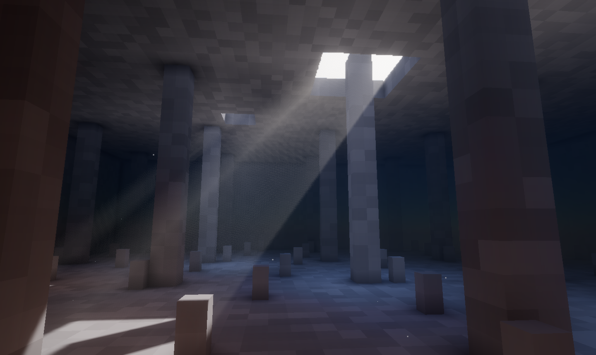

# La cueva paso a paso

Este capítulo monta una cueva como la de la demostración
[La cueva](cueva.md), empezando por un **proyecto vacío**. No sale igual
cubito a cubito (la demo tiene miles de cambios hechos con cuidado), pero
al acabar tendrás lo mismo que la hace llamativa: la abertura con rayos de
sol, la bruma, la antorcha en la mano, una cascada, setas que brillan, los
estilos con teclas y un recorrido de cámara.

Cuenta con una hora o dos. Cada paso enlaza con el capítulo que lo explica
a fondo.



## 1. Un proyecto vacío

1. En la pantalla de inicio, pulsa **Nuevo proyecto**, elige **Vacío 3D**,
   escribe «Mi cueva» y pulsa **Crear proyecto**.
2. La escena empieza solo con una cámara y el **Sol**
   (ver [Empezar una escena desde cero](../guia/escena-desde-cero.md)).

## 2. La forma: una imagen de alturas

La forma grande de la cueva (el suelo, las paredes y el cañón del río) es
más fácil de **dibujar** que de esculpir.

1. **Crear → Imagen de pixel art…**, de 64 × 64, con el nombre `relieve`.
2. Pinta todo de **blanco** (serán las paredes). Con **negro** pinta el
   suelo de la cueva: un óvalo grande en el centro. Con un **gris oscuro**,
   una franja que salga del óvalo hasta un borde: el cañón por donde se va
   el río. Un **gris claro** en un lado del óvalo será un mirador.
3. **Crear → Terreno de cubitos**. En el inspector, pon el generador en
   **Imagen de alturas**, elige `relieve` en **Imagen**, **Del negro al
   blanco** en 35 m y el **Nivel del agua** un poco por encima del negro
   (así el fondo del óvalo se llena de agua: la poza).
4. Pulsa **Regenerar el terreno**.

Más en [El terreno de cubitos](../guia/generadores.md#imagen-de-alturas).

## 3. El techo y la abertura

1. Elige la herramienta **Poner** y el material **Piedra**. Sube el
   **Tamaño** del pincel al máximo y la forma a **Esfera**.
2. Pasa el pincel por encima de las paredes, de un lado a otro, hasta
   cerrar el techo. No hace falta que quede liso: la roca irregular queda
   mejor.
3. Con **Quitar**, abre un agujero grande en un lado del techo. Esa será la
   **abertura** por la que entra el sol.
4. Con el pincel **Suavizar**, redondea los bordes.

Más en [Mundos vóxel](../guia/mundo.md#el-pincel).

## 4. El sol y los rayos

1. Elige el objeto **Sol**. En **Luz del sol**, pon la **Hora** en 9: el
   sol de la mañana viene de lado y entra en diagonal por la abertura. Mueve
   la hora con la barra ☀ de la vista hasta que la luz caiga dentro.
2. **Crear → Niebla**. Pon **Densidad** 0,1 (casi nada), **Rayos** al
   máximo y un **Color** gris verdoso. La niebla apenas se ve, pero donde
   le da el sol se encienden los **rayos**.
3. **Proyecto → Ajustes del proyecto… → Gráficos**: pon el ambiente
   **Realista**. Enciende la luz que rebota (la roca se ilumina con la luz
   que entra) y la niebla con rayos. Baja la **Exposición** a 0,8 para que
   la cueva quede oscura y los rayos destaquen.



Más en [Gráficos: luz, sombras y atmósfera](../guia/graficos.md#rayos-de-luz-con-la-niebla)
y en [Niebla](../referencia/componentes/niebla.md).

## 5. La antorcha en la mano

1. Abre el [creador de objetos](../guia/creador.md) y haz una antorcha
   pequeña: un palo de madera y, arriba, unos cubitos de un material
   naranja con **Luz propia**.
2. Ponla en la escena. En el inspector, **Añadir componente → En la
   mano**: al jugar en primera persona irá en tu mano derecha.
3. **Añadir componente → Luz**: color naranja, alcance de unos 11 m y
   **Sombras** encendidas.
4. Pulsa **Jugar aquí** dentro de la cueva: la antorcha alumbra la roca y
   hace sombra al andar.

Más en [En la mano](../referencia/componentes/mano.md) y
[Luz](../referencia/componentes/luz.md).

## 6. La cascada

1. Con **Poner**, haz una columna de agua de unos 2 × 1 cubitos desde
   el borde del techo hasta la poza. Usa un material propio «Cascada»:
   **Crear → Material…**, azul claro, y en
   [Efectos de material](../guia/efectos-de-material.md) dale un efecto
   que mueva la textura hacia abajo.
2. **Crear → Objeto nuevo** arriba de la cascada, y **Añadir componente →
   Partículas** de tipo **Cascada**: gotas que caen.
3. Otro objeto en la poza con partículas de **Humo**, muy grandes y
   transparentes: la bruma donde cae el agua.

Más en [Partículas](../referencia/componentes/particulas.md).

## 7. Setas, musgo y antorchas

- **Setas que brillan**: en el creador, un pie claro y un sombrero de un
  material con **Luz propia** (cian o naranja). Ponlas en grupos junto al
  agua. A unas pocas, añádeles una **Luz** pequeña: iluminan el suelo de
  alrededor.
- **Musgo**: pinta con **Pintar** un material verde sobre el suelo y las
  rocas de arriba. El pincel **Sembrar** reparte helechos y piedras.
- **Antorchas en la pared**: una antorcha con **Luz** (con sombras) y un
  objeto encima con partículas de **Fuego** y otro de **Ascuas**.

## 8. Los estilos con las teclas

1. **Proyecto → Ajustes del proyecto… → Acciones de entrada**. Pulsa
   **Acción nueva** y llámala «Estilo 1»; pulsa **+ tecla** y la tecla
   <kbd>1</kbd>. Haz igual «Estilo 2» con <kbd>2</kbd>, y así hasta la que
   quieras.
2. En el panel **Código**, abre el guion del mundo y escribe:

```lua
local estilos = {
  ["Estilo 1"] = "proyecto",
  ["Estilo 2"] = "dibujo",
  ["Estilo 3"] = "neon",
  ["Estilo 4"] = "acuarela",
  ["Estilo 5"] = "pixel",
  ["Estilo 6"] = "ninguno",
}

function al_pulsar(nombre)
  if estilos[nombre] then
    motor.ambiente(estilos[nombre])
  end
end
```

3. Juega y pulsa las teclas. `"proyecto"` vuelve a lo que pusiste en los
   ajustes. Con nodos es el nodo **Poner un ambiente**.

Más en [Acciones de entrada](../guia/acciones-entrada.md) y
[Efectos y estilos](../guia/efectos.md#ambientes).

## 9. El recorrido del principio

1. En el panel **Animación**, crea una **Cinemática nueva** llamada
   «recorrido».
2. Añade las pistas de la cámara **Posición** y **Mirar hacia**. Pon una
   clave cada cuatro o cinco segundos: la abertura, la cascada, las setas y,
   al final, el sitio donde empieza el jugador.
3. Añade frases con sucesos de **Diálogo**.
4. En el guion del mundo:

```lua
function al_empezar()
  motor.cinematica("recorrido")
end
```

Más en [Cinemáticas](../guia/cinematicas.md).

## 10. Probar y medir

Pulsa **Desde el inicio**. Mientras juegas, <kbd>F3</kbd> abre la ventana
**Rendimiento**: si va lenta, baja la **Calidad** en los ajustes de
gráficos o pasa el [doctor de rendimiento](../guia/optimizar.md).

Compara con la demostración: crea un proyecto **La cueva** y mira en su
inspector cómo está hecha cada cosa ([La cueva](cueva.md#qué-hay-en-la-escena)).
