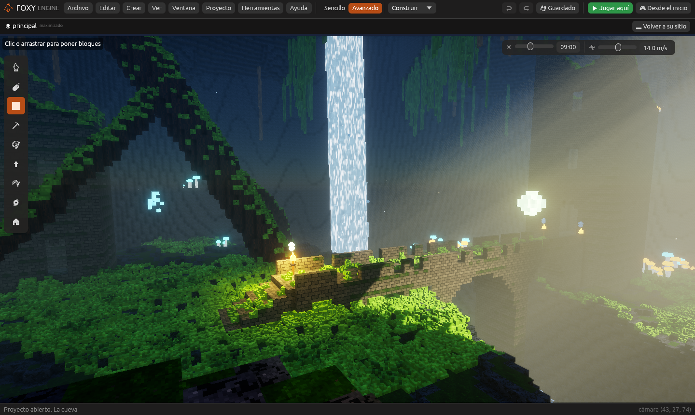
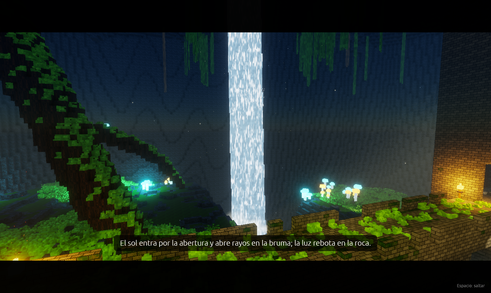
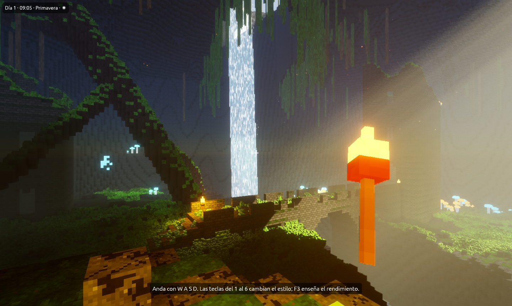

# La cueva

**La cueva** es la imagen de referencia de Foxy Engine hecha con el propio
motor: una cueva enorme con una abertura en el techo por la que entra el sol
de la mañana y abre rayos en la bruma, un tronco caído que cruza la sala,
una cascada que cae a una poza, unas ruinas con un puente de arcos y dos
torres, setas y cristales que brillan, lianas, musgo y antorchas que hacen
sombra. Se juega en primera persona con una antorcha en la mano.



Todo está hecho con el motor: la forma de la cueva es una
[imagen de alturas](../guia/generadores.md#imagen-de-alturas) con cubitos
cambiados encima, las texturas están pintadas en
[Pixel art](../guia/pixel-art.md), la cascada es un
[efecto de material](../guia/efectos-de-material.md) más
[partículas](../referencia/componentes/particulas.md), y el recorrido del
principio es una [cinemática](../guia/cinematicas.md).

## La visita de cinco minutos

1. En la pantalla de inicio, pulsa **Nuevo proyecto**.
2. En **¿Qué juego quieres hacer?**, dentro de *Más ejemplos*, elige
   **La cueva**, escribe un nombre y pulsa **Crear proyecto**. El editor se
   abre mirando a la cueva.
3. Pulsa **Desde el inicio**. Primero sale el **recorrido**: 26 segundos de
   cámara por la abertura, la cascada, el puente y las setas, con un texto
   en cada plano.

   

4. Al acabar, ya juegas: estás en el mirador, con la antorcha en la mano.
   Anda con <kbd>W</kbd> <kbd>A</kbd> <kbd>S</kbd> <kbd>D</kbd>, mira con
   el ratón y salta con <kbd>Espacio</kbd>. Baja hacia la poza: la antorcha
   alumbra la roca y hace sombra.

   

5. Pulsa las teclas del <kbd>1</kbd> al <kbd>6</kbd>. La cueva es la misma,
   pero cambia cómo se dibuja: realista, dibujo animado, neón, acuarela,
   píxel retro y sin efectos. Abajo sale lo que hace cada uno. Los tienes
   todos juntos en la [Galería de estilos](estilos.md).
6. Pulsa <kbd>F3</kbd>: la ventana **Rendimiento** dice a cuántos
   fotogramas por segundo va y qué gasta más (ver
   [Rendimiento](../guia/rendimiento.md)).
7. Pulsa <kbd>F5</kbd> para volver al editor y mira cómo está hecho.

## Qué hay en la escena

Elige cada cosa en **En la escena** para ver su inspector.

| Qué | Cómo está hecho |
|---|---|
| La forma de la cueva | El **Terreno** con el generador **Imagen de alturas** (`imagenes/relieve_cueva.png`) y, encima, los cubitos de la bóveda, el tronco, la cascada, las lianas, el musgo, los cristales y las ruinas, guardados como cambios del pincel. |
| El sol y los rayos | **Luz del sol** a las 9 de la mañana, que entra de lado por la abertura, y una **Niebla** de color verdoso con poca densidad y muchos **Rayos**. |
| La antorcha en la mano | Un objeto con [En la mano](../referencia/componentes/mano.md) y una [Luz](../referencia/componentes/luz.md) naranja con sombras. |
| Las antorchas de la pared | Cada una lleva su luz con sombras y, encima, un objeto «Llama» con partículas de **Fuego** y **Ascuas**. |
| La cascada | Cubitos del material **Cascada**, que tiene un efecto de material de espuma que cae, más dos objetos con partículas de **Cascada** y bruma de **Humo** en la poza. |
| Las setas y los cristales | Objetos de cubitos con materiales que brillan; algunas setas llevan una luz pequeña. Los cristales laten con el efecto **Latido**. |
| Los estilos | El guion del mundo: cada tecla es una acción propia («Estilo 1» a «Estilo 6», en **Ajustes del proyecto → Acciones de entrada**) que llama a `motor.ambiente`. |
| El recorrido | La cinemática «recorrido» (panel **Animación**), que el guion pone al empezar. |

## Los estilos con el guion

El guion del mundo cambia el estilo con
[`motor.ambiente`](../referencia/api-lua.md), que pone uno de los
[ambientes](../guia/efectos.md#ambientes) mientras se juega:

```lua
function al_pulsar(nombre)
  if nombre == "Estilo 2" then
    motor.ambiente("dibujo")      -- dibujo, neon, acuarela, pixel, ninguno o realista
  elseif nombre == "Estilo 1" then
    motor.ambiente("proyecto")    -- vuelve a lo de los ajustes del proyecto
  end
end
```

Con nodos es el nodo **Poner un ambiente**.

## Ajustes que usa

En **Proyecto → Ajustes del proyecto… → Gráficos**: calidad **Ultra**,
exposición 0,8, atmósfera **Realista** con destello, y en **Mar, viento y
reflejos**, los reflejos y algo de viento (mueve las hojas y las lianas).

> <i class="fx fx-consejo"></i> **Consejo.** Si va lenta en tu ordenador,
> baja la **Calidad** a **Alta** o **Media** en esos mismos ajustes. Mira la
> [tabla de rendimiento](rendimiento.md).

## Véase también

- [La cueva paso a paso](cueva-paso-a-paso.md): cómo hacer una cueva así
  desde un proyecto vacío.
- [Galería de estilos](estilos.md)
- [Gráficos: luz, sombras y atmósfera](../guia/graficos.md)
- [Efectos y estilos](../guia/efectos.md)
