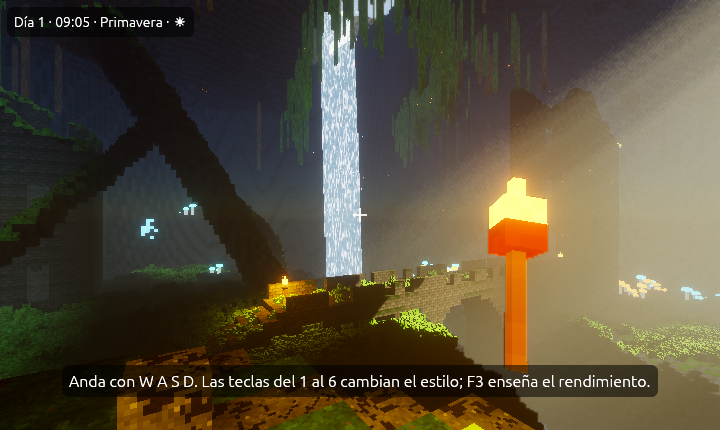
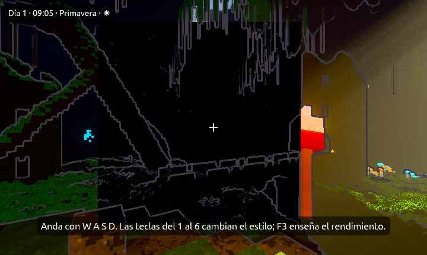
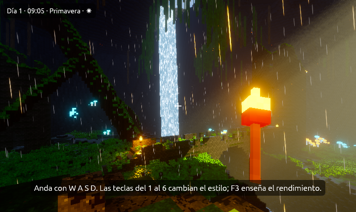
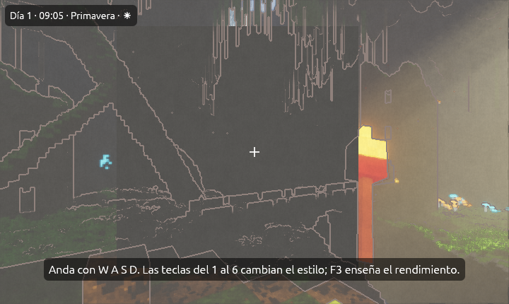
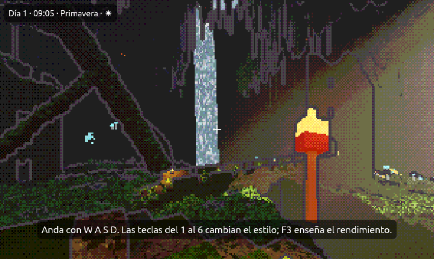
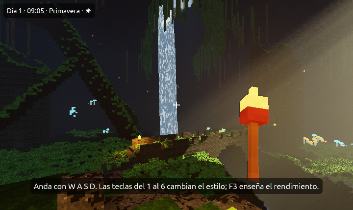

# Galería de estilos

La misma cueva, el mismo sitio y la misma hora, en los seis estilos que
trae la demostración [La cueva](cueva.md). Solo cambia **cómo se dibuja**:
los cubitos, las luces y los objetos son los mismos. Jugando, cada uno se
pone con una tecla, del <kbd>1</kbd> al <kbd>6</kbd>.

Cada estilo es uno de los [ambientes](../guia/efectos.md#ambientes) del
motor. En tu juego puedes ponerlo en **Proyecto → Ajustes del proyecto… →
Gráficos** o cambiarlo mientras se juega con `motor.ambiente(...)` (ver
[Los estilos con el guion](cueva.md#los-estilos-con-el-guion)).

## 1. Realista (el del proyecto)

Rayos de sol en la bruma, luz que rebota en la roca, agua que refleja,
sombras suaves de las antorchas y un poco de destello.

## 2. Dibujo animado

Contorno de tinta, luz por bandas y colores vivos.

## 3. Neón nocturno

Suelo mojado que refleja las luces, lluvia y neones que brillan más. Las
setas y los cristales parecen carteles.

## 4. Acuarela

Papel, trazo a mano, colores pastel y bruma suave.

## 5. Píxel retro

Pocos píxeles y una paleta corta con tramado, como una consola antigua.

## 6. Sin efectos

El folio en blanco del motor: ningún efecto, solo la luz y las sombras de
siempre. Así se ve un proyecto nuevo.

## Mezclar

Un ambiente es solo un punto de partida: después de elegirlo puedes tocar
cada pieza del estilo a mano (el contorno, la luz por bandas, el papel, los
píxeles…) en los ajustes de gráficos. Ver
[Las piezas del estilo](../guia/efectos.md#las-piezas-del-estilo).
