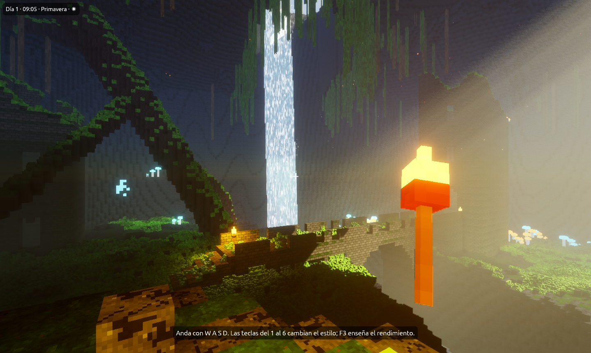

# Demostraciones

Estas plantillas no son para empezar un juego, sino para **ver lo que sabe
hacer Foxy Engine** y destriparlo. Todas están hechas solo con el motor:
sin imágenes, modelos ni código de fuera. Se crean como cualquier proyecto,
desde **Nuevo proyecto → Más ejemplos**, y puedes tocar todo lo que traen.

| Demostración | Qué enseña | Página |
|---|---|---|
| **La cueva** | La imagen de referencia del motor: rayos de sol en la bruma, luz que rebota, cascada, ruinas, setas que brillan y una antorcha en la mano. Con las teclas del 1 al 6 cambia de estilo. | [La cueva](cueva.md) |
| **Galería de estilos** | La misma cueva en los seis estilos: realista, dibujo animado, neón, acuarela, píxel retro y sin efectos. | [Galería de estilos](estilos.md) |
| **Valle enorme con físicas** | Un valle de dos kilómetros que se carga por zonas, con el laboratorio de físicas en el centro y un coche para recorrerlo. | [Valle enorme con físicas](valle-enorme.md) |
| **Juego de píxeles** | Un nivel de plataformas de pixel art en una cueva oscura, con luces, gemas, murciélagos y una cascada. | [Juego de píxeles](juego-de-pixeles.md) |
| **Demo técnica** | El templo del zorro: un monte junto al mar con un templo griego, una ciudad y su puerto. | [Demo técnica](../tu-primer-juego/demo-tecnica.md) |
| **Laboratorio de físicas** | Puente colgante, coche, bola de demolición y muñeco de trapo, sin código. | [Laboratorio de físicas](../tu-primer-juego/laboratorio-fisicas.md) |

## Por dónde empezar

Si solo tienes cinco minutos, abre **La cueva**: la
[visita de cinco minutos](cueva.md#la-visita-de-cinco-minutos) enseña casi
todo. Si quieres aprender a hacer algo parecido, sigue
[La cueva paso a paso](cueva-paso-a-paso.md), que la monta desde un proyecto
vacío.

Para saber cómo irán en tu ordenador, mira la
[tabla de rendimiento](rendimiento.md).

## Los capítulos que explican cada cosa

Las demostraciones usan todo lo que explican estos capítulos:

- [Gráficos: luz, sombras y atmósfera](../guia/graficos.md): el sol, la
  niebla con rayos, la luz que rebota, el agua y los reflejos.
- [Efectos y estilos](../guia/efectos.md): los ambientes, las partículas y lo
  que se lleva en la mano.
- [Efectos de material](../guia/efectos-de-material.md): la espuma de la
  cascada y el latido de los cristales.
- [Físicas precisas](../guia/fisicas.md): cuerpos, articulaciones y
  vehículos.
- [Mundos enormes](../guia/mundos-enormes.md) y
  [Rendimiento](../guia/rendimiento.md): la carga por zonas, el doctor de
  rendimiento y la ventana que dice qué gasta más.
- [Si vienes de Blender o de Unity](../guia/blender-unity.md): las teclas y
  la cámara de siempre para moverte por ellas.
