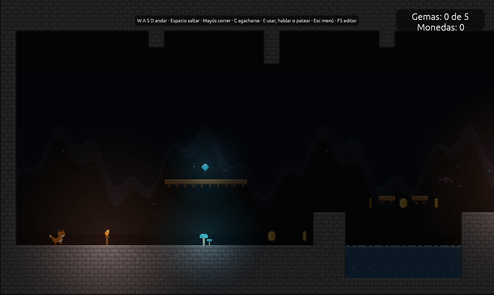
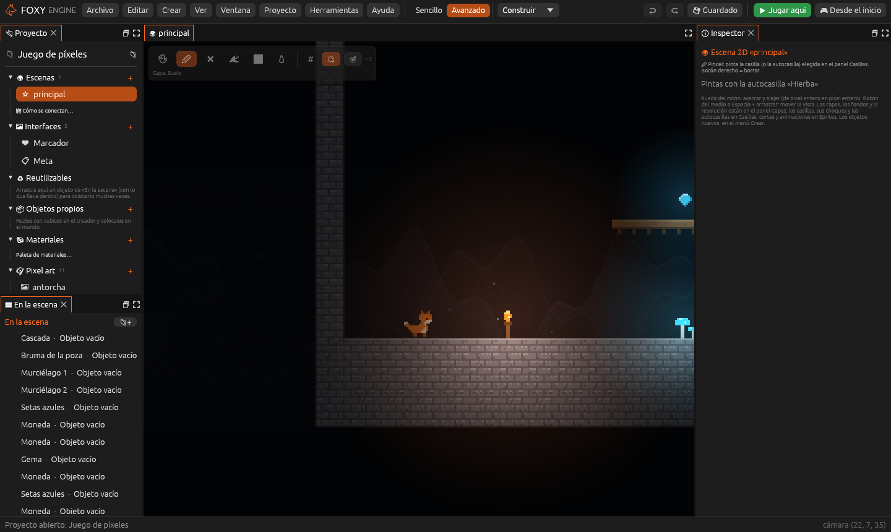

# Juego de píxeles

Un nivel de plataformas de **pixel art** dentro de una cueva oscura. Lo
único que alumbra son las antorchas, las setas y las gemas, así que la luz
2D del motor se luce. Hay que cruzar la cueva hasta la bandera cogiendo
cinco gemas, saltando pinchos y agua, y esquivando murciélagos.

## 1. Crear el proyecto

1. En la pantalla de inicio, pulsa **Nuevo proyecto**.
2. En *Más ejemplos*, elige **Juego de píxeles**, escribe un nombre y pulsa
   **Crear proyecto**.

## 2. Jugar

Pulsa **Desde el inicio**. Anda con <kbd>A</kbd> y <kbd>D</kbd>, salta con
<kbd>Espacio</kbd> y corre con <kbd>Mayús</kbd>. El marcador de arriba
cuenta las gemas y las monedas. Si te toca un **murciélago**, vuelves a la
entrada (sin perder lo que llevabas). Al llegar a la **bandera** sale el
cartel del final, con un botón para jugar otra vez.

## 3. Cómo está hecho

| Qué | Cómo |
|---|---|
| El nivel | Un [mapa de casillas](../guia/casillas.md) con la autocasilla de piedra, plataformas de madera que se atraviesan desde abajo, pinchos y agua. |
| El fondo | Tres [capas](../interfaz/capas.md) que se mueven a distinta velocidad (paralaje): rocas lejanas, rocas cercanas y el fondo. |
| La luz | La **luz ambiente** de la escena está muy baja (0,22) y cada antorcha, seta y gema lleva una [Luz](../referencia/componentes/luz.md). |
| Las gemas y las monedas | [Recogible](../referencia/componentes/recogible.md): al tocarlas suman a «gemas» o «monedas». |
| Los murciélagos | El comportamiento ya hecho **Patrullar**: van y vienen. |
| La cascada | [Partículas](../referencia/componentes/particulas.md) de tipo **Cascada** y bruma en la poza. |
| La bandera | Una [Zona](../referencia/componentes/zona.md) que, al entrar, abre la interfaz «Meta». |
| El guion | Pone los contadores a cero, avisa al coger las cinco gemas y, en `al_chocar`, devuelve al jugador a la entrada si lo que ha tocado es un murciélago. |

Las imágenes (el zorro, las setas, el murciélago, las rocas y las casillas)
están pintadas en [Pixel art](../guia/pixel-art.md), dentro del proyecto.

## Véase también

- [Juegos 2D](../guia/juegos-2d.md)
- [Sprites](../guia/sprites.md)
- [Plataformas](../tu-primer-juego/plataformas.md)
