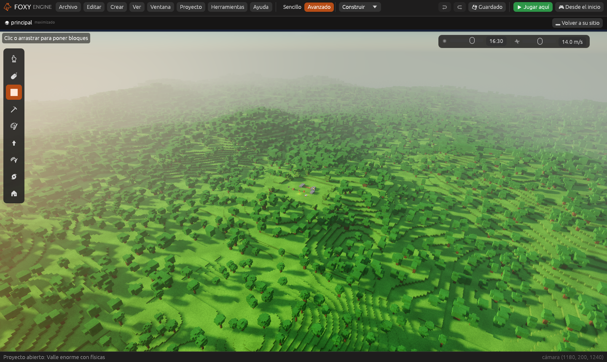
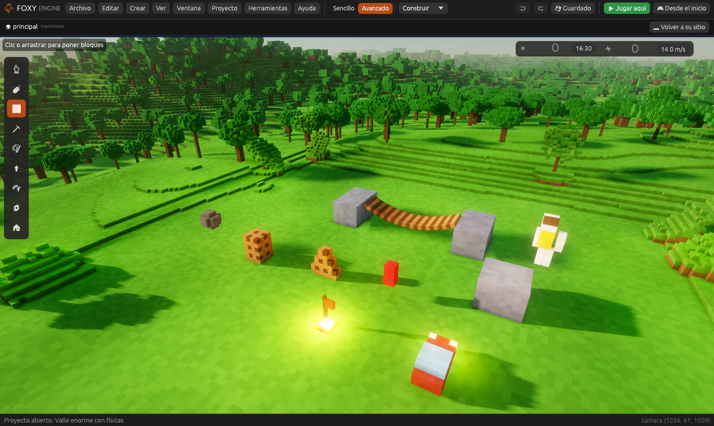

# Valle enorme con físicas

Un valle de colinas con bosques de **dos kilómetros de lado** y, en el
centro, sobre un llano, el [Laboratorio de físicas](../tu-primer-juego/laboratorio-fisicas.md):
el puente colgante, el coche, la bola de demolición, el muñeco de trapo, el
saco y las cajas. Enseña dos cosas a la vez: un mundo muy grande que se
mueve con soltura y las físicas precisas funcionando en él.

## 1. Crear el proyecto

1. En la pantalla de inicio, pulsa **Nuevo proyecto**.
2. En *Más ejemplos*, elige **Valle enorme con físicas**, escribe un nombre
   y pulsa **Crear proyecto**.

El editor se abre mirando al laboratorio.

## 2. Jugar

Pulsa **Desde el inicio**.

- Cruza el **puente**, empuja las **cajas** o da patadas al **saco**
  (mira a uno y pulsa **Usar**, <kbd>E</kbd>).
- Acércate al **coche** y pulsa **Usar** para subir. Conduce con
  <kbd>W</kbd> <kbd>A</kbd> <kbd>S</kbd> <kbd>D</kbd>, frena con
  <kbd>Espacio</kbd> y sal del llano por la cuesta. Las colinas siguen
  hasta el horizonte, y el terreno se va cargando a tu alrededor según
  avanzas.
- Pulsa <kbd>F3</kbd> para ver en la ventana **Rendimiento** cuántos trozos
  de terreno se dibujan y cuántos de ellos son de lejos (con menos detalle).

## 3. Cómo está hecho

- **El terreno** es el generador **Colinas** con un **Lado** de 2.048 m
  (ver [El terreno de cubitos](../guia/generadores.md)). En el centro hay un
  cuadrado allanado con una cuesta suave alrededor, hecho con cubitos
  cambiados.
- **Mundos enormes**: en **Proyecto → Ajustes del proyecto… → Gráficos**,
  en *Mundo enorme*, están encendidas la carga por zonas, no dibujar lo
  tapado, el límite de objetos lejanos y las coordenadas grandes (ver
  [Mundos enormes](../guia/mundos-enormes.md)).
- **Físicas**: en **Ajustes del proyecto… → Físicas**, las físicas
  precisas y el modo determinista. Rapier solo conoce el terreno de
  alrededor de cada cuerpo que se mueve, así que el tamaño del mundo no
  le pesa (ver [Físicas precisas](../guia/fisicas.md)).
- **El laboratorio** es el mismo de la plantilla Laboratorio de físicas;
  cada montaje se explica allí.

## Véase también

- [Mundos enormes](../guia/mundos-enormes.md)
- [Físicas precisas](../guia/fisicas.md)
- [Tabla de rendimiento](rendimiento.md)
