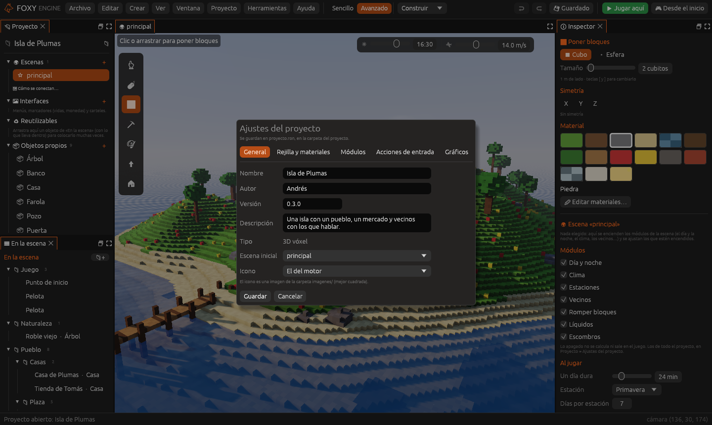
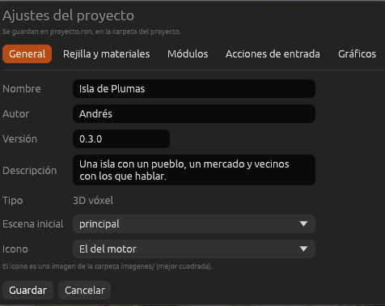

# Ajustes del proyecto

La ventana **Ajustes del proyecto** reúne los datos generales del juego:
su nombre, quién lo hace, su versión, su descripción, la escena con la que
empieza y su icono. Se abre con **Proyecto → Ajustes del proyecto…**.

## Opciones

| Opción | Descripción |
|---|---|
| **Nombre** | El nombre del proyecto en la pantalla de inicio y en la barra del editor. Cambiarlo no cambia el nombre de la carpeta |
| **Autor** | La persona o el estudio que hace el juego |
| **Versión** | La versión del juego, por ejemplo `0.1.0` |
| **Descripción** | Una frase sobre el juego. Se muestra en la lista de proyectos |
| **Tipo** | El tipo de proyecto elegido al crearlo. No se puede cambiar |
| **Escena inicial** | La escena con la que empieza el juego al pulsar **Desde el inicio** y en el juego publicado |
| **Icono** | Una imagen de la carpeta `imagenes/` del proyecto (preferiblemente cuadrada). **El del motor** usa el icono de Foxy Engine |

Pulsa **Guardar** para aplicar los cambios. Se escriben en el archivo
`proyecto.ron`, en la carpeta del proyecto.

> <i class="fx fx-nota"></i> **Nota.** La escena inicial también se puede
> cambiar desde el panel **Proyecto**, con el botón derecho sobre una escena.

## Véase también

- [Archivos del proyecto: proyecto.ron](../referencia/archivos.md#proyecto)
- [Escenas](../guia/escenas.md)
- [Pixel art](../guia/pixel-art.md)
