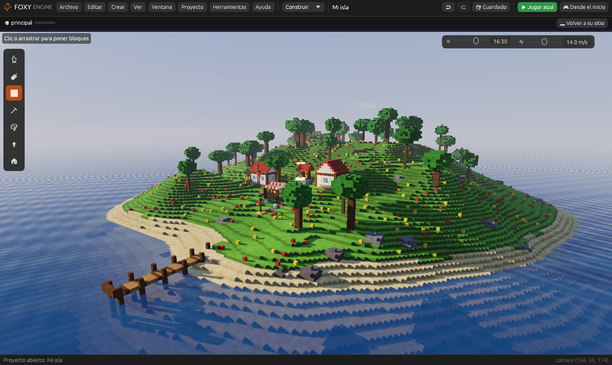
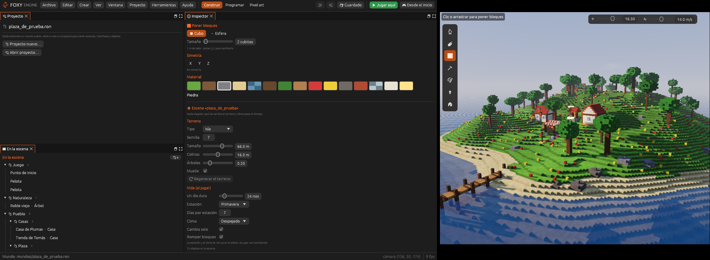
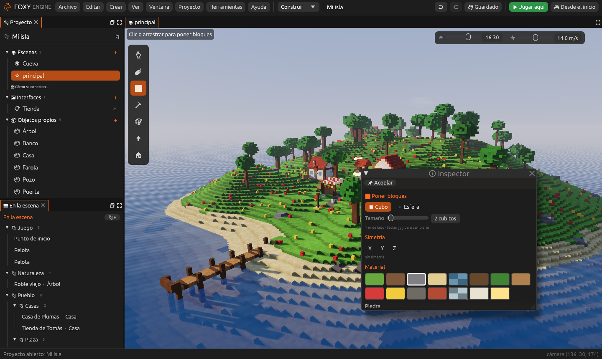
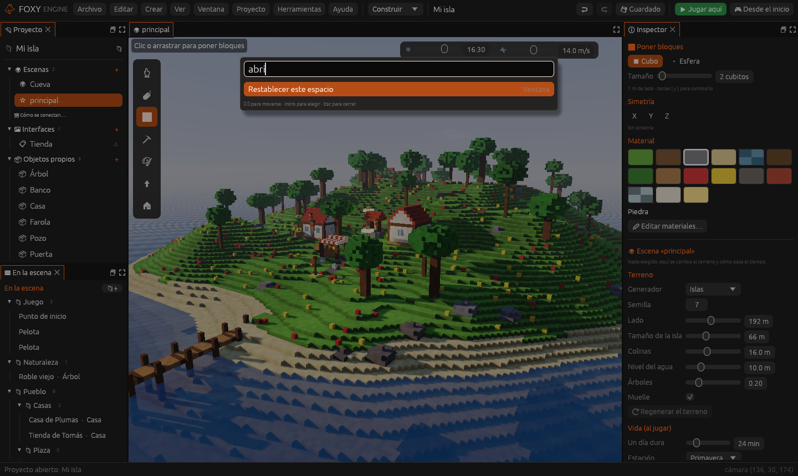
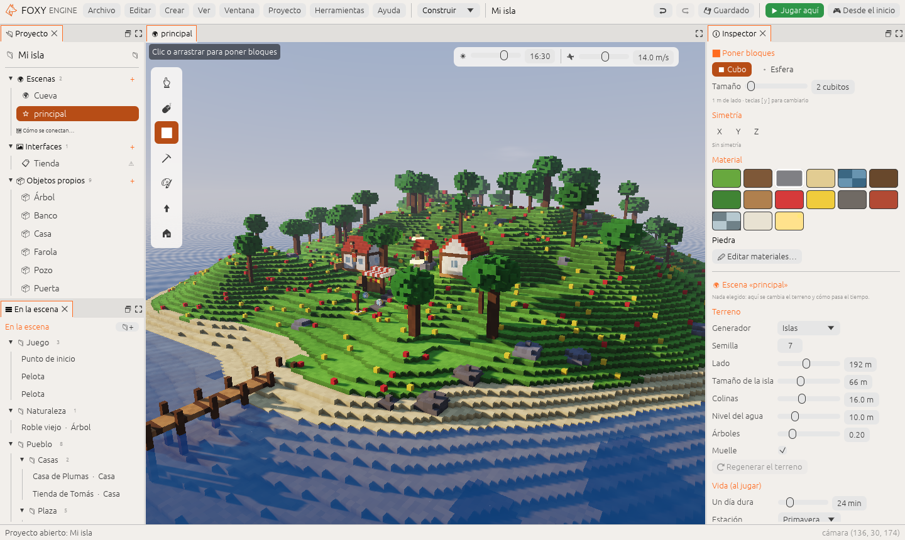

# Personalizar el espacio de trabajo

Los paneles del editor se colocan como quieras, y el motor recuerda cómo los
dejaste. Esta página explica cómo moverlos, separarlos en otras ventanas,
guardar tus propios espacios y cambiar el aspecto del editor.

## Mover y juntar paneles

- **Arrastra la pestaña** de un panel. Mientras arrastras, una zona resaltada
  dice dónde va a quedar: a un lado de otro panel, encima, debajo, o junto a
  sus pestañas (los dos paneles comparten sitio y se cambia con un clic en
  la pestaña).
- **Arrastra el borde** entre dos paneles para cambiar su tamaño.
- La <i class="fx fx-cerrar"></i> de la pestaña **cierra** el panel. Se
  vuelve a abrir desde el menú **Ventana**. La [Vista](../interfaz/vista.md)
  no se cierra.

El panel en el que haces clic es el que **tiene el teclado**: deshacer,
guardar y las teclas van a él.

## Maximizar un panel

**⛶** (arriba a la derecha del panel), **doble clic en su pestaña** o
<kbd>Cmd</kbd>/<kbd>Ctrl</kbd>+<kbd>Mayús</kbd>+<kbd>M</kbd> hace que el
panel ocupe toda la ventana. Lo mismo lo devuelve.

## Separar un panel en otra ventana

**🗗** (arriba a la derecha del panel) o **clic derecho en su pestaña →
Separar en una ventana** saca el panel a una ventana propia del sistema.
Esa ventana se mueve, cambia de tamaño y se pone a pantalla completa como
cualquier otra, **también en otro monitor**.

Con la **Vista** separada, la escena se dibuja y se edita en esa ventana:
puedes tener el mundo en el monitor grande y el código, los nodos y el
inspector en el otro. Al **cerrar la ventana**, el panel vuelve a la
distribución.

| Un panel separado | |
|---|---|
|  | Cada ventana separada se guarda con su sitio y su tamaño, y vuelve a abrirse igual la próxima vez |

> <i class="fx fx-nota"></i> **Nota.** Al pulsar **Jugar aquí**, el juego ocupa la
> ventana principal y las ventanas separadas se esconden; al volver al
> editor reaparecen. Por ahora hay una sola Vista a la vez.

## Espacios

Arriba en el centro están los espacios: **Construir**, **2D**,
**Programar**, **Pixel art** y **Animar** (ver [La interfaz del editor](../empezar/editor.md#los-espacios)).
Cada uno recuerda cómo lo dejaste, así que puedes ajustar *Programar* a tu
gusto y volver a *Construir* sin perder nada.

En el menú **Ventana**:

- **Guardar como espacio nuevo…** guarda cómo están ahora los paneles con un
  nombre. Sale junto a los de serie **en todos tus proyectos** (se guardan en
  `Documentos/Foxy Engine/espacios/`).
- **Restablecer este espacio** vuelve a poner los paneles como venían.
- **Borrar el espacio «…»** borra uno de los tuyos.

### Dónde se guarda

Cómo quedaron los paneles de cada espacio, y cuál estabas usando, se guarda
**en el proyecto**, en `.foxy/espacio.ron`, unos segundos después de cada
cambio y al salir. Si abres el proyecto en otro ordenador, los paneles
salen igual. Con un mundo suelto (sin proyecto) se guarda en
`Documentos/Foxy Engine/espacio.ron`.

## La paleta de comandos

<kbd>Cmd</kbd>/<kbd>Ctrl</kbd>+<kbd>K</kbd> (o *Editar → Buscar una
acción…*) abre la paleta: **escribe lo que quieres hacer o abrir** y pulsa
<kbd>Intro</kbd>.

Encuentra acciones (*Guardar*, *Jugar aquí*…), cosas para crear, paneles,
espacios, herramientas, y lo que tiene el proyecto: escenas, interfaces,
objetos e imágenes. No hace falta escribir el nombre entero ni las tildes:
«pix» encuentra *Pixel art* y «interfaz nu» encuentra *Interfaz nueva…*. Las flechas
<kbd>↑</kbd> <kbd>↓</kbd> eligen, <kbd>Intro</kbd> lo hace y
<kbd>Esc</kbd> la cierra.

## Tema, color y tamaño

En **Editar → Preferencias… → General**:

- **Tema**: *Oscuro* (el de siempre) o *Claro*.
- **Color de acento**: el de los botones elegidos y lo resaltado. Naranja,
  azul, verde, morado, rosa o amarillo.
- **Tamaño de los paneles**: más grande si los textos se ven pequeños.

Valen para todos los proyectos. Ver [Preferencias](../guia/preferencias.md).
