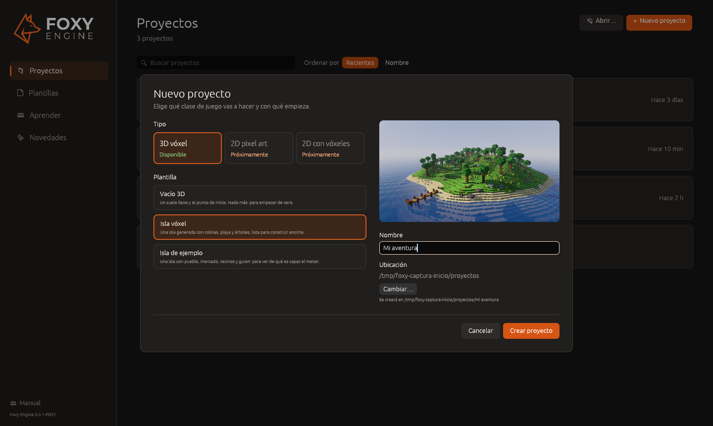
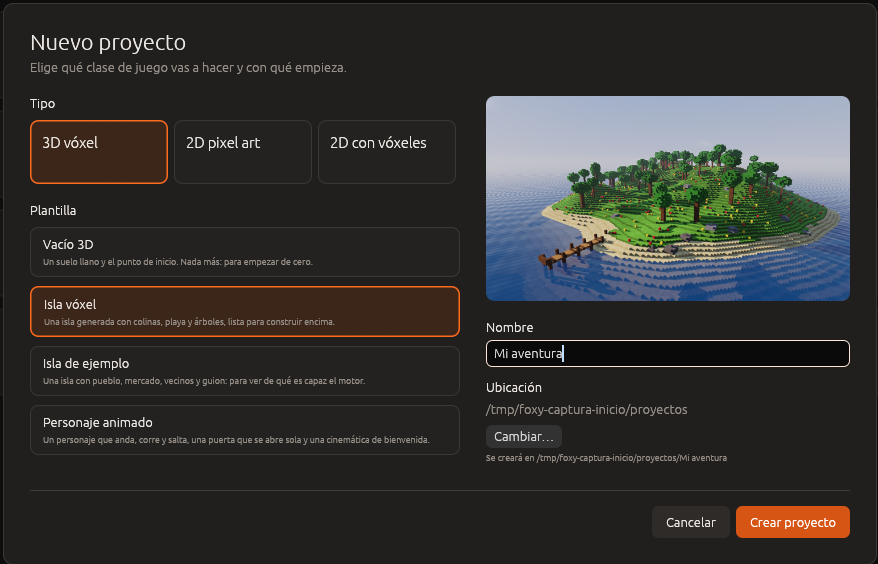
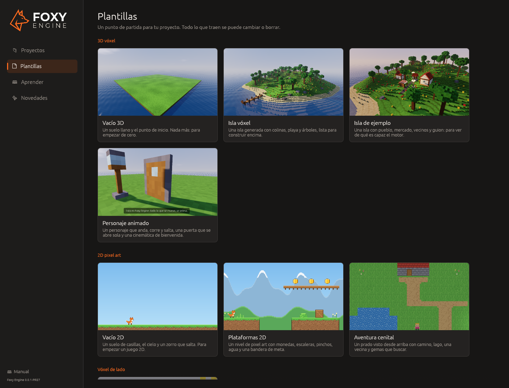

# Crear un proyecto

Un proyecto nuevo se crea con el asistente de la pantalla de inicio: se
elige el tipo de juego, la plantilla con la que empieza, el nombre y la
carpeta donde se guarda.



## Pasos

1. En la pantalla de inicio, pulsa **Nuevo proyecto**
   (<kbd>Cmd</kbd>/<kbd>Ctrl</kbd>+<kbd>N</kbd>). También puedes elegir una
   tarjeta en la sección **Plantillas**.
2. En **Tipo**, elige la clase de juego.
3. En **Plantilla**, elige con qué empieza el proyecto. La imagen de la
   derecha muestra cómo es.
4. Escribe el **Nombre** del proyecto.
5. Si quieres guardarlo en otro sitio, pulsa **Cambiar…** en **Ubicación**.
   Debajo se indica la carpeta exacta que se va a crear.
6. Pulsa **Crear proyecto** o <kbd>Intro</kbd>.

El editor abre el proyecto nuevo y lo añade a la lista de proyectos.



## Tipos de proyecto

| Tipo | Para qué sirve | Disponible |
|---|---|---|
| **3D vóxel** | Mundos de cubitos en tres dimensiones: construir, explorar y jugar | Sí |
| **2D pixel art** | Juegos 2D con sprites, mapas de casillas y cámara *pixel perfect* | Sí |
| **2D con vóxeles** | La estética de cubitos vista de lado o desde arriba | Sí |

## Plantillas



| Plantilla | Qué incluye | Recomendada para |
|---|---|---|
| **Vacío 3D** | Un llano de 96 × 96 m, el punto de inicio y un guion con las funciones vacías | Empezar un juego desde cero |
| **Isla vóxel** | Una isla generada con colinas, playa, árboles y muelle, sin construcciones | Construir sobre un terreno natural |
| **Isla de ejemplo** | Una isla con pueblo, mercado, vecinos, pelotas y un guion de ejemplo | Aprender viendo un proyecto completo |
| **Personaje animado** | Un personaje en tercera persona que anda, corre y salta, una puerta que se abre sola, un farol que parpadea y una cinemática de presentación | Aprender a [animar](../guia/animacion.md) |
| **Vacío 2D** | Un suelo de casillas, el cielo y un zorro que salta | Empezar un juego 2D desde cero |
| **Plataformas 2D** | Un nivel de pixel art con monedas, escaleras, pinchos, agua y una bandera de meta | Aprender a hacer un juego de plataformas |
| **Aventura cenital** | Un prado visto desde arriba con camino, lago, una vecina y gemas que buscar | Juegos de aventura y exploración |
| **Plataformas vóxel** | Un nivel de cubitos visto de lado, con cámara fija y monedas | Plataformas con la estética de cubitos |

Los juegos 2D se explican en [Juegos 2D](../guia/juegos-2d.md).

Todo lo que trae una plantilla forma parte del proyecto y se puede cambiar o
borrar.

## Dónde se guardan los proyectos

Por defecto, los proyectos se crean en `Documentos/Foxy Engine/proyectos/`,
cada uno en su propia carpeta con el nombre del proyecto. Si ya existe una
carpeta con ese nombre, se añade un número (`Mi juego 2`).

```text
Documentos/
  Foxy Engine/
    Foxy Engine.app        el motor (en Mac)
    proyectos/
      Mi juego/            un proyecto
    editor.ron             proyectos recientes y fijados
    preferencias.ron       preferencias del motor
    registro.txt           registro de la última sesión
```

> <i class="fx fx-consejo"></i> **Consejo.** Instalar una versión nueva del
> motor solo sustituye la aplicación. Los proyectos y las preferencias se
> conservan.

## Véase también

- [La pantalla de inicio](pantalla-de-inicio.md)
- [Primeros pasos en el editor](primer-proyecto.md)
- [Archivos del proyecto](../referencia/archivos.md)
