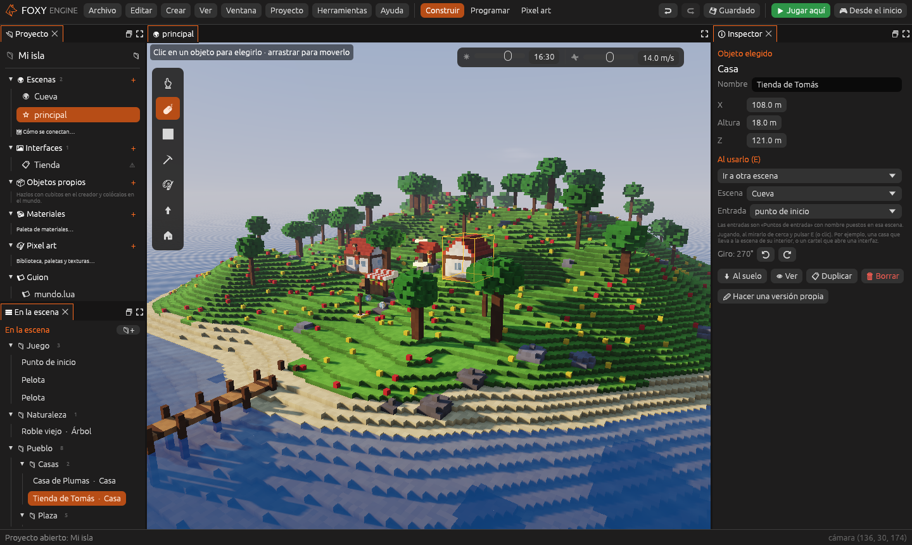
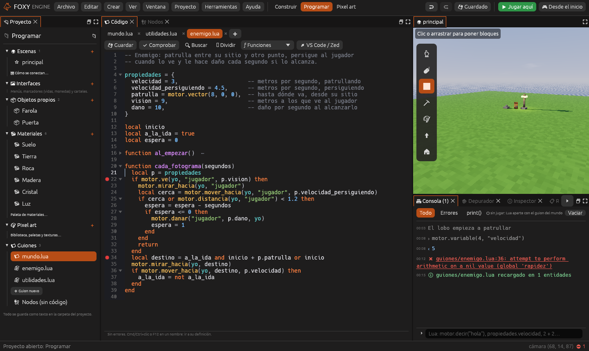
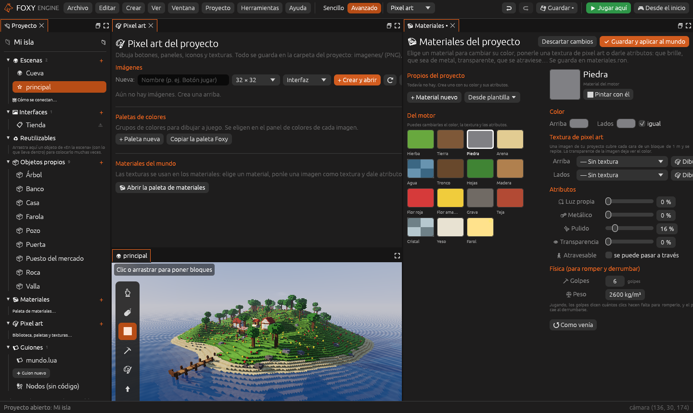

# La interfaz del editor

El editor es un **espacio de trabajo hecho de paneles**. Cada panel hace una
cosa (ver la escena, listar el proyecto, editar el código…) y se pueden
mover, juntar en pestañas, maximizar o sacar a otra ventana. Cómo hacerlo lo
explica [Personalizar el espacio de trabajo](../editor/espacio-de-trabajo.md).

| Dónde | Qué hay |
|---|---|
| **Arriba a la izquierda** | La **barra de menús** |
| **Arriba en el centro** | Los **espacios**: *Construir*, *Programar* y *Pixel art* |
| **Arriba a la derecha** | Deshacer, rehacer, guardar, <i class="fx fx-jugar"></i> **Jugar aquí** y <i class="fx fx-mando"></i> **Desde el inicio** |
| **En medio** | Los **paneles** |
| **Abajo** | La **barra de estado** |

## Los espacios

Un espacio es un reparto de paneles pensado para un trabajo. Se cambia con
un clic arriba en el centro:

| Espacio | Para qué | Paneles |
|---|---|---|
| **Construir** | Hacer el mundo: bloques, objetos, terreno | Proyecto, En la escena, Vista e Inspector |
| **Programar** | Escribir guiones o nodos, probarlos y depurarlos | Proyecto, Código y Nodos, Vista, Consola, Depurador, Inspector y Registro |
| **Pixel art** | Dibujar imágenes y texturas | Proyecto, Pixel art, Vista y Materiales |

| Programar | Pixel art |
|---|---|
|  |  |

Cada espacio **recuerda cómo lo dejaste** en cada proyecto. Más espacios
(Animar, 2D) llegarán con sus fases.

## Los paneles

| Panel | Qué hace |
|---|---|
| [Vista](../interfaz/vista.md) | La escena en 3D, y los objetos, imágenes e interfaces que abras |
| [Proyecto](../interfaz/proyecto.md) | Todo lo que tiene el proyecto: escenas, interfaces, objetos, imágenes y guion |
| [En la escena](../interfaz/escena.md) | Lo que hay en la escena abierta, en carpetas |
| [Inspector](../interfaz/inspector.md) | Las opciones de la herramienta y de lo que tengas elegido |
| [Código](../interfaz/codigo.md) | El guion en Lua |
| [Nodos](../interfaz/nodos.md) | Guiones sin código, con cajas y cables |
| [Archivos](../interfaz/archivos.md) | Las carpetas y archivos del proyecto |
| [Materiales](../interfaz/materiales.md) | La paleta de materiales del mundo |
| [Pixel art](../interfaz/pixel-art.md) | Las imágenes, paletas y texturas del proyecto |
| [Registro](../interfaz/registro.md) | Todos los avisos y errores |

Los paneles que no estén en el espacio se abren desde el menú **Ventana**,
desde el panel «Proyecto» o con la [paleta](../editor/espacio-de-trabajo.md#la-paleta-de-comandos)
(<kbd>Cmd</kbd>/<kbd>Ctrl</kbd>+<kbd>K</kbd>).

## La barra de menús

Al lado de cada cosa está su tecla.

| Menú | Qué tiene |
|---|---|
| **Archivo** | *Proyecto nuevo…*, *Abrir proyecto…*, *Cerrar proyecto*, *Guardar* (<kbd>Cmd</kbd>+<kbd>S</kbd>), *Guardar todo*, *Volver a abrir lo guardado*, *Importar al proyecto…*, *Importar modelo (.vox, .qb)…* y *Salir* |
| **Editar** | *Deshacer*, *Rehacer*, *Duplicar*, *Ir a verlo*, *Borrar*, *Buscar una acción…* (<kbd>Cmd</kbd>+<kbd>K</kbd>) y *Preferencias…* |
| **Crear** | *Escena nueva…*, *Interfaz nueva…*, *Objeto nuevo*, *Imagen de pixel art…*, *Material…*, *Importar modelo…*; y en la escena abierta *Zona de cambio*, *Punto de entrada* y *Vecino* |
| **Ver** | La hora y la velocidad de la cámara, *Rendimiento* y los fotogramas por segundo |
| **Ventana** | Abrir cada panel, *Maximizar el panel*, los espacios, *Guardar como espacio nuevo…*, *Restablecer este espacio* y borrar los espacios propios |
| **Proyecto** | *Ajustes del proyecto…*, *Mapa de escenas…*, *Archivos del proyecto* y *Mostrar la carpeta del proyecto* |
| **Herramientas** | Las herramientas de la escena, y *Materiales*, *Pixel art*, *Nodos*, *Código* y *Rendimiento* |
| **Ayuda** | El manual, *Teclas y ratón…*, *Cambiar las teclas…* y la versión del motor |

## La barra de estado

Abajo del todo sale **el último aviso** (guardado, un error en el guion…),
con su color: gris si es normal, amarillo si es un aviso y rojo si es un
error. Un clic abre el panel [Registro](../interfaz/registro.md) con todos.
A la derecha, dónde está la cámara, los fotogramas por segundo si los
enseñas, y **⛔ N** si hay errores.

## Deshacer y guardar

Casi todo se puede deshacer con <i class="fx fx-deshacer"></i>
<kbd>Cmd</kbd>/<kbd>Ctrl</kbd>+<kbd>Z</kbd> y rehacer con
<i class="fx fx-rehacer"></i> <kbd>Cmd</kbd>/<kbd>Ctrl</kbd>+<kbd>Mayús</kbd>+<kbd>Z</kbd>.
Deshacer y guardar actúan sobre **el panel en el que hiciste clic por
última vez**: deshacer en el código no toca la escena.

<i class="fx fx-guardar"></i> <kbd>Cmd</kbd>/<kbd>Ctrl</kbd>+<kbd>S</kbd>
guarda lo que tengas delante; *Archivo → Guardar todo* lo guarda todo.

## Probar

- <i class="fx fx-jugar"></i> **Jugar aquí** (<kbd>F5</kbd>): juegas al
  momento desde el punto al que mira la cámara. <kbd>F5</kbd> vuelve al
  editor.
- <i class="fx fx-mando"></i> **Desde el inicio**: abre el juego completo,
  con su menú principal.

Más en [Probar el juego](../guia/jugar.md).

> <i class="fx fx-consejo"></i> **Consejo.** Cuando nadie lo toca, el editor
> dibuja más despacio (30 imágenes por segundo, 10 si la ventana está
> detrás) para no gastar batería. Jugando va siempre al ritmo de la pantalla.
