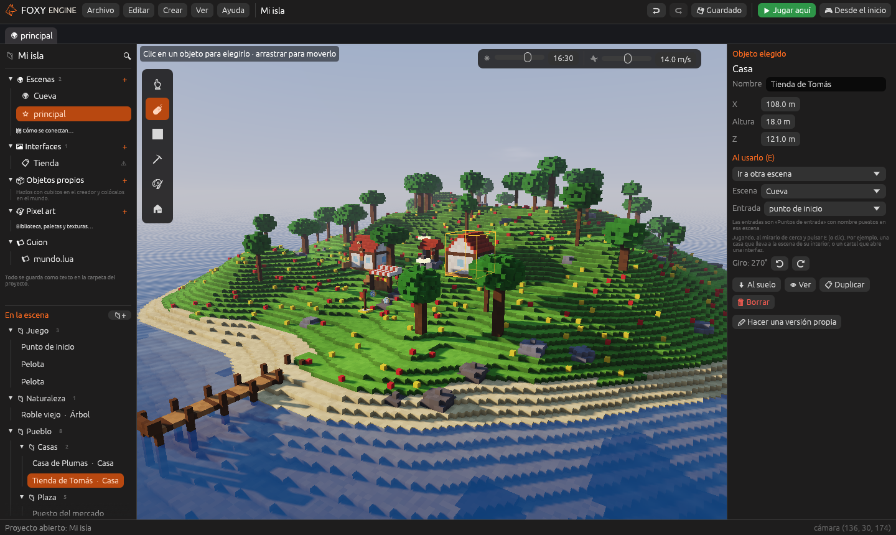

# Un vistazo al editor

Cada cosa tiene su sitio fijo:

| Dónde | Qué hay |
|---|---|
| **Arriba** | La **barra de menús** (*Archivo*, *Editar*, *Crear*, *Ver* y *Ayuda*), el nombre del proyecto y, a la derecha, deshacer, rehacer, guardar, <i class="fx fx-jugar"></i> **Jugar aquí** y <i class="fx fx-mando"></i> **Desde el inicio** |
| **Debajo** | Las **pestañas** de lo que tienes abierto |
| **A la izquierda** | El panel **«Proyecto»**, con todo lo que tiene el proyecto, y debajo la lista **En la escena** |
| **En el centro** | La **vista** del mundo, con la tira de herramientas a la izquierda y la hora y la velocidad de la cámara arriba a la derecha |
| **A la derecha** | El **inspector**: las opciones de la herramienta y de lo que tengas elegido |
| **Abajo** | La **barra de estado**: avisos y dónde está la cámara |

## La barra de menús

| Menú | Qué tiene |
|---|---|
| **Archivo** | *Proyecto nuevo…*, *Abrir proyecto…*, *Ver la carpeta del proyecto*, *Guardar*, *Guardar todo*, *Volver a abrir lo guardado* y *Salir* |
| **Editar** | *Deshacer*, *Rehacer* y, con un objeto elegido, *Duplicar*, *Ir a verlo* y *Borrar* |
| **Crear** | *Escena nueva…*, *Interfaz nueva…*, *Objeto nuevo* e *Imagen de pixel art…*; y, en la escena abierta, *Zona de cambio*, *Punto de entrada* y *Vecino* |
| **Ver** | Enseñar o esconder el panel «Proyecto», y la hora y la velocidad de la cámara |
| **Ayuda** | <i class="fx fx-teclado"></i> *Teclas y ratón…*, con todas las teclas del editor, y la versión del motor |

## El panel «Proyecto»

A la izquierda está **todo lo que tiene el proyecto** en un solo sitio. Un
clic abre cualquier cosa, y el <i class="fx fx-mas"></i> de cada grupo crea
una nueva:

| Grupo | Qué lista | Capítulo |
|---|---|---|
| <i class="fx fx-mundo"></i> **Escenas** | Las escenas del proyecto. La <i class="fx fx-estrella"></i> marca la inicial. Debajo, *Cómo se conectan…* abre el mapa de escenas | [Escenas](../guia/escenas.md) |
| <i class="fx fx-interfaz"></i> **Interfaces** | Menús, marcadores y carteles | [Interfaces](../guia/interfaces.md) |
| <i class="fx fx-objeto"></i> **Objetos propios** | Los objetos que has hecho con cubitos | [Crear objetos propios](../guia/creador.md) |
| <i class="fx fx-pixel"></i> **Pixel art** | Las imágenes, y *Biblioteca, paletas y texturas…* | [Pixel art](../guia/pixel-art.md) |
| <i class="fx fx-guion"></i> **Guion** | `mundo.lua`, el guion del mundo | [Guiones en Lua](../guia/guiones.md) |

Arriba del todo están el nombre del proyecto y una <i class="fx fx-buscar"></i>
lupa que abre su carpeta.

### Los avisos <i class="fx fx-aviso"></i>

Un <i class="fx fx-aviso"></i> al lado de algo avisa de que **todavía no se
podrá ver al jugar**:

- Una **escena** a la que no lleva nada (ninguna zona, objeto, botón ni guion).
- Una **interfaz** que nada abre (ni una tecla, ni un botón, ni una zona, ni
  un objeto, ni el guion).
- El **guion**, si tiene errores.

Pasa el ratón por encima para ver qué falta. No es un error: solo una
pista de lo que queda por conectar.

### En la escena

Debajo del panel «Proyecto», en la pestaña de la escena, está la lista
**En la escena**: todo lo que hay en el mundo, ordenado en carpetas. Lo
explica [Ordenar la escena](../guia/carpetas.md).

*Ver → Panel «Proyecto»* esconde el panel entero para tener más sitio.

## Las pestañas

Debajo de la barra de menús hay pestañas, como en un navegador, pero solo de
**lo que tienes abierto**: la escena siempre está, y el resto aparece cuando
lo abres desde el panel «Proyecto».

| Pestaña | Para qué |
|---|---|
| <i class="fx fx-mundo"></i> **La escena** (con su nombre) | El mundo que estás editando |
| <i class="fx fx-guion"></i> **Guion** | El guion Lua, con *Comprobar* y una consola |
| <i class="fx fx-objeto"></i> **Un objeto** | Un objeto propio en el creador (una pestaña por objeto) |
| <i class="fx fx-pixel"></i> **Pixel art** | La biblioteca: imágenes, paletas y materiales |
| <i class="fx fx-imagen"></i> **Una imagen** | Una imagen abierta en el lienzo de pixel art |
| <i class="fx fx-interfaz"></i> **Una interfaz** | Un menú, un marcador o un cartel (una pestaña por interfaz) |

Las pestañas con cambios sin guardar llevan un punto (•). La
<i class="fx fx-cerrar"></i> las cierra.

## La vista y sus herramientas

En el borde izquierdo de la vista está la **tira de herramientas**. Cada
botón dice su nombre y su tecla al pasar el ratón:

| | Herramienta | Tecla |
|---|---|---|
| <i class="fx fx-cursor"></i> | Cursor (solo elegir) | <kbd>C</kbd> |
| <i class="fx fx-mover"></i> | Elegir y mover | <kbd>V</kbd> |
| <i class="fx fx-poner"></i> | Poner bloques | <kbd>B</kbd> |
| <i class="fx fx-quitar"></i> | Quitar bloques | <kbd>E</kbd> |
| <i class="fx fx-pintar"></i> | Pintar | <kbd>P</kbd> |
| <i class="fx fx-colocar"></i> | Colocar objetos | <kbd>O</kbd> |

Arriba a la izquierda, una línea recuerda qué hace la herramienta elegida.
Arriba a la derecha están la **hora** del editor (para ver el mundo de día o
de noche) y la **velocidad** de la cámara. Todo se explica en
[Construir el mundo](../guia/mundo.md).

## El inspector

A la derecha, el inspector cambia según lo que estés haciendo:

- Con una herramienta de bloques: el **pincel** y los **materiales**.
- Con *Colocar objetos*: la **lista de objetos** para colocar.
- Con un objeto elegido: su **nombre**, posición, giro, botones, y
  <i class="fx fx-usar"></i> **Al usarlo (E)**, lo que pasa cuando el jugador
  lo usa.
- Sin nada elegido: el **terreno** de la escena y cómo pasa el **tiempo**.

## Deshacer y guardar

Casi todo se puede deshacer con <i class="fx fx-deshacer"></i>
<kbd>Cmd</kbd>/<kbd>Ctrl</kbd>+<kbd>Z</kbd> y rehacer con
<i class="fx fx-rehacer"></i> <kbd>Cmd</kbd>/<kbd>Ctrl</kbd>+<kbd>Mayús</kbd>+<kbd>Z</kbd>.
Cada pestaña tiene su propio historial: deshacer en un objeto no toca la
escena.

<i class="fx fx-guardar"></i> <kbd>Cmd</kbd>/<kbd>Ctrl</kbd>+<kbd>S</kbd>
guarda lo que tengas delante; *Archivo → Guardar todo* guarda todas las
pestañas a la vez.

## Probar

- <i class="fx fx-jugar"></i> **Jugar aquí** (<kbd>F5</kbd>): juegas al
  momento desde el punto al que mira la cámara. <kbd>F5</kbd> vuelve al
  editor.
- <i class="fx fx-mando"></i> **Desde el inicio**: abre el juego completo,
  con su menú principal, y empiezas en el punto de inicio de la escena
  inicial.

Más en [Probar el juego](../guia/jugar.md).

> <i class="fx fx-consejo"></i> **Consejo.** Cuando nadie lo toca, el editor
> dibuja más despacio (30 imágenes por segundo, 10 si la ventana está
> detrás) para no gastar batería. Jugando va siempre al ritmo de la pantalla.
