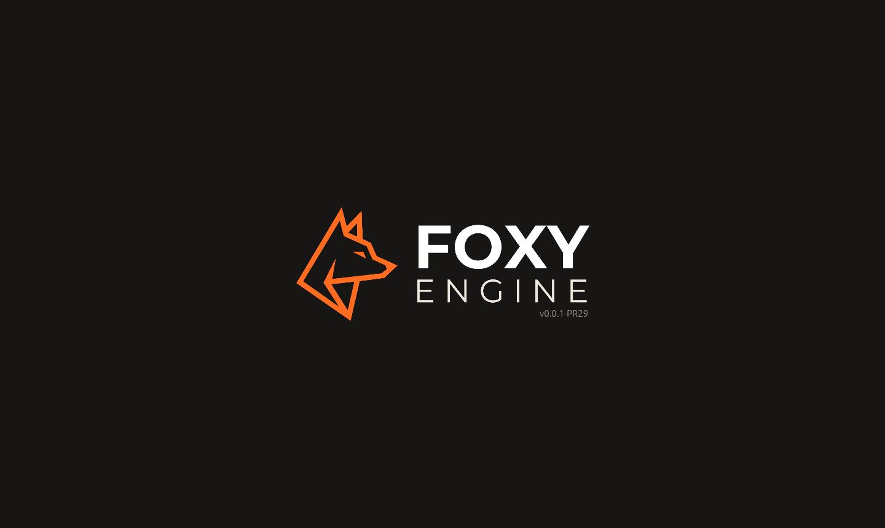

# Instalar Foxy Engine

Foxy Engine funciona en **macOS**, **Windows** y **Linux**. Todavía no hay
instaladores públicos (llegarán más adelante), así que hay dos caminos:

| Sistema | Cómo se consigue |
|---|---|
| **Mac** | Se compila en tu Mac con un script, que deja la app en `Documentos/Foxy Engine` |
| **Windows** | Se descarga ya fabricado de GitHub Actions: un `.exe` que no hay que instalar |
| **Linux** | Se descarga de GitHub Actions o se compila desde el código |

> <i class="fx fx-nota"></i> **Nota.** El código del motor está en un
> repositorio **privado** de GitHub. Para descargarlo hace falta una cuenta con
> acceso a `TheMaxymuzZ/foxy-engine`, con la sesión iniciada.

## Lo que necesitas

| | Qué hace falta |
|---|---|
| Sistema | macOS 14 o más nuevo (probado en un Mac con Apple M2), Windows 10/11 de 64 bits, o Linux con Vulkan |
| <i class="fx fx-chip"></i> Tarjeta gráfica | Compatible con Metal (Mac), DirectX 12 (Windows) o Vulkan (Linux). En Windows también sirven Vulkan u OpenGL si DirectX 12 falla |
| Espacio | Para compilar, unos gigas libres; la app ocupa mucho menos |
| Herramientas | Solo para compilar: [Rust](https://rustup.rs) y Git |

## En Mac

### 1. Instala las herramientas (solo una vez)

Abre la app **Terminal** y pega estas dos líneas, una cada vez:

```sh
xcode-select --install
curl --proto '=https' --tlsv1.2 -sSf https://sh.rustup.rs | sh
```

La primera instala las herramientas de Apple; la segunda, Rust. Cuando
terminen, cierra la Terminal y ábrela de nuevo.

### 2. Descarga el motor

```sh
git clone https://github.com/TheMaxymuzZ/foxy-engine.git ~/foxy-engine
```

### 3. Instala la app

```sh
cd ~/foxy-engine && scripts/instalar-mac.sh
```

El script compila el motor y deja **Foxy Engine.app**, con su icono, en
`Documentos/Foxy Engine`, sustituyendo la versión anterior. Ábrela con doble
clic; puedes arrastrarla al Dock.

> <i class="fx fx-consejo"></i> **Consejo.** Si prefieres probarlo sin
> instalar nada, dentro de la carpeta del motor basta con
> `cargo run --release`.

## En Windows

En Windows no hace falta compilar nada. Cada vez que cambia el motor, GitHub
Actions fabrica el programa y lo guarda como un **artefacto** llamado
**FoxyEngine-Windows**.

### 1. Descarga el artefacto

1. Con la sesión de GitHub iniciada, abre la pestaña **Actions** del
   repositorio del motor:
   [github.com/TheMaxymuzZ/foxy-engine/actions](https://github.com/TheMaxymuzZ/foxy-engine/actions/workflows/ci.yml?query=branch%3Amain).
2. Elige la ejecución más reciente de **CI** en la rama `main` que tenga la
   marca verde.
3. Baja hasta **Artifacts** y pulsa <i class="fx fx-descargar"></i>
   **FoxyEngine-Windows**. Se descarga un `.zip`.

### 2. Descomprime y ábrelo

1. El archivo descargado es un zip **dentro de otro zip**: descomprime
   `FoxyEngine-Windows.zip` y después `FoxyEngine-windows.zip`.
2. Dentro está **`foxy-engine.exe`**, que ya lleva todo dentro (iconos,
   mundos de ejemplo, sonidos). Muévelo donde quieras, por ejemplo a
   `Documentos\Foxy Engine`, y ábrelo con doble clic.
3. <i class="fx fx-escudo"></i> La primera vez, Windows avisa con
   **«Windows protegió su PC»** porque el programa todavía no está firmado.
   Pulsa **Más información → Ejecutar de todas formas**.

> <i class="fx fx-aviso"></i> **Atención.** Los artefactos de GitHub
> caducan a los **90 días**. Si el enlace ya no está, descarga el de una
> ejecución más reciente.

### Cómo dibuja en Windows

Foxy Engine prueba los gráficos **uno a uno**: primero **DirectX 12**, que
viene con Windows; si no sirve, **Vulkan**, y por último **OpenGL**. El
programa abre sin la ventana negra de consola. Si algo falla al arrancar,
sale una ventana con el error y todo queda apuntado en el
[registro](../apendices/problemas.md#el-registro-registrotxt).

### Compilarlo tú mismo (opcional)

Si prefieres compilarlo, instala [Rust](https://rustup.rs) (te pedirá las
*Build Tools* de Visual Studio; acepta) y [Git](https://git-scm.com), y en
*PowerShell*:

```powershell
git clone https://github.com/TheMaxymuzZ/foxy-engine.git
cd foxy-engine
cargo run --release
```

## En Linux

La forma rápida es el artefacto **FoxyEngine-Linux** de la misma página de
Actions: trae `FoxyEngine-linux.tar.gz` con el programa, su icono y un
`foxy-engine.desktop` para el menú de aplicaciones.

Para compilarlo, en Debian o Ubuntu:

```sh
curl --proto '=https' --tlsv1.2 -sSf https://sh.rustup.rs | sh
sudo apt install git libudev-dev libasound2-dev
git clone https://github.com/TheMaxymuzZ/foxy-engine.git
cd foxy-engine
cargo run --release
```

## Actualizar a una versión nueva

**En Mac**, con el comando completo:

```sh
cd ~/foxy-engine && git checkout main && git pull && scripts/instalar-mac.sh
```

Luego **cierra el motor del todo** con <kbd>Cmd</kbd>+<kbd>Q</kbd> y vuelve a
abrirlo desde `Documentos/Foxy Engine`.

**En Windows**, cierra el motor, descarga el artefacto más reciente y
sustituye el `foxy-engine.exe` anterior por el nuevo.

**En Linux**, el artefacto nuevo, o `git pull` y otra vez
`cargo run --release`.

En todos los casos, **tus proyectos no se tocan**: viven en su propia
carpeta, `Documentos/Foxy Engine/proyectos`.

## Al abrirlo

Durante unos segundos sale el logo de Foxy Engine con la **versión**, por
ejemplo `0.0.1-PR15` (la versión del motor y el número del último cambio
incorporado). Un clic o cualquier tecla la salta.



Después aparece la [pantalla de inicio](pantalla-de-inicio.md), desde la
que se abre un proyecto o se crea uno nuevo.

> <i class="fx fx-nota"></i> **Nota.** Los juegos hechos con el motor
> (`foxy-engine --juego`) enseñan en cambio la pantalla
> [*Powered by Foxy Engine*](../apendices/marca.md#powered-by-foxy-engine).
