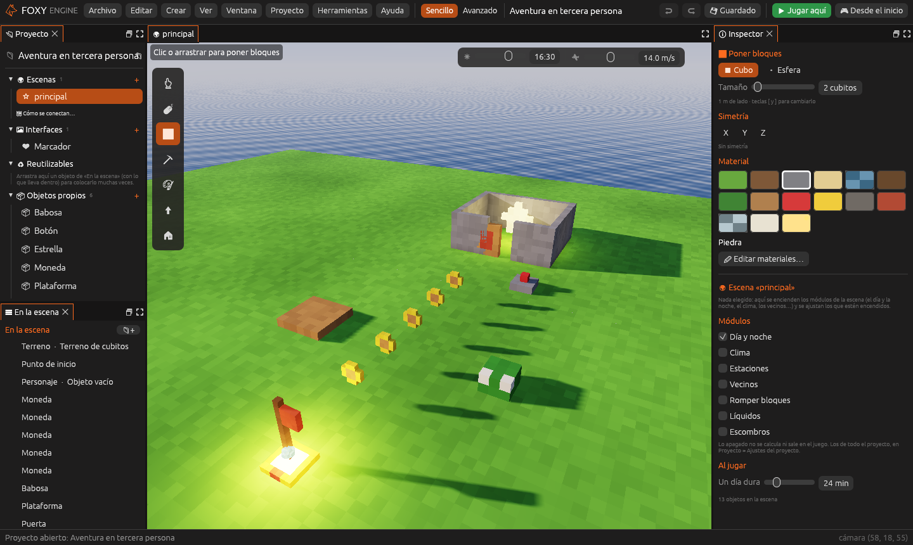
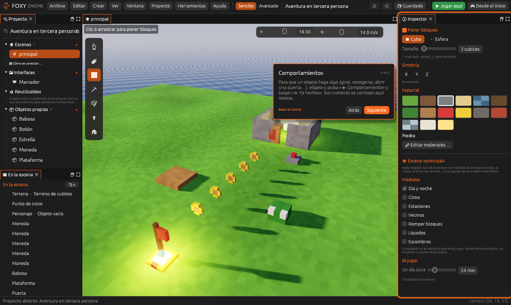

# Modo Sencillo y tutorial guiado

Foxy Engine tiene dos modos: el **Sencillo**, para quien empieza, y el
**Avanzado**, con todo. Se cambia en cualquier momento, arriba en el centro
de la barra, y el proyecto no cambia: solo cambia lo que enseña el editor.

## Los dos modos

| Modo | Qué enseña | Para quién |
|---|---|---|
| **Sencillo** | La escena, tus cosas (Proyecto), la lista de lo que hay en la escena (En la escena) y el Inspector. En 2D, también Capas y Casillas | Quien empieza, o quien solo quiere construir y poner comportamientos |
| **Avanzado** | Todo: Código, Consola, Depurador, Archivos, Registro, Rendimiento y los [espacios de trabajo](../editor/espacio-de-trabajo.md) | Quien programa en Lua o quiere ordenar los paneles a su gusto |

El motor empieza en el modo **Sencillo**. Para cambiarlo:

- Pulsa **Sencillo** o **Avanzado** en la barra de arriba.
- O ve a **Editar → Preferencias… → General → Modo**.

El motor recuerda el modo para la próxima vez.

### Qué cambia en el modo Sencillo

- Los paneles técnicos (Código, Consola, Depurador, Archivos y Registro) se
  cierran y no salen en el menú **Ventana**. Los [Nodos](../guia/nodos.md)
  siguen a mano, porque no hace falta escribir código para usarlos.
- No salen los espacios ni la ventana **Rendimiento**.
- En el Inspector, los [componentes](../conceptos/entidades.md) de un objeto
  se recogen en **Más ajustes**, plegado. Lo primero que se ve son su
  nombre, su sitio y sus [comportamientos](../guia/comportamientos.md).
- Al pulsar **➕ Comportamiento**, los **Ya hechos** salen los primeros y no
  sale **Código nuevo**.

Al volver al **Avanzado**, los paneles se colocan como estaban antes.

> <i class="fx fx-consejo"></i> **Consejo.** Todo lo que hagas en el modo
> Sencillo se ve igual en el Avanzado, y al revés. Un comportamiento de
> código que ya tenga un objeto sigue saliendo en el Inspector en los dos
> modos.

## El tutorial guiado

La primera vez que abres un proyecto, el editor te enseña sus partes en
**ocho pasos cortos**. Cada paso enmarca en naranja la parte de la que habla
y explica para qué sirve.

| Paso | Qué enseña |
|---|---|
| 1 | La bienvenida |
| 2 | **La escena**: cómo moverte por ella (en 2D, cómo pintar casillas) |
| 3 | **Tus cosas**: el panel Proyecto, con las escenas, los objetos, las imágenes y los sonidos |
| 4 | **Lo que hay en la escena**: la lista para elegir y ordenar los objetos |
| 5 | **El inspector**: donde se cambia lo elegido |
| 6 | **Comportamientos**: cómo hacer que un objeto haga algo |
| 7 | **Pruébalo**: el botón **Jugar aquí** |
| 8 | **Sencillo o Avanzado**: dónde se cambia el modo |

Pulsa **Siguiente** para avanzar, **Atrás** para volver o **Saltar el
tutorial** para cerrarlo. Una vez visto o saltado, no vuelve a salir solo.

Para verlo otra vez, elige **Ayuda → Tutorial guiado**. Para que salga de
nuevo al abrir un proyecto, marca **Enseñar el tutorial guiado al abrir un
proyecto** en **Editar → Preferencias… → General**.

## Ayuda en todas partes

Deja el ratón quieto un momento sobre cualquier botón, opción de menú o
ajuste y sale una línea que explica para qué sirve. Si una opción está
apagada, la misma línea dice por qué.

El editor usa siempre las mismas palabras. Todo lo que pones en una escena
es un **objeto**, ya sea un cubo, un personaje, un sonido o una luz; lo que
hace un objeto es un **comportamiento**, y lo que se ajusta de él son sus
**componentes**. El [glosario](../apendices/glosario.md) las explica todas.

## Véase también

- [Tu primer juego](../tu-primer-juego/index.md)
- [La interfaz del editor](editor.md)
- [Preferencias y teclas](../guia/preferencias.md)
