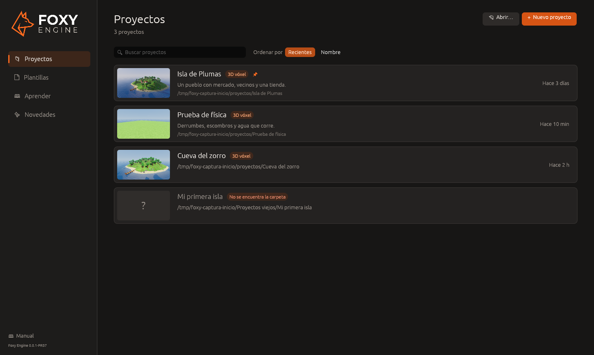
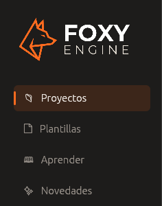
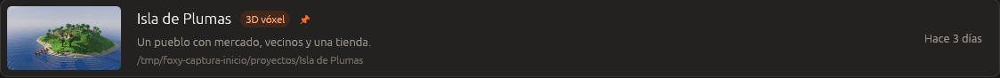

# La pantalla de inicio

La pantalla de inicio es lo primero que muestra Foxy Engine al abrirse,
después del logo. Desde ella se abre un proyecto existente, se crea uno nuevo
a partir de una plantilla y se accede al manual.

## Secciones

La columna de la izquierda agrupa la pantalla en cuatro secciones:

| Sección | Contenido |
|---|---|
| **Proyectos** | Los proyectos recientes y los de la carpeta de proyectos |
| **Plantillas** | Los puntos de partida para un proyecto nuevo, agrupados por tipo de juego. Ver [Crear un proyecto](crear-proyecto.md#las-plantillas) |
| **Aprender** | Accesos directos a las páginas principales de este manual, como [Tu primer juego](../tu-primer-juego/index.md) |
| **Novedades** | Lo nuevo en la versión instalada del motor |

En la parte inferior están el acceso al **Manual** y la versión del motor.

 

## La lista de proyectos

Cada proyecto ocupa una fila con su miniatura, su nombre, su tipo, su
descripción (o su carpeta) y la última vez que se abrió o se guardó.

- **Abrir un proyecto:** haz clic en su fila.
- **Buscar:** escribe en **Buscar proyectos**. La búsqueda tiene en cuenta
  el nombre y la carpeta.
- **Ordenar:** elige **Recientes** (el último usado primero) o **Nombre**.

Los proyectos fijados aparecen siempre arriba, marcados con una chincheta.

### Menú de un proyecto

Haz clic con el botón derecho en una fila para ver sus opciones:

| Opción | Qué hace |
|---|---|
| **Abrir** | Abre el proyecto en el editor |
| **Mostrar la carpeta** | Abre la carpeta del proyecto en el Finder, el Explorador de archivos o el gestor de archivos del sistema |
| **Fijar arriba** / **Soltar de arriba** | Mantiene el proyecto al principio de la lista |
| **Renombrar…** | Cambia el nombre que se muestra. La carpeta no cambia |
| **Duplicar** | Crea una copia completa junto al original, sin partidas guardadas ni papelera |
| **Quitar de la lista** | Deja de mostrar el proyecto. La carpeta no se borra |

> <i class="fx fx-nota"></i> **Nota.** Si la carpeta de un proyecto se ha
> movido o borrado, su fila aparece atenuada con la etiqueta **No se
> encuentra la carpeta**. Usa **Quitar de la lista** para retirarla, o
> **Abrir…** para volver a abrir el proyecto desde su nueva ubicación.

### La miniatura

El editor actualiza la miniatura cada vez que se guarda la escena y al
cerrar el proyecto: es la vista del mundo desde la cámara del editor en ese
momento. Un proyecto recién creado muestra la imagen de su plantilla hasta
que se guarda por primera vez.

## Abrir un proyecto de otra carpeta

Un proyecto puede estar en cualquier carpeta del ordenador, por ejemplo en
una unidad externa o en un repositorio de Git. Para abrirlo:

1. Pulsa **Abrir…** (<kbd>Cmd</kbd>/<kbd>Ctrl</kbd>+<kbd>O</kbd>).
2. Elige la carpeta que contiene el archivo `proyecto.ron`.

También puedes **arrastrar la carpeta del proyecto** desde el Finder o el
Explorador de archivos y soltarla sobre la ventana del motor. Una vez
abierto, el proyecto se añade a la lista.

## Volver a la pantalla de inicio

Desde el editor, elige **Archivo → Cerrar proyecto**. Si hay cambios sin
guardar, el editor pregunta antes si quieres guardarlos.

**Archivo → Proyecto nuevo…** y **Archivo → Abrir proyecto…** también
vuelven a la pantalla de inicio, con el asistente o con la lista de
proyectos.

## Véase también

- [Crear un proyecto](crear-proyecto.md)
- [Ajustes del proyecto](../editor/ajustes-proyecto.md)
- [Proyectos, escenas y recursos](../conceptos/proyectos.md)
