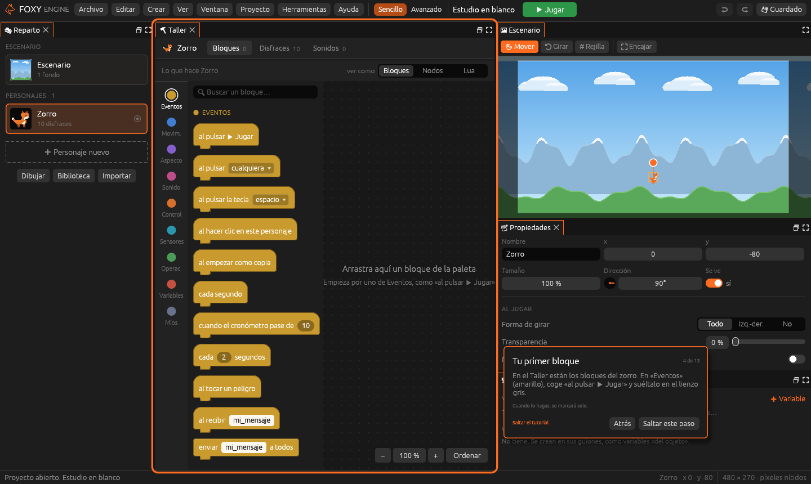
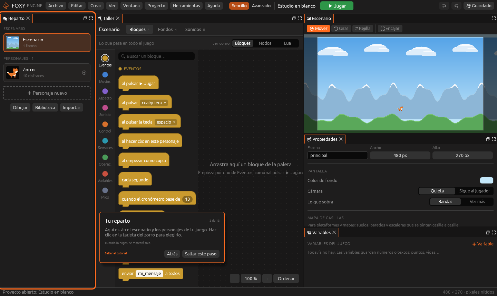
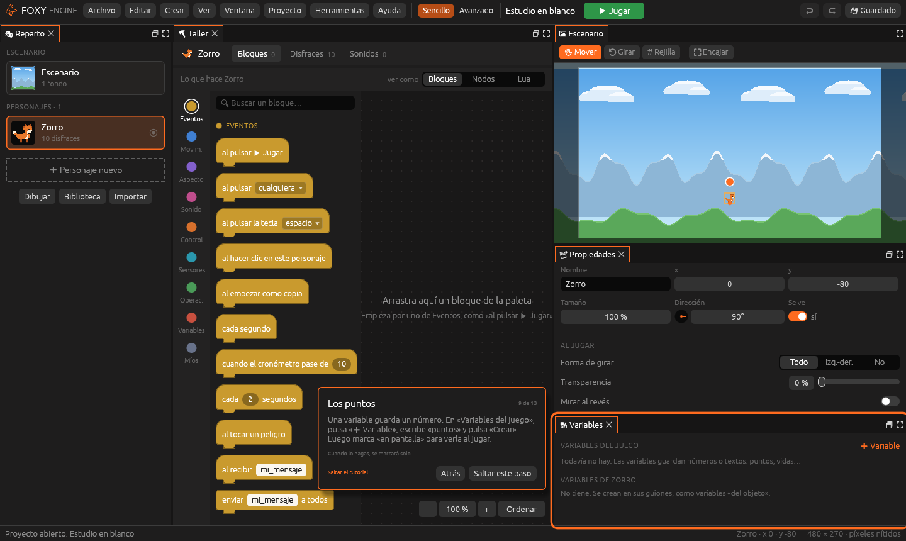

# Tutorial: tu primer juego 2D

El tutorial del Estudio 2D lleva **del zorro quieto a un juego con puntos**
en unos diez minutos, sin escribir código: el zorro saluda, anda con las
flechas y atrapa una manzana que cae, y los puntos se ven en la pantalla.
Sale solo la primera vez que creas un proyecto con la plantilla **Estudio
en blanco**, y esta página cuenta lo mismo, paso a paso.

**Aprenderás a:** elegir y mover personajes, encajar bloques, usar
eventos, movimiento, aspecto, control, sensores y variables, y probar el
juego.



## Cómo funciona

Cada paso enmarca en naranja la parte del Estudio de la que habla y dice
qué hacer. La tarjeta se pone a un lado, para que no tape lo que hay que
usar. **Cuando lo haces, el paso se marca solo**: sale **¡Bien hecho!** y
el botón **Siguiente** se vuelve naranja. Si prefieres no hacerlo, pulsa
**Saltar este paso**.

Para verlo otra vez, elige **Ayuda → Tutorial guiado** con un proyecto 2D
abierto. Con un proyecto 3D, el mismo menú enseña el
[tutorial del editor](modo-sencillo.md#el-tutorial-guiado).

## 1. Crear el proyecto

1. En la [pantalla de inicio](pantalla-de-inicio.md), pulsa **Nuevo
   proyecto**.
2. En **¿Qué juego quieres hacer?**, elige **Estudio en blanco**, la
   primera de **Juego 2D** (ya viene elegida).
3. Escribe un nombre y pulsa **Crear proyecto**.

El proyecto se abre en el [Estudio 2D](../guia/estudio-2d.md) y el
tutorial empieza.

## 2. Elegir y mover al zorro



1. **Tu reparto.** En el panel **Reparto**, haz clic en la tarjeta del
   **Zorro**.
2. **El escenario.** Arrastra al zorro con el ratón y suéltalo donde
   quieras. Lo que se ve en el escenario es lo que verá quien juegue.

## 3. Que hable

1. **Tu primer bloque.** En el **Taller**, en la familia **Eventos**
   (amarilla), coge **al pulsar ▶ Jugar** y suéltalo en el lienzo.
2. **Que hable.** En **Aspecto** (morada), arrastra **decir ¡Hola! durante
   2 s** justo debajo, hasta que encaje. Haz clic en el texto para
   cambiarlo.
3. **Pruébalo.** Pulsa **Jugar**: el zorro dice lo que has escrito. Pulsa
   **Parar** (o <kbd>Esc</kbd>) para volver.

## 4. Que se mueva

**Que se mueva.** Saca otro **al pulsar la tecla…** de Eventos y elige la
**flecha derecha**. Debajo, encaja **mover 10 pasos** de **Movimiento**
(azul). Haz lo mismo con la flecha izquierda y **mover -10 pasos**.

## 5. Algo que atrapar y los puntos



1. **Algo que atrapar.** Pulsa **Personaje nuevo** y elige la **manzana**
   en la biblioteca de Foxy (o cualquier otro).
2. **Los puntos.** En **Variables del juego**, pulsa **Variable**, escribe
   `puntos` y pulsa **Crear**. Marca **en pantalla** para que se vea al
   jugar.

## 6. Que caiga y se pueda atrapar

Con la manzana elegida en el reparto:

1. **Que caiga.** Pon **al pulsar ▶ Jugar** y, debajo, **siempre**
   (Control, naranja). Dentro de **siempre**, encaja **sumar -3 a y**
   (Movimiento): la manzana baja sin parar.
2. **Atrapar.** Dentro de **siempre**, debajo de lo anterior, pon **si …
   entonces** y mete en su hueco **¿tocando Zorro?** (Sensores). Dentro
   del **si**, pon **sumar 1 a puntos** (Variables) e **ir a x 0 y 130**,
   para que vuelva a caer desde arriba.

Los bloques de la manzana quedan así:

```text
al pulsar ▶ Jugar
siempre
    sumar -3 a y
    si ¿tocando Zorro? entonces
        sumar 1 a puntos
        ir a x 0 y 130
```

## 7. A jugar

Pulsa **Jugar** y atrapa la manzana con las flechas. Los puntos suben en
la esquina de la pantalla.

## Para ir más lejos

- Que la manzana salga por un sitio distinto cada vez: en **ir a x … y
  130**, mete **número al azar entre -220 y 220** en el hueco de la x.
- Un sonido al atraparla: **tocar el sonido** (Sonido), con uno de la
  biblioteca.
- Un tiempo límite: **cuando el cronómetro pase de 30** (Eventos).
- Los [tres juegos de ejemplo](../guia/ejemplos-2d.md) enseñan diálogos,
  preguntas, copias, el ratón y un plataformas completo.
- Para un nivel pintado con casillas, sigue
  [Tutorial: un plataformas con casillas](primer-juego-2d-casillas.md).
