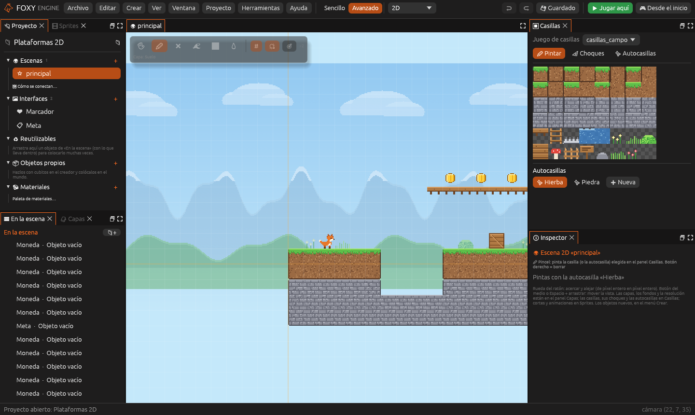
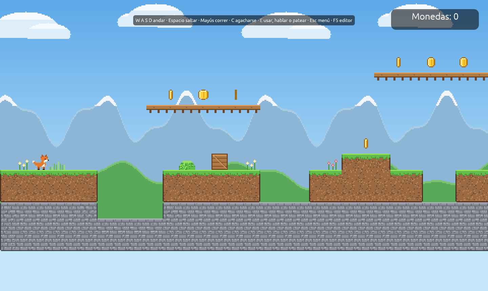

# Tutorial: tu primer juego 2D

Este tutorial crea un juego de plataformas de pixel art desde la plantilla
**Vacío 2D**: un nivel pintado con casillas, monedas dibujadas a mano, un
marcador y una bandera de meta. No hace falta escribir código. Se completa
en unos veinte minutos.

**Aprenderás a:** pintar con casillas y autocasillas, dibujar un sprite,
crear objetos 2D, conectar una zona con una interfaz y probar el juego.

## 1. Crear el proyecto

1. En la [pantalla de inicio](pantalla-de-inicio.md), pulsa
   <i class="fx fx-mas"></i> **Nuevo proyecto**.
2. En **¿Qué juego quieres hacer?**, elige **Vacío 2D** (en *Empezar de
   cero*).
3. En **Nombre**, escribe `Mi plataformas` y pulsa **Crear proyecto**.

El proyecto se abre en el espacio **2D**: la escena en el centro, con un
suelo de hierba, el cielo y un zorro, y a la derecha los paneles
[Casillas](../interfaz/casillas.md), [Capas](../interfaz/capas.md),
[Sprites](../interfaz/sprites.md) e **Inspector**.

Pulsa <i class="fx fx-jugar"></i> **Jugar aquí** (<kbd>F5</kbd>) para
probarlo: el zorro corre con <kbd>A</kbd> y <kbd>D</kbd> y salta con
<kbd>Espacio</kbd>. Pulsa <kbd>F5</kbd> otra vez para volver.

## 2. Moverse por la escena

| Acción | Control |
|---|---|
| Mover la vista | Botón del medio, o <kbd>Espacio</kbd> y arrastrar |
| Acercar y alejar | Rueda del ratón |
| Volver a centrar | El botón de centrar, arriba en la vista |

## 3. Pintar el nivel

1. En el panel **Capas**, elige la capa **Suelo**.
2. En el panel **Casillas**, debajo de las casillas, haz clic en la
   autocasilla **Hierba**.
3. En la barra de herramientas de la vista, elige **Rectángulo** y arrastra
   a la derecha del suelo para alargarlo unas veinte casillas.
4. Con el **Pincel**, pinta dos o tres plataformas en el aire, a unas tres
   casillas de altura, con un hueco entre ellas.

La autocasilla pone sola los bordes de hierba y las esquinas. El botón
derecho borra. Ver [Mapas de casillas](../guia/casillas.md).

> <i class="fx fx-consejo"></i> **Consejo.** Para un hueco que haga daño,
> pinta casillas de pinchos y márcalas como **Peligro** en el modo
> **Choques** del panel Casillas.

## 4. Dibujar una moneda

1. Cambia al espacio **Pixel art** (arriba en el centro).
2. En el apartado **Imágenes** del panel Pixel art, en **Nueva**, escribe
   `Moneda`, elige el tamaño **16 × 16** y el uso **Sprite** y pulsa
   **+ Crear y abrir**.
3. Con el **Círculo** (<kbd>O</kbd>) y un amarillo, dibuja una moneda
   rellena. Añade un borde más oscuro con el **Lápiz** (<kbd>B</kbd>).
4. Guarda la imagen (<kbd>Cmd</kbd>/<kbd>Ctrl</kbd>+<kbd>S</kbd>) y vuelve
   al espacio **2D**.

Ver [Pixel art](../guia/pixel-art.md).

## 5. Colocar las monedas

1. En el centro de la vista, abre el menú **Crear** y elige **Moneda**.
2. Con **Elegir**, arrastra la moneda encima de una plataforma.
3. Repite hasta tener cinco monedas repartidas por el nivel.

Cada moneda lleva los componentes **Sprite** (con la imagen `moneda`) y
**Recogible**: al tocarla desaparece y suma 1 al valor `monedas`. La
plantilla ya trae la interfaz **Marcador**, que muestra `Monedas:
{monedas}` arriba a la derecha.

> <i class="fx fx-nota"></i> **Nota.** Si una moneda se ve con su nombre en
> lugar del dibujo, elígela y, en el componente **Sprite** del Inspector,
> elige la imagen **moneda**.

## 6. Poner la meta

1. En el panel [Proyecto](../interfaz/proyecto.md), pulsa el
   <i class="fx fx-mas"></i> del grupo **Interfaces**. Escribe `Meta`, elige
   la plantilla **Cartel** y acepta.
2. En el lienzo de la interfaz, cambia el mensaje por
   `¡Nivel superado con {monedas} monedas!` y guárdala.
3. Vuelve a la escena. En el menú **Crear** de la vista, elige **Zona** y
   arrástrala al final del nivel.
4. En el Inspector, en el componente **Zona**, elige en **Al entrar** la
   acción **Abrir una interfaz** y la interfaz **Meta**.

## 7. Probar el juego

1. Pulsa <i class="fx fx-jugar"></i> **Jugar aquí** (<kbd>F5</kbd>).
2. Recorre el nivel, recoge las monedas y entra en la zona de la meta.
3. El cartel muestra cuántas monedas has cogido.

Guarda con <kbd>Cmd</kbd>/<kbd>Ctrl</kbd>+<kbd>S</kbd>.

## Para ir más lejos

- La plantilla **Plataformas 2D** tiene un nivel completo con escaleras,
  agua, pinchos y una caja que se empuja: ábrela para ver cómo está hecho.
- Las animaciones del zorro (`quieto`, `correr`, `saltar`…) están en el
  panel [Sprites](../interfaz/sprites.md). El motor elige la que toca según
  lo que hace el personaje; ver [Juegos 2D](../guia/juegos-2d.md#animaciones-del-jugador).
- Para comportamientos propios (un enemigo que patrulla, una plataforma que
  se mueve), sigue el [tutorial del enemigo](../guia/tutorial-enemigo.md).
- Cuando el juego esté listo, [publícalo](../publicar/publicar.md).
