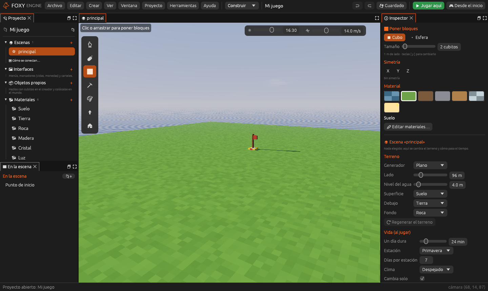
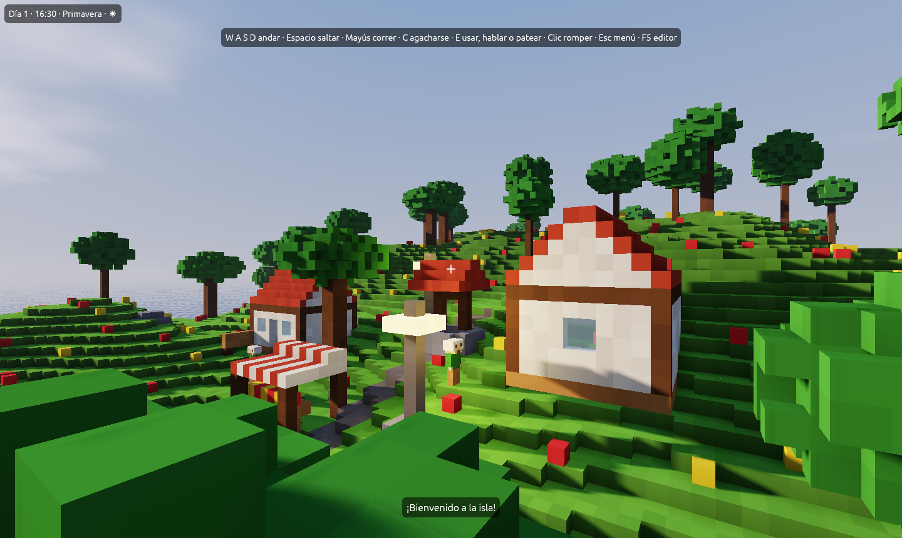

# Tutorial: tu primer juego 3D

Este tutorial crea un juego 3D completo desde un proyecto vacío: un camino
de madera, tres gemas que recoger, un marcador que las cuenta y una puerta
que se abre al llegar a la meta. No hace falta escribir código. Se completa
en unos veinte minutos.

**Aprenderás a:** moverte por la escena, construir con bloques, colocar
objetos, modelar un objeto propio, añadir componentes, crear interfaces y
probar el juego.

## 1. Crear el proyecto

1. En la [pantalla de inicio](pantalla-de-inicio.md), pulsa
   <i class="fx fx-mas"></i> **Nuevo proyecto**.
2. En **Tipo**, elige **3D vóxel**. En **Plantilla**, elige **Vacío 3D**.
3. En **Nombre**, escribe `Mi primer juego` y pulsa **Crear proyecto**.

El editor se abre en el espacio **Construir**, con un suelo liso y el
**Punto de inicio**, la bandera donde aparece el jugador.

## 2. Moverse por la escena

| Acción | Control |
|---|---|
| Desplazarse | <kbd>W</kbd> <kbd>A</kbd> <kbd>S</kbd> <kbd>D</kbd> |
| Subir y bajar | <kbd>Espacio</kbd> y <kbd>Mayús</kbd> |
| Mirar alrededor | Arrastrar con el botón derecho, o mantener <kbd>Cmd</kbd>/<kbd>Ctrl</kbd> y mover el ratón |
| Acercarse y alejarse | Rueda del ratón |
| Ir a lo elegido | <kbd>F</kbd> |

> <i class="fx fx-consejo"></i> **Consejo.** La lista completa de teclas
> está en **Ayuda → Teclas y ratón…** y en
> [Atajos de teclado](../referencia/atajos.md).

## 3. Construir un camino

1. En la tira de herramientas de la [Vista](../interfaz/vista.md), elige
   <i class="fx fx-poner"></i> **Poner bloques** (<kbd>B</kbd>).
2. En el [Inspector](../interfaz/inspector.md), elige el material
   **Madera**.
3. Arrastra sobre el suelo, desde el Punto de inicio hacia delante, para
   trazar un camino de unos veinte bloques.
4. Al final del camino, levanta dos columnas de cuatro bloques de alto,
   separadas tres bloques entre sí: será el marco de la puerta.

Para deshacer un trazo, pulsa <kbd>Cmd</kbd>/<kbd>Ctrl</kbd>+<kbd>Z</kbd>.

## 4. Colocar una puerta

1. Elige <i class="fx fx-colocar"></i> **Colocar objetos** (<kbd>O</kbd>).
2. El proyecto vacío no trae objetos. En el Inspector, pulsa **Añadir los
   objetos de ejemplo**: se copian al proyecto la casa, el árbol, la
   farola, la puerta y los demás objetos de la biblioteca del motor.
3. Elige **Puerta**, pulsa <kbd>R</kbd> hasta que mire hacia el camino y
   haz clic entre las dos columnas.
4. Elige la herramienta <i class="fx fx-mover"></i> **Elegir y mover**
   (<kbd>V</kbd>), haz clic en la puerta y, en el Inspector, cambia su
   **Nombre** a `Puerta`.

## 5. Modelar una gema

Las gemas son un **objeto propio**, hecho con cubitos en el creador.

1. Pulsa **Crear → Objeto nuevo**. El creador se abre en una pestaña de la
   Vista.
2. En **Nombre**, escribe `Gema`.
3. Con <i class="fx fx-poner"></i> **Poner** y el material **Cristal**,
   construye una pieza pequeña: tres cubitos en cruz y uno encima basta.
4. Pulsa **Guardar objeto** (<kbd>Cmd</kbd>/<kbd>Ctrl</kbd>+<kbd>S</kbd>) y
   vuelve a la pestaña de la escena.

El creador se explica en [Crear objetos propios](../guia/creador.md).

## 6. Colocar las gemas y hacerlas recogibles

1. Con **Colocar objetos**, elige **Gema** y coloca tres a lo largo del
   camino.
2. Con **Elegir y mover**, haz clic en la primera gema.
3. En el Inspector, pulsa <i class="fx fx-mas"></i> **Añadir componente →
   Recogible**.
4. En **Suma a**, escribe `gemas`.
5. Repite los pasos 2 a 4 con las otras dos gemas.

Al tocar una gema, el jugador la recoge: suena, suelta chispas y el valor
`gemas` aumenta en 1. Ver [Recogible](../referencia/componentes/recogible.md).

> <i class="fx fx-consejo"></i> **Consejo.** Con la primera gema ya
> preparada, pulsa <kbd>Cmd</kbd>/<kbd>Ctrl</kbd>+<kbd>D</kbd> para
> duplicarla con sus componentes. Para muchas copias iguales, conviene un
> [prefabricado](../guia/entidades.md#prefabricados).

## 7. Mostrar un marcador

1. Pulsa **Crear → Interfaz nueva…**.
2. Escribe el nombre `Marcador`, elige la plantilla **Marcador** y acepta.
3. En el lienzo, haz clic en el texto del contador y cámbialo por
   `Gemas: {gemas}`.
4. Guarda la interfaz (<kbd>Cmd</kbd>/<kbd>Ctrl</kbd>+<kbd>S</kbd>).

Una interfaz de uso **Marcador** se ve siempre encima del juego. El texto
entre llaves se sustituye por el valor al jugar. Ver
[Interfaces](../guia/interfaces.md).

## 8. Abrir la puerta en la meta

1. Crea otra interfaz con **Crear → Interfaz nueva…**, de nombre `Meta` y
   plantilla **Cartel**. Cambia su mensaje por `¡Has llegado a la meta con
   {gemas} gemas!` y guárdala.
2. Vuelve a la escena y elige la **Puerta**.
3. Pulsa **Añadir componente → Zona**.
4. En **Al entrar**, elige **Mover una entidad**. Deja **Entidad** vacío
   (la propia puerta) y escribe en **Cuánto** `0`, `3`, `0`: la puerta
   subirá tres metros.
5. En **Al usarlo (E)**, elige **Abrir una interfaz** y la interfaz **Meta**.

## 9. Probar el juego

1. Pulsa <i class="fx fx-jugar"></i> **Jugar aquí** (<kbd>F5</kbd>). El
   jugador aparece donde mira la cámara.
2. Recorre el camino con <kbd>W</kbd> <kbd>A</kbd> <kbd>S</kbd>
   <kbd>D</kbd>, recoge las gemas y acércate a la puerta: se abre.
3. Pulsa <kbd>E</kbd> delante de la puerta para ver el cartel de la meta.
4. Pulsa <kbd>F5</kbd> para volver al editor en el mismo punto.

Para probar el juego como lo verá el jugador, desde el Punto de inicio y con
su menú principal, pulsa <i class="fx fx-mando"></i> **Desde el inicio**.
Ver [Probar el juego](../guia/jugar.md).

## 10. Guardar

Pulsa <i class="fx fx-guardar"></i> **Guardar**
(<kbd>Cmd</kbd>/<kbd>Ctrl</kbd>+<kbd>S</kbd>). El botón muestra
**Guardar •** mientras hay cambios pendientes y **Guardado** cuando todo
está a salvo.

> <i class="fx fx-aviso"></i> **Importante.** Al cerrar el proyecto o el
> motor con cambios sin guardar, el editor pregunta qué hacer. Si eliges
> **No guardar**, los cambios se pierden.

> <i class="fx fx-nota"></i> **Nota.** Todo se guarda como texto. La puerta,
> sus componentes y las gemas aparecen en `mundos/principal.ron`, y la gema
> en `objetos/gema.ron`.

## Siguientes pasos

- [Tutorial: tu primer juego 2D](primer-juego-2d.md): lo mismo, con sprites
  y casillas.
- [Tutorial: un enemigo que persigue](../guia/tutorial-enemigo.md): dar
  comportamiento con nodos.
- [Publicar tu juego](../publicar/publicar.md): convertir el proyecto en una
  aplicación para Mac, Windows o Linux.
