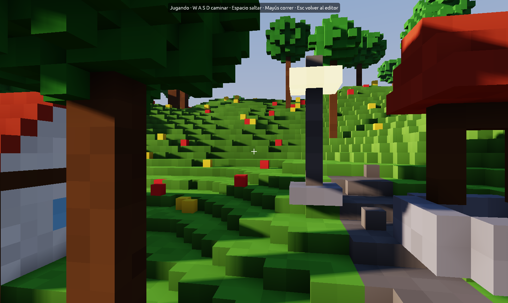

# Tu primer proyecto

Cada juego que haces con Foxy Engine es un **proyecto**: una carpeta con sus
escenas, objetos, imágenes, interfaces y guion. En este capítulo vas a crear
uno, construir algo y jugarlo, en unos diez minutos.

## Dónde viven los proyectos

```text
Documentos/
  Foxy Engine/
    Foxy Engine.app        el motor (en Mac)
    proyectos/
      Mi isla/             un proyecto
      La cueva/            otro
    ajustes.ron            tus opciones de juego
    registro.txt           lo que ha pasado al abrir el motor
```

Instalar una versión nueva del motor solo cambia la app; los proyectos se
quedan como estaban.

## 1. Crea el proyecto

En la barra de menús, **Archivo → <i class="fx fx-carpeta"></i> Proyecto
nuevo…**:

1. Escribe un nombre, por ejemplo *Isla del faro*.
2. Elige con qué empieza:

   | Empezar con | Qué trae |
   |---|---|
   | **Proyecto vacío** (el de serie) | Un suelo llano de hierba de 96 × 96 m, el punto de inicio y un guion con las funciones vacías. Nada más: para empezar de cero |
   | **Isla sin objetos** | Una isla con colinas, playa y árboles, sin casas ni vecinos |
   | **Plaza de prueba** | Una isla con casas, un mercado, vecinos y pelotas. Ideal para aprender viendo un ejemplo |

3. Pulsa **Crear**.


El editor abre el proyecto, y a partir de ahora volverá a él cada vez que
abras Foxy Engine. Para cambiar de proyecto usa **Archivo →
<i class="fx fx-abrir"></i> Abrir proyecto…**, y para ver sus archivos,
**Archivo → <i class="fx fx-buscar"></i> Ver la carpeta del proyecto** (o la
lupa de arriba del panel «Proyecto»).

## 2. Muévete por el mundo

| Para | Haz |
|---|---|
| Volar | <kbd>W</kbd> <kbd>A</kbd> <kbd>S</kbd> <kbd>D</kbd> |
| Subir y bajar | <kbd>Espacio</kbd> y <kbd>Mayús</kbd> |
| Mirar alrededor | Arrastra con el botón derecho (o mantén <kbd>Cmd</kbd>/<kbd>Ctrl</kbd> y mueve el ratón) |
| Acercarte | La rueda del ratón |

Todas las teclas están en **Ayuda → <i class="fx fx-teclado"></i> Teclas y
ratón…**.

## 3. Construye algo

1. En la **tira de herramientas** del borde izquierdo de la vista, elige
   <i class="fx fx-poner"></i> **Poner bloques** (o pulsa <kbd>B</kbd>).
2. En el **inspector**, a la derecha, elige el material *Grava*.
3. Arrastra por el suelo para hacer un camino.

Ahora pon una farola al lado:

1. Elige <i class="fx fx-colocar"></i> **Colocar objetos** (<kbd>O</kbd>).
2. En el inspector, elige **Farola**.
3. Haz clic en el suelo. Con <kbd>R</kbd> la giras antes de ponerla.

## 4. Pruébalo

Pulsa <i class="fx fx-jugar"></i> **Jugar aquí** (<kbd>F5</kbd>), el botón
verde de arriba a la derecha. Apareces de pie justo donde miraba la cámara.
Anda con <kbd>W</kbd> <kbd>A</kbd> <kbd>S</kbd> <kbd>D</kbd> y salta con
<kbd>Espacio</kbd>. Pulsa <kbd>F5</kbd> otra vez para volver al editor,
justo donde estabas.



## 5. Guarda

<i class="fx fx-guardar"></i> **Guardar** (<kbd>Cmd</kbd>/<kbd>Ctrl</kbd>+<kbd>S</kbd>).
El botón dice `Guardar •` cuando hay cambios sin guardar y `Guardado` cuando
está todo a salvo. Si cierras el editor con cambios pendientes, te pregunta
antes.

> <i class="fx fx-consejo"></i> **Consejo.** Todo se guarda como texto.
> Puedes abrir `mundos/principal.ron` con cualquier editor y ver tu farola
> ahí escrita. Más en [Archivos del proyecto](../referencia/archivos.md).

## Siguiente paso

Lee [Un vistazo al editor](editor.md) para conocer cada parte, o salta
directamente a [Construir el mundo](../guia/mundo.md).
