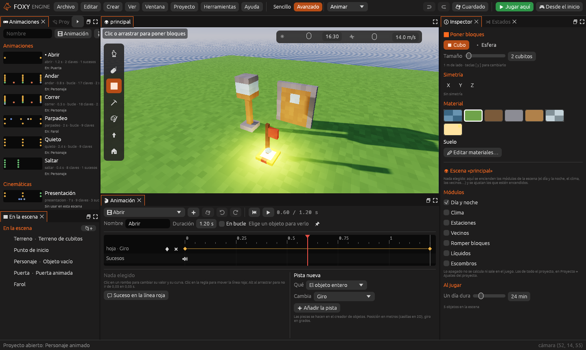
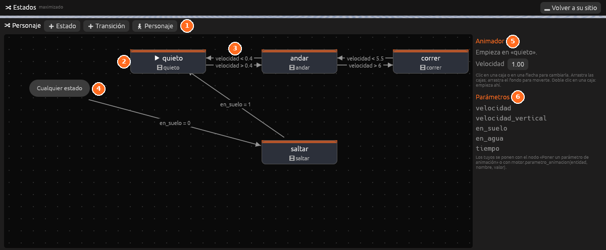

# Animación

Todo lo que se mueve en un juego se anima en el mismo editor, en 3D y en
2D: una puerta que se abre, un farol que parpadea, un personaje que anda y
salta, o una presentación con la cámara. Cada movimiento se guarda como una
**animación** (un *clip*) que cualquier objeto puede usar.

## Cómo funciona

| Pieza | Qué es | Dónde se hace |
|---|---|---|
| **Animación** | Lo que cambia con el tiempo: posición, giro, escala, color, luz o fotograma | Panel [Animación](../interfaz/animacion.md) |
| **Clave** | El valor que tiene algo en un segundo concreto. Entre dos claves, el motor rellena el camino | Línea de tiempo |
| **Curva** | Cómo se va de una clave a la siguiente: suave, rebotando, de golpe… | Al elegir una clave |
| **Suceso** | Algo que pasa en un segundo: un sonido, partículas, un aviso a los nodos o una frase | Línea de tiempo, fila **Sucesos** |
| **Animador** | El componente que dice qué animaciones usa un objeto | [Inspector](../referencia/componentes/animador.md) |
| **Máquina de estados** | Elige sola la animación según lo que hace el objeto: quieta, andando, saltando… | Panel [Estados](../interfaz/estados.md) |
| **Cinemática** | Una animación de la escena entera, con la cámara y frases | [Cinemáticas](cinematicas.md) |

Las animaciones se guardan en la carpeta `animaciones/` del proyecto y las
cinemáticas en `cinematicas/`. El panel
[Animaciones](../interfaz/animaciones.md) las enseña todas.

> <i class="fx fx-consejo"></i> **Consejo.** El espacio de trabajo
> **Animar** junta los paneles Animaciones, Vista, Animación, Inspector y
> Estados. La plantilla **Personaje animado** trae un ejemplo de cada cosa.

## Crear una animación

1. Elige en la escena el objeto que quieres animar. La animación se verá
   en ella mientras la editas.
2. En el panel **Animación**, pulsa <i class="fx fx-mas"></i> y luego
   **Animación nueva**, o escribe un nombre en el panel **Animaciones** y
   pulsa **Animación**.
3. En **Pista nueva**, elige **Qué** se mueve (el objeto entero o una de
   sus [piezas](personajes-piezas.md)) y **Cambia** (posición, giro…), y
   pulsa **Añadir la pista**.
4. Mueve la línea roja al segundo que quieras y pulsa el rombo de la pista
   para poner una clave allí.
5. Haz clic en la clave y escribe su **Valor**.
6. Pulsa <i class="fx fx-jugar"></i> para verla en la Vista y
   <i class="fx fx-guardar"></i> para guardarla.

La animación se guarda como `animaciones/<nombre>.ron`.

## Las pistas

Cada pista cambia una propiedad de una cosa. Los valores van siempre
**desde su sitio** en el editor: una posición de `(0, 1, 0)` sube el
objeto un metro, y un giro de `(0, 90, 0)` lo gira 90° sobre sí mismo.

| Propiedad | Qué cambia | Medida |
|---|---|---|
| **Posición** | Cuánto se mueve | Metros (casillas en 2D) |
| **Giro** | Cuánto gira en cada eje | Grados |
| **Escala** | Su tamaño | 1 = como es |
| **Fotograma** | El fotograma de su hoja de sprites (2D) | Número, desde 0 |
| **Color** | El color de su luz (o el tinte de su sprite en 2D) | Rojo, verde y azul, de 0 a 1 |
| **Intensidad de la luz** | Lo fuerte que brilla su [Luz](../referencia/componentes/luz.md) | Número |
| **Alcance de la luz** | Hasta dónde llega su luz | Metros |
| **Mirar hacia** | Adónde mira la cámara (solo en cinemáticas) | Metros |
| **Campo de visión** | Lo abierta que es la cámara (solo en cinemáticas) | Grados |
| **Valor** | Un valor propio que leen los nodos o Lua | Número |

A la derecha del nombre de cada pista, el **rombo** pone una clave en la
línea roja con el valor de ese momento y la **cruz** quita la pista entera.

## Las claves

| Para… | Haz esto |
|---|---|
| Mover la línea roja | Haz clic o arrastra en la regla de arriba |
| Poner una clave | Doble clic en la fila, o el rombo de la pista |
| Elegir una clave | Haz clic en ella; abajo salen su segundo, su valor y su curva |
| Mover una clave | Arrástrala. Va de 0,05 en 0,05 s; con <kbd>Alt</kbd>, libre |
| Borrar una clave | Elígela y pulsa **Borrar la clave** |
| Deshacer | Los botones de deshacer y rehacer del propio panel |

Una pista de la cámara puede tomar el valor de la Vista: con una clave
elegida, **Desde la cámara del editor** copia dónde está o adónde mira.

## Las curvas

La curva de una clave dice cómo se llega de ella a la siguiente. Al elegir
una clave se ve un dibujo de su curva.

| Curva | Cómo se mueve |
|---|---|
| **Lineal** | A la misma velocidad todo el rato |
| **Suave** | Arranca y frena despacio. Es la de siempre |
| **Acelerar** | Arranca despacio y llega deprisa |
| **Frenar** | Sale deprisa y frena al llegar |
| **Escalón** | Se queda quieto y salta de golpe a la clave siguiente |
| **Rebote** | Llega botando, como una pelota que cae |
| **Muelle** | Se pasa un poco y vuelve |

**Todas con esta curva** pone la misma curva en todas las claves de la
pista.

## Los sucesos

Un suceso pasa una vez, en su segundo, cada vez que la animación llega a
él. Se ponen en la fila **Sucesos** con **Suceso en la línea roja** o con
doble clic en la fila.

| Suceso | Qué hace |
|---|---|
| **Sonar** | Toca un sonido del proyecto o de ejemplo (los pasos, una bisagra…) |
| **Partículas** | Suelta unas partículas en el objeto: polvo al caer, chispas… |
| **Avisar a los nodos** | Lanza el evento [Aviso de una animación](../referencia/nodos.md#evento-al_evento_animacion) con un nombre |
| **Diálogo** | Enseña una frase abajo de la pantalla durante unos segundos |

## Poner una animación en un objeto

Hay tres maneras:

- **Siempre**: añade el componente **Animador** al objeto y elige la
  animación en **Animación**. Si está **En bucle**, se repite sin parar.
- **Con una acción**: en una zona, un botón o un objeto que se usa con
  <kbd>E</kbd>, elige la acción **Animar un objeto**, el nombre de el
  objeto y la animación. **Al revés** la pone de atrás hacia delante: así
  se cierra una puerta que se abrió con la misma animación.
- **Con nodos o Lua**: los nodos de la categoría
  [Animación](../referencia/nodos.md#animación) o las funciones
  `motor.animar`, `motor.animar_al_reves` y `motor.parar_animacion`.

### Ejemplo: una puerta que se abre sola

La plantilla **Personaje animado** lo trae hecho:

1. La puerta es un objeto propio con una pieza **hoja** que gira sobre su
   bisagra (ver [Personajes por piezas](personajes-piezas.md)).
2. La animación **Abrir** gira la hoja de 0° a 100° en 1,2 s con la curva
   **Suave**, y toca un sonido al empezar.
3. El objeto tiene un **Animador** y una **Zona**: **Al entrar**, *Animar
   un objeto* con **Abrir**; **Al salir**, lo mismo con **Al revés**
   marcado.

> <i class="fx fx-nota"></i> **Nota.** Mientras se mueve, un objeto
> animada no choca con el jugador. Quieta en su sitio, vuelve a ser sólida.

## Máquina de estados

Una máquina de estados elige la animación por sí sola. Cada **estado** usa
una animación y las **transiciones** (las flechas) dicen cuándo se pasa de
uno a otro, mirando unos **parámetros**.

El motor pone estos parámetros en cada fotograma:

| Parámetro | Qué vale |
|---|---|
| `velocidad` | Lo deprisa que va, en metros por segundo (sin contar la caída) |
| `velocidad_vertical` | Lo deprisa que sube (positivo) o cae (negativo) |
| `en_suelo` | 1 si pisa el suelo, 0 si está en el aire |
| `en_agua` | 1 si está en el agua |
| `tiempo` | Segundos que lleva en el estado |

Los parámetros propios se ponen con el nodo **Poner un parámetro de
animación** o con `motor.parametro_animacion(entidad, nombre, valor)`.

### Hacer la máquina de un personaje

1. Elige el objeto y abre el panel **Estados**. Si no tiene Animador,
   pulsa **Añadir un Animador**.
2. Pulsa **Personaje**. Se crean los estados **quieto**, **andar**,
   **correr** y **saltar** con sus transiciones y, si no estaban, sus cuatro
   animaciones para una figura de bloques.
3. Ajusta los números de las flechas: por ejemplo, que corra a partir de
   6 m/s.

### Cambiar estados y flechas

| Para… | Haz esto |
|---|---|
| Añadir un estado | **Estado**, y elige su animación a la derecha |
| Añadir una flecha | **Transición**, y elige **De** y **a** |
| Que una flecha valga desde cualquier estado | En **De**, elige *cualquiera* (sale de la caja **Cualquier estado**) |
| Poner condiciones | **Condición**: un parámetro, `>`, `<`, `=` o `≠`, y un número. Se tienen que cumplir todas |
| Esperar a que acabe la animación | Marca **Espera a que acabe su animación** |
| Pasar suave de una a otra | **Mezcla**, en segundos |
| Elegir el estado del principio | Doble clic en su caja, o **Empieza aquí** |
| Moverse por el lienzo | Arrastra el fondo; las cajas también se arrastran |

Jugando, el estado en el que está el objeto se ve resaltado en el panel.

> <i class="fx fx-consejo"></i> **Consejo.** Una animación puesta con una
> acción o con `motor.animar` manda sobre la máquina hasta que termina.
> Después, la máquina sigue sola.

## En 2D

En una escena 2D se anima igual que en 3D, en casillas en vez de metros.
Además:

- La propiedad **Fotograma** elige el fotograma de la hoja de sprites, y la
  curva **Escalón** hace que salte de uno a otro.
- **Color** tiñe el sprite.
- Un estado puede usar una animación de la hoja de sprites: escribe su
  nombre en **o escrita** (por ejemplo, `correr`).

Las animaciones de la hoja de sprites se siguen haciendo en el panel
[Sprites](sprites.md), ahora también con la duración de cada fotograma.

## Véase también

- [Personajes por piezas](personajes-piezas.md)
- [Cinemáticas](cinematicas.md)
- [Panel Animación](../interfaz/animacion.md), [Estados](../interfaz/estados.md) y [Animaciones](../interfaz/animaciones.md)
- [Animador](../referencia/componentes/animador.md)
- [Referencia de nodos: Animación](../referencia/nodos.md#animación)
