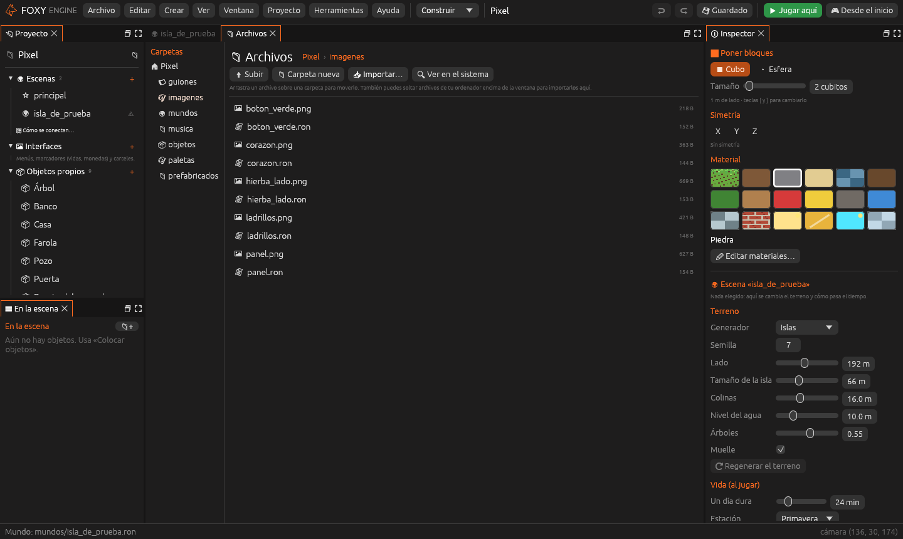

# Archivos del proyecto

El panel <i class="fx fx-carpeta"></i> **Archivos** es un gestor de archivos
dentro del motor: ves las carpetas del proyecto, creas las tuyas, mueves
cosas e **importas** archivos de tu ordenador.

Se abre con **Proyecto → Archivos del proyecto** o con el icono
<i class="fx fx-carpeta"></i> de arriba del panel «Proyecto».

## Moverse

- A la izquierda, el **árbol de carpetas**. Un clic abre una carpeta.
- Arriba, el camino (*Mi isla › imagenes*): un clic en cualquier parte vuelve
  ahí. **Subir** va a la carpeta de arriba.
- **Doble clic** en una carpeta entra en ella. En un archivo, lo abre donde
  toca: las imágenes en el pixel art, las escenas en el editor, los objetos
  en el creador, las interfaces, los materiales y el guion. Lo que el motor
  no sabe abrir se abre con el programa de tu ordenador.

## Ordenar

- **Carpeta nueva**: escribe el nombre y pulsa <kbd>Intro</kbd>.
- **Mover**: arrastra un archivo o una carpeta **encima de otra carpeta**
  (de la lista o del árbol). También con clic derecho → **Mover a…**.
- Clic derecho en cualquier cosa: **Renombrar**, **Duplicar**, **Ver en el
  sistema** y **A la papelera**.

Lo que se lleva a la papelera no se borra: va a la carpeta oculta
`.papelera` del proyecto, desde donde se puede recuperar a mano.

> <i class="fx fx-aviso"></i> **Importante.** Las carpetas y archivos que usa el motor
> (`mundos`, `imagenes`, `objetos`, `interfaces`, `guiones`, `paletas`,
> `proyecto.ron` y `materiales.ron`) se pueden abrir y llenar, pero **no
> renombrar, mover ni borrar**: el proyecto dejaría de encontrarlos.

## Importar

Dos maneras de traer archivos de tu ordenador a la carpeta abierta:

1. **Importar…**: abre la ventana del sistema para elegir uno o varios
   archivos (también desde **Archivo → Importar al proyecto…**).
2. **Arrastrar**: suelta archivos del Finder o del Explorador de Windows
   **encima de la ventana del motor**. Si no está abierto el panel Archivos y
   son PNG, van directos a `imagenes/` y ya salen en el pixel art.

Importar **copia** los archivos: el original se queda donde estaba. Si ya hay
uno con el mismo nombre, el nuevo se llama «nombre 2».
