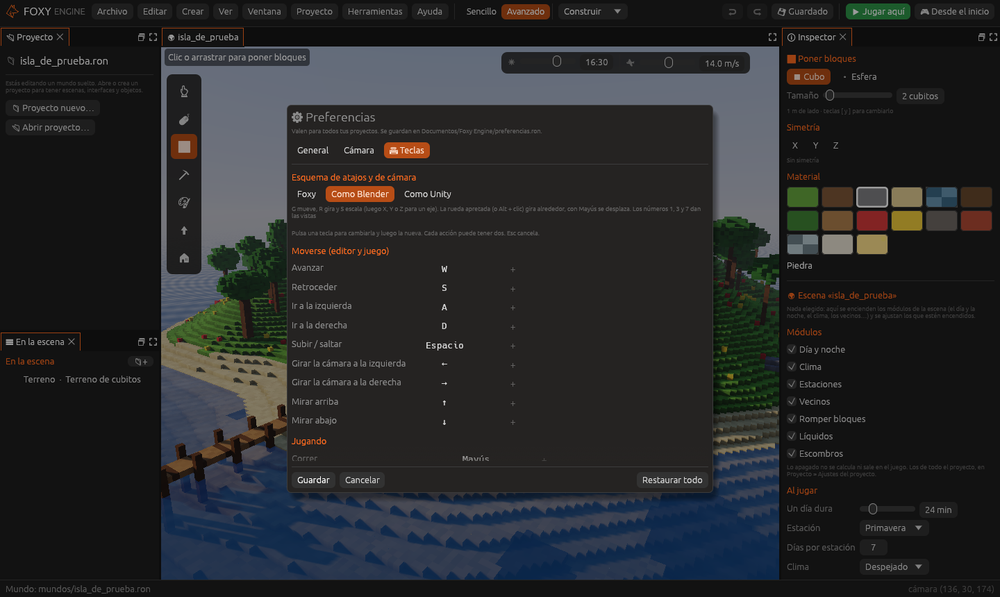
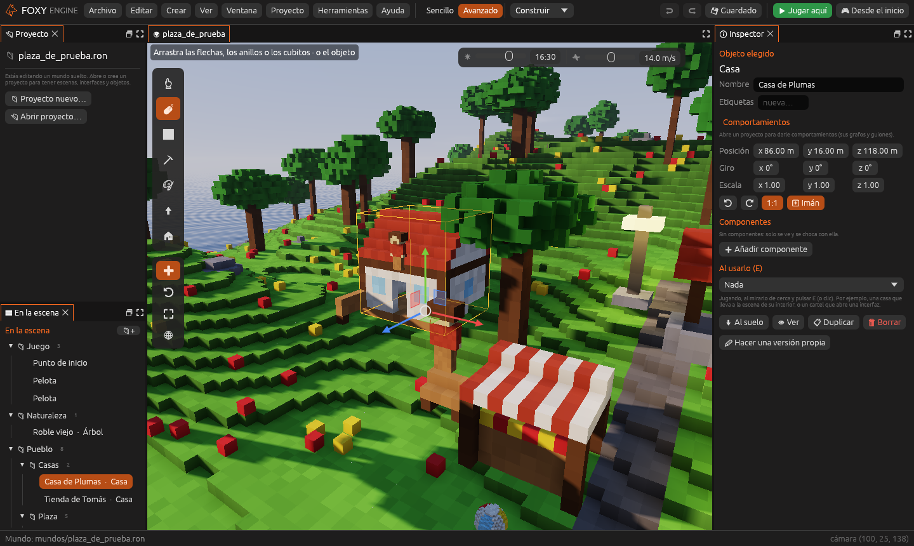
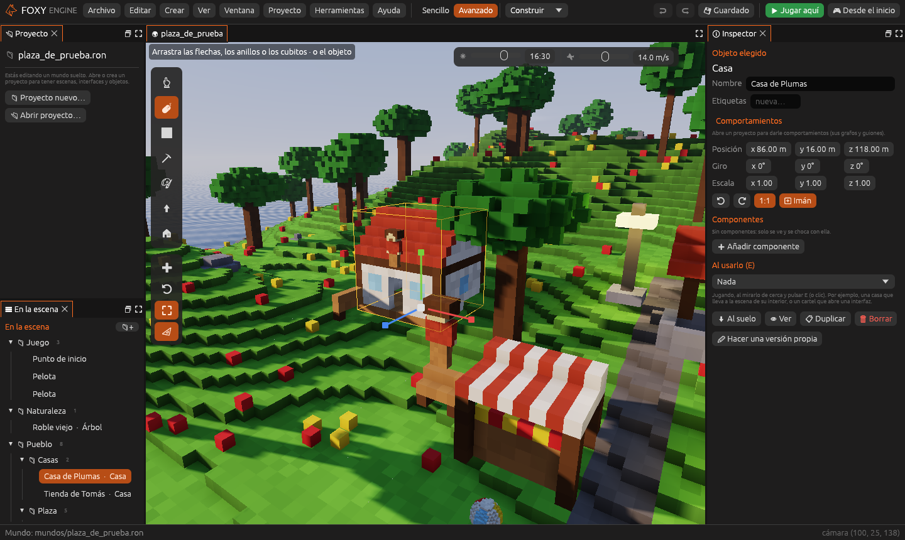

# Si vienes de Blender o de Unity

Si ya sabes manejar Blender o Unity, no hace falta que aprendas otras
teclas: Foxy Engine puede usar las tuyas. Se elige una vez y vale para
todos tus proyectos.

## Elegir el esquema

**Editar → Preferencias…**, página **General** o **Teclas**, apartado
**Esquema de atajos y cámara**:

| Esquema | Para quién |
|---|---|
| **Foxy** | El de siempre: <kbd>W</kbd> <kbd>A</kbd> <kbd>S</kbd> <kbd>D</kbd> vuelan y el botón derecho mira |
| **Como Blender** | <kbd>G</kbd> mueve, <kbd>R</kbd> gira, <kbd>S</kbd> escala; la rueda apretada gira alrededor |
| **Como Unity** | <kbd>W</kbd> <kbd>E</kbd> <kbd>R</kbd> cambian de manipulador; botón derecho + <kbd>W</kbd> <kbd>A</kbd> <kbd>S</kbd> <kbd>D</kbd> vuelan |

Al cambiar de esquema, las teclas vuelven a las de ese esquema. Después
puedes cambiar cualquiera, como siempre, en la misma página: el motor
guarda solo las que tú has cambiado.

## Mover la cámara

| Qué | Foxy | Como Blender | Como Unity |
|---|---|---|---|
| Mirar alrededor | Botón derecho, o <kbd>Alt</kbd> + arrastrar | Botón derecho | Botón derecho |
| Girar alrededor de lo que miras | (no) | Rueda apretada (o <kbd>Alt</kbd> + clic) | <kbd>Alt</kbd> + clic |
| Desplazar | Herramienta Mano (<kbd>H</kbd>) | <kbd>Mayús</kbd> + rueda apretada | Rueda apretada, o herramienta Mano (<kbd>Q</kbd>) |
| Acercarse | Rueda (avanza) | Rueda, o <kbd>Cmd</kbd>/<kbd>Ctrl</kbd> + rueda apretada | Rueda, o <kbd>Alt</kbd> + botón derecho |
| Volar | <kbd>W</kbd> <kbd>A</kbd> <kbd>S</kbd> <kbd>D</kbd> siempre | Botón derecho + <kbd>W</kbd> <kbd>A</kbd> <kbd>S</kbd> <kbd>D</kbd> | Botón derecho + <kbd>W</kbd> <kbd>A</kbd> <kbd>S</kbd> <kbd>D</kbd>, <kbd>Q</kbd> / <kbd>E</kbd> bajan y suben |
| Ir al objeto elegido | <kbd>F</kbd> | <kbd>.</kbd> o <kbd>F</kbd> | <kbd>F</kbd> |

**Con trackpad** (como Blender): dos dedos giran alrededor, con
<kbd>Mayús</kbd> desplazan y con <kbd>Cmd</kbd> o pellizcando acercan.
La herramienta **Mano** desplaza la vista arrastrando con el botón
izquierdo en cualquier esquema.

La cámara gira alrededor del punto que tienes delante, a la distancia del
objeto o del suelo que miras, igual que en Blender y Unity. Después de
pulsar <kbd>F</kbd>, gira alrededor del objeto elegido.

### Vistas

Con el esquema de Blender, los números <kbd>1</kbd>, <kbd>3</kbd> y
<kbd>7</kbd> ponen la vista de frente, de lado y desde arriba (con
<kbd>Ctrl</kbd>, desde detrás, desde el otro lado y desde abajo), y
<kbd>5</kbd> cambia entre perspectiva y **vista ortográfica** (sin
perspectiva, para alinear cosas). En los otros esquemas no tienen tecla,
pero se la puedes poner en **Teclas**.

## Manipuladores: mover, girar y escalar

Con la herramienta **Elegir y mover** y un objeto elegido, salen sus
manipuladores. Debajo de la tira de herramientas hay tres botones para
cambiar entre ellos y uno para los ejes:

| Manipulador | Foxy | Como Blender | Como Unity |
|---|---|---|---|
| Mover (flechas) | <kbd>1</kbd> | <kbd>G</kbd> | <kbd>W</kbd> |
| Girar (anillos) | <kbd>2</kbd> | <kbd>R</kbd> | <kbd>E</kbd> |
| Escalar (cubitos) | <kbd>3</kbd> | <kbd>S</kbd> | <kbd>R</kbd> |
| Ejes del objeto o del mundo | <kbd>L</kbd> | Pulsar el eje dos veces | <kbd>X</kbd> |

- **Mover**: arrastra una flecha para moverlo solo en ese eje, un cuadrado
  para moverlo en un plano, o el círculo del centro para moverlo libre.
- **Girar**: arrastra un anillo para girar en ese eje; el anillo de fuera
  gira de cara a la cámara.
- **Escalar**: arrastra un cubito para estirar en ese eje, o el del centro
  para hacerlo todo más grande o más pequeño.

Los colores son los de siempre: **rojo** X, **verde** Y (arriba), **azul**
Z. Con el **imán** encendido, se mueve de cubito en cubito y gira de 15 en
15 grados; mantén <kbd>Ctrl</kbd> mientras arrastras para hacer lo
contrario. Cada arrastre se deshace de una vez con
<kbd>Cmd</kbd>/<kbd>Ctrl</kbd>+<kbd>Z</kbd>.

### Ejes del mundo o del objeto

El botón del globo cambia entre los ejes del **mundo** (las flechas
siempre apuntan igual) y los del **objeto** (giran con él). Así puedes
mover un objeto girado «hacia delante» desde su punto de vista.

## Mover como en Blender

Con el esquema de Blender, <kbd>G</kbd>, <kbd>R</kbd> y <kbd>S</kbd>
funcionan como allí, sin tener que arrastrar ningún manipulador:

1. Elige un objeto y pulsa <kbd>G</kbd> (mover), <kbd>R</kbd> (girar) o
   <kbd>S</kbd> (escalar).
2. Mueve el ratón: el objeto le sigue.
3. Si quieres, pulsa <kbd>X</kbd>, <kbd>Y</kbd> o <kbd>Z</kbd> para un solo
   eje (dos veces: el eje del objeto) y escribe un número, por ejemplo
   <kbd>G</kbd> <kbd>Z</kbd> <kbd>2</kbd> sube el objeto 2 metros.
4. **Clic** o <kbd>Intro</kbd> para dejarlo; **botón derecho** o
   <kbd>Esc</kbd> para dejarlo como estaba.

Como en Blender, <kbd>Z</kbd> es **hacia arriba** (en el motor, el eje
vertical se llama Y), así que <kbd>G</kbd> <kbd>Z</kbd> sube y baja.

También: <kbd>Alt</kbd>+<kbd>G</kbd>, <kbd>Alt</kbd>+<kbd>R</kbd> y
<kbd>Alt</kbd>+<kbd>S</kbd> llevan el objeto al origen (0, 0, 0), le
quitan el giro y lo devuelven a su tamaño; <kbd>Mayús</kbd>+<kbd>D</kbd> duplica y empieza a mover la
copia; <kbd>X</kbd> o <kbd>Supr</kbd> borran.

## Modo Sencillo y Avanzado

Para quien ya sabe, el modo **Avanzado** (arriba, en la barra) enseña todos
los paneles, incluidos los [paneles propios](herramientas-propias.md). Ver
[Modo Sencillo y tutorial guiado](../empezar/modo-sencillo.md).

## Véase también

- [Preferencias y teclas](preferencias.md)
- [Atajos de teclado](../referencia/atajos.md)
- [Objetos libres y jerarquía](objetos-libres.md)
- [Demostraciones](../demos/index.md): proyectos de ejemplo grandes para practicar la navegación
