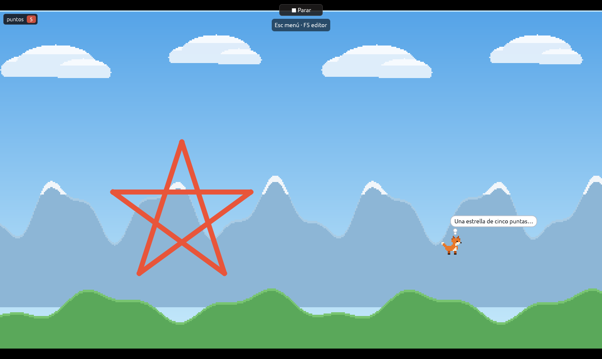
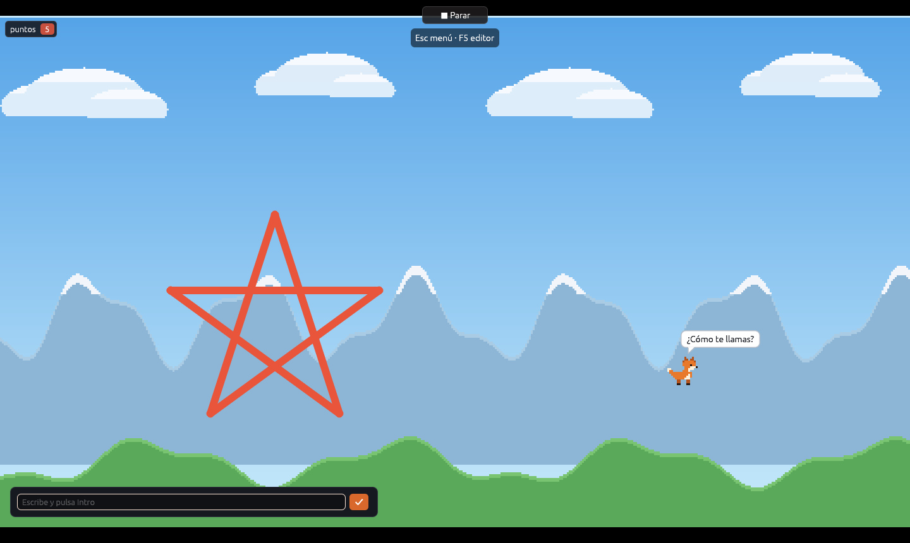
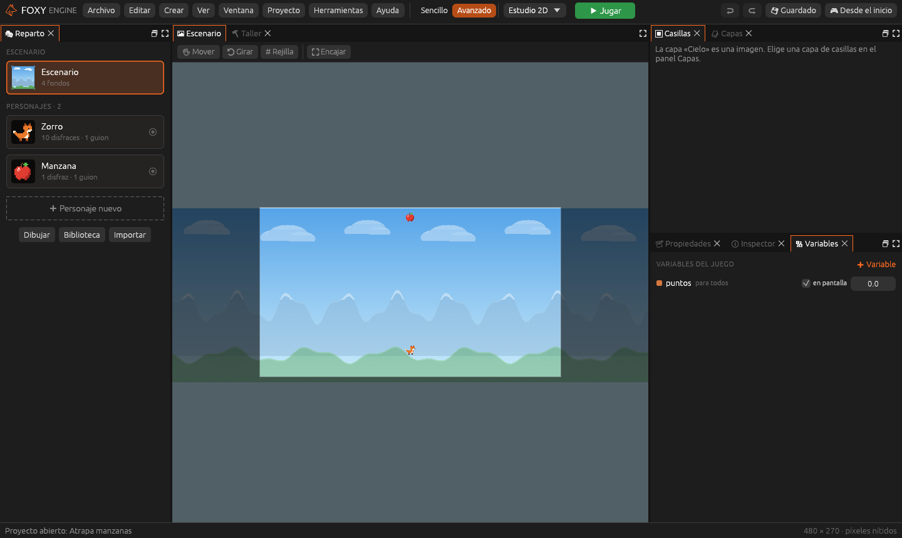
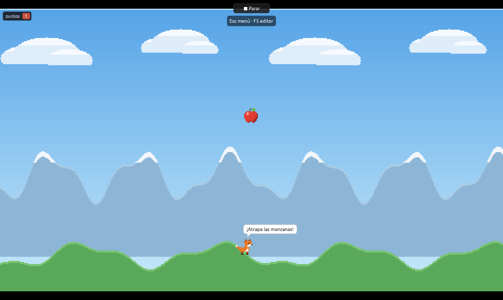
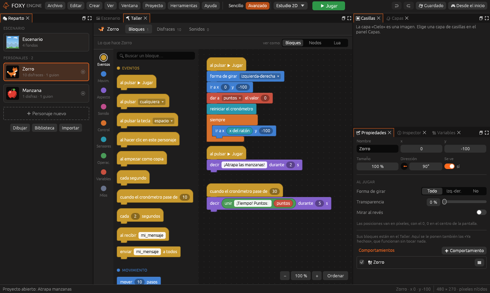
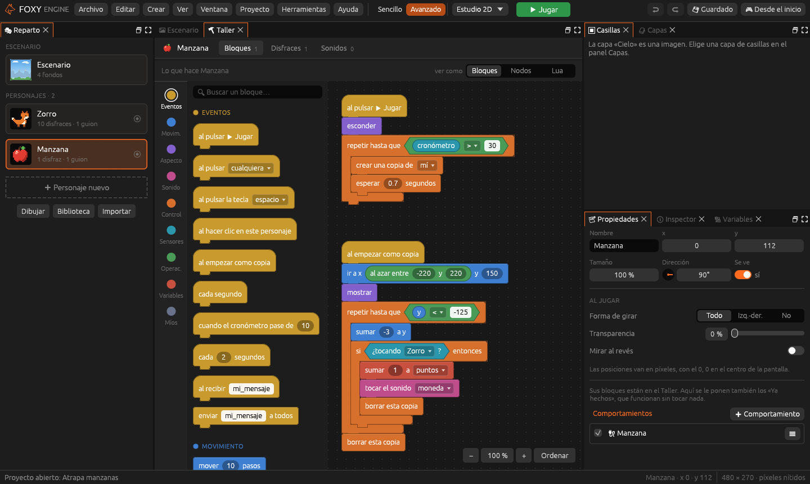

# Ratón, copias, lápiz y más

Estos bloques dan vida al escenario: los personajes hablan con bocadillos,
siguen al ratón, se tocan, se copian, preguntan y dibujan. Todos están en
la paleta del [Taller](bloques.md), cada uno en su familia, y todos tienen
también su nodo y su función de Lua.

## Bocadillos

| Bloque | Qué hace |
|---|---|
| **decir** `texto` **durante** `2` **s** | Un bocadillo encima del personaje. El guion espera esos segundos y luego lo quita. |
| **decir** `texto` | El bocadillo se queda hasta que diga otra cosa. Con el texto vacío, se quita. |
| **pensar** `texto` **durante** `2` **s** y **pensar** `texto` | Igual, con una nube de pensar. |
| **mensaje abajo** `texto` | El mensaje de siempre, abajo de la pantalla. |

Están en **Aspecto**.

## El ratón y las teclas

| Bloque | Familia | Qué hace |
|---|---|---|
| **x del ratón**, **y del ratón** | Sensores | Dónde está el ratón, en píxeles del escenario. |
| **¿ratón pulsado?** | Sensores | Sí mientras se pulsa el botón. |
| **al hacer clic en este personaje** | Eventos | Empieza cuando se hace clic encima de su dibujo. |
| **se puede arrastrar:** `sí` | Sensores | Al jugar, el personaje se puede llevar con el ratón. |
| **al pulsar la tecla** `espacio` | Eventos | Empieza al pulsar esa tecla (una letra, un número, las flechas, espacio o Intro). Con `cualquiera`, cualquier tecla. |
| **¿tecla** `a` **pulsada?** | Sensores | Sí mientras se pulsa esa tecla. |

En los juegos 2D el ratón se ve siempre mientras se juega.

## Tocar

| Bloque | Qué hace |
|---|---|
| **¿tocando** `Zorro` **?** | Sí si su dibujo toca el de otro personaje (o el de cualquiera de sus copias), el **borde** de la pantalla o el **ratón**. |
| **¿tocando el color** `rojo` **?** | Sí si su dibujo está encima de algo de ese color: el fondo, otro personaje o una raya del lápiz. |
| **distancia a** `ratón` | Cuántos píxeles hay hasta el ratón o hasta otro personaje. |

Están en **Sensores**.

## Moverse

En **Movimiento**:

- **ir a** `ratón` y **apuntar hacia** `ratón`: también a una **posición
  al azar** o a otro personaje.
- **deslizar en** `1` **s a x** `0` **y** `0`, y **deslizar en** `1` **s
  a** `ratón`: va poco a poco y el guion espera a que llegue.
- **rebotar si toca un borde**: si se sale por un lado, vuelve hacia
  dentro mirando al otro lado.

## Copias

Una copia es otro personaje igual que el original, que solo existe
mientras se juega. Sirve para lo que sale muchas veces: manzanas que caen,
balas, enemigos.

| Bloque | Familia | Qué hace |
|---|---|---|
| **crear una copia de** `mí` | Control | Hace una copia en el mismo sitio, con el mismo aspecto y las mismas variables. |
| **al empezar como copia** | Eventos | Lo que hace cada copia nueva nada más nacer. |
| **borrar esta copia** | Control | La copia desaparece. No se puede poner nada debajo. En el original no hace nada. |
| **¿es una copia?** | Control | Sí si es una copia. |

Como mucho puede haber 300 copias a la vez, para que un bucle que crea
copias sin parar no cuelgue el juego.

## Preguntar

**preguntar** `¿Cómo te llamas?` **y esperar** (en **Sensores**) enseña la
pregunta en el bocadillo del personaje y una caja abajo para escribir. El
guion espera hasta que se responde con <kbd>Intro</kbd> o con el botón. Lo
escrito queda en **respuesta**.

## El cronómetro

El cronómetro cuenta los segundos desde que empieza el juego.

- **cronómetro** (en **Sensores**): los segundos que lleva.
- **reiniciar el cronómetro**: vuelve a cero.
- **cuando el cronómetro pase de** `10` (en **Eventos**): empieza una vez,
  cuando llega a ese número.

## Variables en pantalla

Una variable del juego se puede ver arriba a la izquierda mientras se
juega, con su nombre y su valor:

- En el panel **Variables**, marca **en pantalla** al lado de la variable.
- Desde los bloques: **mostrar la variable** `puntos` y **esconder la
  variable** `puntos` (en **Variables**).

En los juegos 2D sin día y noche, estaciones ni clima, el reloj del motor
no sale: así no tapa las variables.

## El lápiz

Cada personaje lleva un lápiz. Con el lápiz bajado, deja una raya por
donde pasa. Los bloques están en **Aspecto**:

- **bajar el lápiz** y **subir el lápiz**.
- **color del lápiz** `rojo` y **grosor del lápiz** `4` (en píxeles).
- **estampar**: deja un dibujo quieto del personaje donde está.
- **borrar todo lo dibujado**: quita las rayas y lo estampado.

Lo dibujado va por detrás de los personajes.

Por ejemplo, esto dibuja una estrella:

1. **bajar el lápiz**.
2. **repetir** `5` **veces**: **mover** `110` **pasos** y **girar** `144`
   **grados**.
3. **subir el lápiz**.

## Ejemplo: Atrapa manzanas

La plantilla **Atrapa manzanas** (en **Juego 2D**) es un juego hecho
solo con bloques. Las manzanas caen desde arriba, el zorro sigue al ratón
por abajo y cada manzana atrapada suma un punto. A los 30 segundos se
acaba.

**El zorro**:

- **al pulsar ▶ Jugar**: **forma de girar** `izquierda-derecha`, **ir a
  x** `0` **y** `-100`, **dar a puntos el valor** `0`, **reiniciar el
  cronómetro** y **siempre**: **ir a x** (**x del ratón**) **y** `-100`.
- Otro **al pulsar ▶ Jugar**: **decir** `¡Atrapa las manzanas!`
  **durante** `2` **s**. Va aparte para que el zorro siga al ratón
  mientras habla.
- **cuando el cronómetro pase de** `30`: **decir** (**unir** `¡Tiempo!
  Puntos:` **puntos**) **durante** `5` **s**.

**La manzana** está escondida y solo hace copias:

- **al pulsar ▶ Jugar**: **esconder** y **repetir hasta que**
  (**cronómetro** > `30`): **crear una copia de** `mí` y **esperar**
  `0.7` **segundos**.
- **al empezar como copia**: **ir a x** (**al azar entre** `-220` **y**
  `220`) **y** `150`, **mostrar**, y **repetir hasta que** (**y** <
  `-125`): **sumar** `-3` **a y** y, **si ¿tocando Zorro?**: **sumar**
  `1` **a puntos**, **tocar el sonido** `moneda` y **borrar esta copia**.
  Al llegar abajo, **borrar esta copia**.

La variable **puntos** está marcada **en pantalla** en el panel
**Variables**.

Ideas para seguir: que caigan más deprisa con el tiempo, una manzana
podrida que reste puntos o un récord que se guarde.
