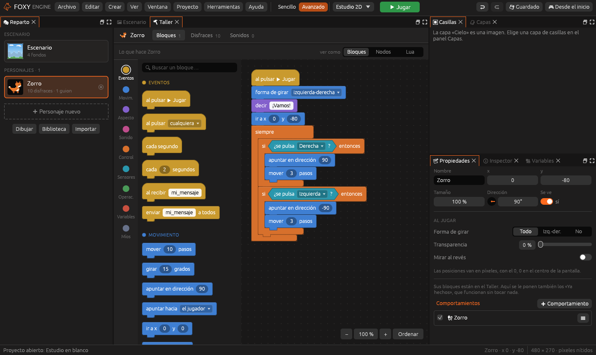
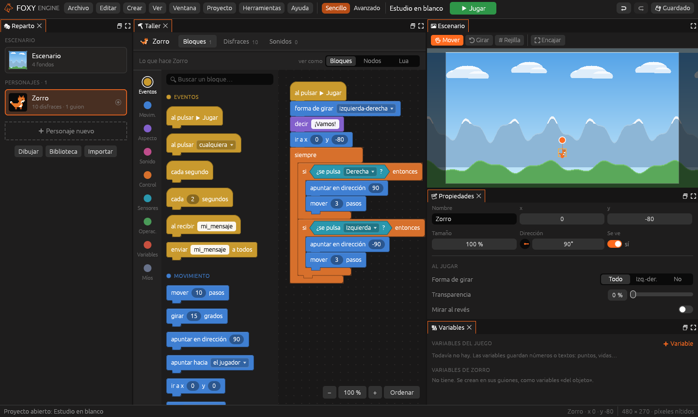
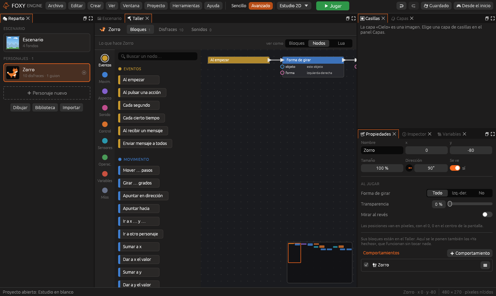
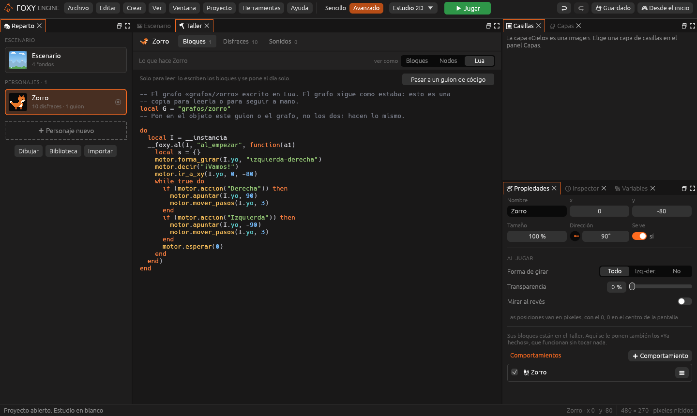

# Programar con bloques

En el Estudio 2D, lo que hace cada personaje se programa con **bloques**:
piezas de colores que se arrastran y encajan unas debajo de otras, sin
cables. Están en la pestaña **Bloques** del **Taller**.

Los bloques no son un sistema aparte: son otra forma de ver los
[nodos](nodos.md). Lo que hagas con bloques se puede ver como nodos o como
Lua en cualquier momento, y al revés.

## Las partes del panel

| Parte | Qué hay |
|---|---|
| **Familias** | La columna de círculos de colores. Al pulsar una, la paleta salta a sus bloques. |
| **Paleta** | Todos los bloques, por familias, y un buscador arriba. |
| **Lienzo** | Donde se juntan los bloques del personaje. Se mueve arrastrando el fondo. |
| **ver como** | Arriba a la derecha: **Bloques**, **Nodos** o **Lua**. |
| **Zoom y Ordenar** | Abajo a la derecha: alejar, el tanto por ciento (vuelve al 100 %), acercar y **Ordenar**, que pone los guiones en una columna. |

Con el **escenario** elegido en el reparto, el panel enseña los bloques del
juego entero (lo que no es de ningún personaje).

## Las familias

| Familia | Color | Para qué |
|---|---|---|
| **Eventos** | amarillo | Cuándo empieza un guion: al pulsar Jugar, al pulsar una tecla, cada cierto tiempo, al recibir un mensaje. |
| **Movimiento** | azul | Mover, girar, ir a un punto, apuntar hacia otro personaje. |
| **Aspecto** | morado | Decir algo, cambiar de disfraz, de tamaño o de transparencia, esconderse y mostrarse. |
| **Sonido** | rosa | Tocar sonidos. |
| **Control** | naranja | Esperar, repetir, siempre, si… entonces. |
| **Sensores** | turquesa | Preguntas como «¿se pulsa Derecha?» y el tiempo que se lleva jugando. |
| **Operaciones** | verde | Cuentas, comparaciones, azar y textos. |
| **Variables** | rojo | Leer y cambiar variables y listas. **Crear una variable** abre una ventana para darle nombre y elegir si es para todos o solo para este personaje. |
| **Mis bloques** | gris azulado | Las funciones hechas con nodos y los nodos escritos en Lua del proyecto. |

Cada nodo nuevo lleva también el color de su familia en el panel Nodos.

## Las formas de los bloques

- **Sombrero** (redondeado arriba): un evento. Empieza un guion y no se
  puede poner nada encima.
- **Pieza**: una orden. Encaja debajo de otra.
- **Abrazo** (forma de C): «siempre», «repetir», «si… entonces». Lo que
  va dentro se repite o se hace solo si se cumple la condición.
- **Valor** (ovalado): un número o un texto, como `x` o `3 + 4`.
- **Pregunta** (con puntas): algo que es sí o no, como «¿se pulsa
  Derecha?».

## Usar los bloques

- **Poner un bloque**: arrástralo de la paleta al lienzo. Mientras lo
  arrastras, una raya blanca enseña dónde va a encajar.
- **Encajar**: suéltalo cerca de la parte de abajo de otro bloque, o dentro
  de un abrazo. Un valor o una pregunta encaja en un **hueco** (el hueco
  se marca con un borde blanco).
- **Mover**: al arrastrar un bloque se lleva consigo los que tiene debajo.
- **Escribir en un hueco**: haz clic en él y escribe. Los huecos con
  flecha (como la tecla o la forma de girar) abren una lista.
- **Borrar**: arrastra el bloque de vuelta a la paleta, o pulsa
  <kbd>Supr</kbd> con él elegido.
- **Clic derecho** en un bloque: **Duplicar**, **Copiar**, **Borrar este
  bloque** o **Borrar con lo de debajo**.
- **Atajos**: <kbd>Cmd</kbd>+<kbd>Z</kbd> deshace, <kbd>Mayús</kbd>+<kbd>Cmd</kbd>+<kbd>Z</kbd>
  rehace, <kbd>Cmd</kbd>+<kbd>C</kbd> copia, <kbd>Cmd</kbd>+<kbd>V</kbd> pega y
  <kbd>Cmd</kbd>+<kbd>D</kbd> duplica (en Windows y Linux, <kbd>Ctrl</kbd>).

Todo se guarda solo. Un personaje que todavía no tenía guion recibe uno
nuevo con el primer bloque que le pongas.

## Ejemplo: el zorro anda con las flechas

1. Crea un proyecto con la plantilla **Estudio en blanco** y elige el zorro
   en el reparto.
2. En **Eventos**, arrastra **al pulsar ▶ Jugar** al lienzo.
3. En **Aspecto**, encaja debajo **decir** y escribe `¡Vamos!`.
4. En **Movimiento**, encaja **forma de girar** y elige
   `izquierda-derecha`, para que se dé la vuelta sin ponerse boca abajo.
5. En **Control**, encaja **siempre**.
6. Dentro de **siempre**, pon un **si … entonces**. En su hueco, encaja
   **¿se pulsa …?** de **Sensores** y elige `Derecha`. Dentro del **si**,
   pon **apuntar en dirección** `90` y **mover** `3` **pasos**.
7. Haz lo mismo con otro **si** para `Izquierda`, con dirección `-90`.
8. Pulsa **Jugar** y mueve el zorro con las flechas.

## Píxeles, grados y fotogramas

- Los bloques de **Movimiento** van en **píxeles**, con el 0, 0 en el
  centro de la pantalla y la y hacia arriba, como en
  [el Estudio](estudio-2d.md#coordenadas-en-píxeles).
- La **dirección** va en grados: 90 a la derecha, -90 a la izquierda, 0
  arriba y 180 abajo.
- **siempre**, **repetir hasta que** y **esperar hasta que** dan una vuelta
  en cada fotograma, así que no paran el juego. **repetir** y **repetir
  mientras** también, cuando están puestos así desde la paleta de bloques.

## Ver como nodos o como Lua

- **Nodos** enseña el mismo guion con nodos y cables. Lo que cambies ahí
  se ve después en los bloques. Si algo no se puede enseñar como bloques
  (por ejemplo, un valor que va a dos sitios), sale en gris, «hecho con
  nodos», y se cambia en esta vista.
- **Lua** enseña el código que hacen los bloques, solo para leerlo. **Pasar
  a un guion de código** hace una copia que ya se puede cambiar a mano.

## Programar siempre con nodos

Si prefieres los nodos, abre **Preferencias** y, en **Programar en el
Estudio 2D con**, elige **Nodos**. La pestaña del Taller pasa a llamarse
**Nodos** y enseña siempre nodos con cables.

## Los «Ya hechos»

Los comportamientos **Ya hechos** (y los guiones de código) de un personaje
están en **Propiedades**, en la sección **Comportamientos**. Funcionan junto
con sus bloques.
