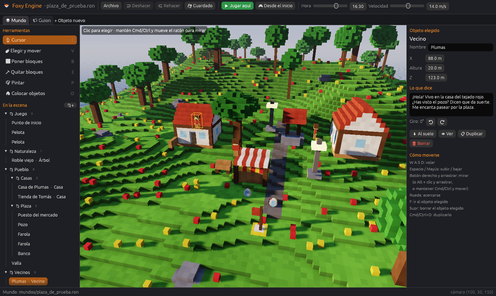

# Ordenar la escena

Al panel de la izquierda, debajo de las herramientas, está la **escena**: la
lista de todo lo que hay en el mundo. Cuando un mundo crece, esa lista se
ordena en **carpetas**, como los archivos de tu ordenador.



## Crear carpetas

- **📁+** crea una carpeta nueva.
- **Clic derecho** en una carpeta → **📁 Subcarpeta nueva** crea una dentro.
- En el mismo menú están **✏ Renombrar** y **🗑 Borrar carpeta**. Borrar una
  carpeta **no borra sus objetos**: pasan a la carpeta de arriba.

## Meter objetos en carpetas

- **Arrastra** un objeto de la lista hasta una carpeta.
- O haz **clic derecho** en el objeto → **📁 Mover a** y elige la carpeta (o
  *En una carpeta nueva*).

Un clic en un objeto de la lista lo elige en el mundo. **👁 Ver** lleva la
cámara hasta él.

## Cómo se guardan

Las carpetas se guardan dentro del mundo. Las subcarpetas se escriben con `/`:

```ron
carpetas: [
    "Pueblo",
    "Pueblo/Casas",
    "Vecinos",
],
objetos: [
    (tipo: "casa", nombre: "Casa de Plumas", pos: (86.0, 16.0, 118.0), giro: 0, carpeta: "Pueblo/Casas"),
],
```

> **Consejo.** Una carpeta *Juego* para el punto de inicio, las entradas, las
> zonas y las pelotas, y otra por cada barrio o zona del mapa, hacen que un
> mundo grande sea fácil de recorrer.
