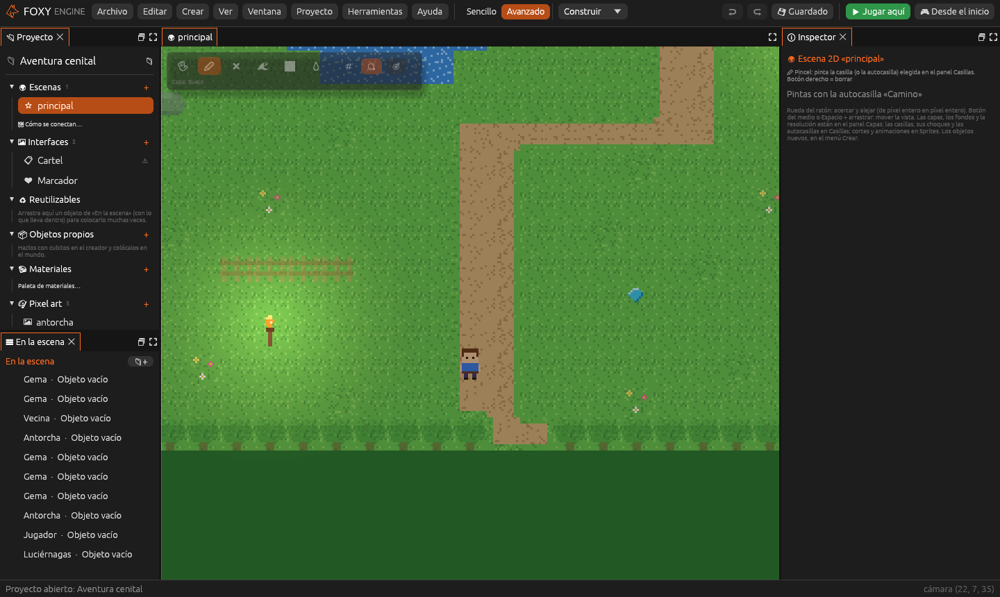
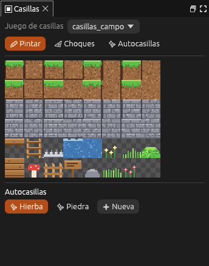
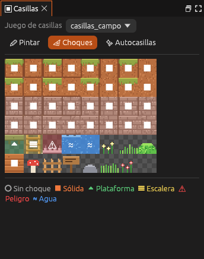
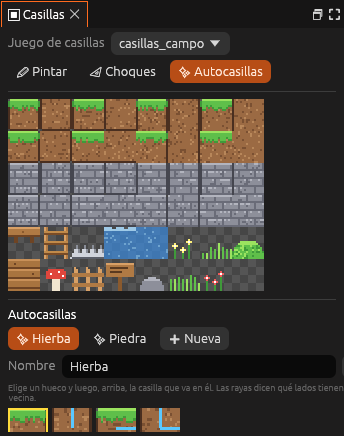
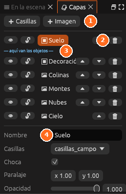

# Mapas de casillas

Un mapa de casillas es una rejilla de pequeñas imágenes iguales (las
**casillas**) con las que se dibuja el nivel: suelo, paredes, escaleras,
agua, decoración. Las casillas salen de un **juego de casillas**, una imagen
con todas ellas, y se pintan en las **capas** de la escena.



## Juegos de casillas

Un juego de casillas es una imagen de `imagenes/` marcada como **Juego de
casillas** en el panel [Sprites](sprites.md). Sus ajustes son el **lado**
de cada casilla en píxeles, el **margen** de alrededor y la **separación**
entre casillas. Las casillas se numeran desde 0, de izquierda a derecha y
de arriba abajo.

Para hacer uno nuevo, dibuja la imagen en [Pixel art](pixel-art.md) con la
rejilla del tamaño de la casilla y márcala como **Juego de casillas**.

## El panel Casillas



Arriba se elige el **Juego de casillas** de la capa activa. Debajo, tres
modos:

| Modo | Qué hace un clic en una casilla |
|---|---|
| **Pintar** | La elige para pintar con el **Pincel**, el **Relleno** o el **Rectángulo** |
| **Choques** | Cambia cómo choca (ver abajo) |
| **Autocasillas** | Elige la casilla para el hueco de la autocasilla que se edita |

## Pintar

1. En el panel **Capas**, elige la capa en la que quieres pintar.
2. En el panel **Casillas**, en el modo **Pintar**, haz clic en una casilla.
3. En la vista, elige el **Pincel** y pinta con el botón izquierdo. El
   derecho borra.

| Herramienta | Para qué |
|---|---|
| **Pincel** | Casilla a casilla |
| **Rectángulo** | Llenar (o vaciar, con el botón derecho) un rectángulo |
| **Relleno** | Llenar un hueco entero, hasta donde cambian las casillas |
| **Goma** | Borrar |
| **Cuentagotas** | Coger la casilla que ya hay en el mapa |

Cada trazo se deshace con <kbd>Cmd</kbd>/<kbd>Ctrl</kbd>+<kbd>Z</kbd>.

## Choques

En el modo **Choques**, cada casilla muestra cómo choca. Un clic pasa al
siguiente tipo.



| Choque | Qué pasa |
|---|---|
| **Sin choque** | Se atraviesa. Para la decoración |
| **Sólida** | Pared y suelo. Es lo normal |
| **Plataforma** | Se sube desde abajo y se pisa desde arriba. **Abajo** + **Saltar** la atraviesa |
| **Escalera** | Se trepa con **Arriba** y **Abajo** |
| **Peligro** | Hace daño: el jugador vuelve al último sitio seguro |
| **Agua** | Se nada, despacio y flotando |

Solo chocan las casillas de las capas con **Choca** marcado.

## Autocasillas

Una autocasilla es un terreno que pone solo sus bordes y esquinas. Al
pintar con ella, el motor mira las cuatro casillas vecinas y elige la pieza
que toca: el borde con hierba arriba, la esquina, el centro… Al borrar,
arregla también las de alrededor.



### Pintar con una autocasilla

1. En el panel **Casillas**, debajo de las casillas, haz clic en la
   autocasilla (por ejemplo, **Hierba**).
2. Pinta en la vista con el **Pincel**, el **Rectángulo** o el **Relleno**.

### Crear una autocasilla

1. Pulsa **Nueva**.
2. Escribe su **Nombre**.
3. Abajo salen los 16 huecos, uno por cada forma de tener vecinas. Las
   rayas azules dicen qué lados tienen vecina.
4. Haz clic en un hueco y luego, arriba, en la casilla que va en él.
5. Repite con los demás huecos.

> <i class="fx fx-consejo"></i> **Consejo.** Empieza por el hueco sin rayas
> (una casilla sola) y por el de las cuatro rayas (el centro del terreno).
> Con esos dos ya se puede pintar; los bordes se afinan después.

## Capas

Las capas se dibujan una encima de otra, de la de atrás a la de delante.
Cada una es de **casillas** o de **imagen** (un fondo como el cielo o unas
montañas).



| Botón | Qué hace |
|---|---|
| **Casillas** / **Imagen** | Añade una capa de ese tipo |
| <i class="fx fx-ver"></i> | Muestra u oculta la capa, en el editor y en el juego |
| Candado | Con candado no se pinta en ella |
| Flechas | La pone más atrás o más delante |
| <i class="fx fx-borrar"></i> | Borra la capa |

La línea **aquí van los objetos** marca dónde se dibujan los personajes y
los objetos: las capas de encima los tapan.

Al elegir una capa se ven sus ajustes:

| Ajuste | Qué hace |
|---|---|
| **Nombre** | Cómo se llama. Los guiones la nombran así |
| **Casillas** o **Imagen** | El juego de casillas o la imagen que dibuja |
| **Repetir** | Repite la imagen a lo ancho, a lo alto o en los dos sentidos |
| **Posición** | Dónde está, en casillas |
| **Paralaje** | Cuánto se mueve con la cámara: 0 se queda quieta (el cielo), 1 va con la escena y menos de 1 da sensación de lejanía |
| **Opacidad** | De transparente a opaca |
| **Choca** | Sus casillas chocan con el jugador y con los cuerpos |
| **Objetos encima** | Los objetos se dibujan justo encima de esta capa |

Debajo, el apartado **Escena 2D** tiene los
[ajustes de la escena](juegos-2d.md#la-escena-2d).

> <i class="fx fx-consejo"></i> **Consejo.** Para un fondo con
> profundidad, usa varias capas de imagen con paralaje distinto: el cielo a
> 0, las montañas a 0,2 y las colinas a 0,5.

## En el archivo de la escena

Cada capa de casillas guarda su mapa como texto, fila a fila de arriba
abajo. Cada número es una casilla del juego de casillas y `.` es un hueco:

```ron
mapa: (
    origen: (1, 1),
    filas: [
        " .  . 37  .",
        " 0  1  1  2",
    ],
),
```

`origen` es la casilla de abajo a la izquierda del mapa.

## Véase también

- [Juegos 2D](juegos-2d.md)
- [Sprites](sprites.md)
- [Pixel art](pixel-art.md)
- [Archivos del proyecto](../referencia/archivos.md)
