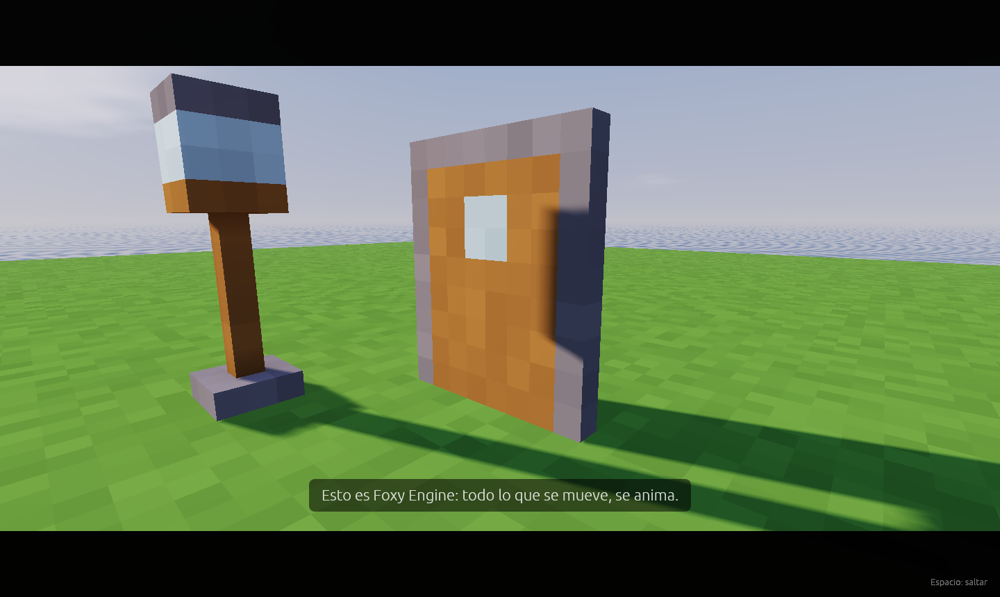
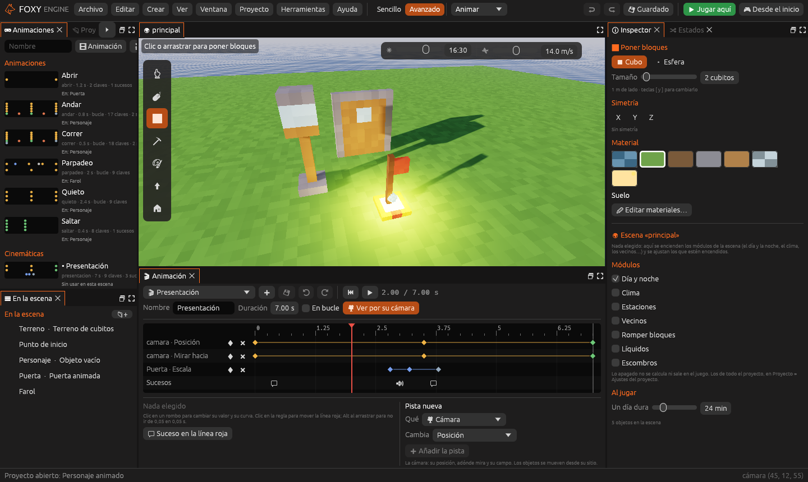

# Cinemáticas

Una cinemática es una escena corta que el jugador mira sin manejar: la
cámara se mueve sola, los objetos se mueven y salen frases abajo de la
pantalla. Sirve para presentar un lugar, enseñar que se abrió una puerta
lejana o contar un trozo de historia.



Mientras dura, la pantalla tiene **bandas negras** arriba y abajo, el
marcador se esconde y el jugador no se mueve. Con <kbd>Espacio</kbd> (o
<kbd>E</kbd>) se salta.

## Crear una cinemática

Una cinemática es una animación de la escena entera. Se hace en el mismo
panel [Animación](../interfaz/animacion.md):



1. En el panel **Animación**, pulsa <i class="fx fx-mas"></i> y luego
   **Cinemática nueva**, o escribe un nombre en el panel **Animaciones** y
   pulsa **Cinemática**.
2. En **Pista nueva**, elige **Cámara** en **Qué** y **Posición** en
   **Cambia**. Añade otra pista de la cámara con **Mirar hacia**.
3. Coloca la Vista donde quieras la cámara en un momento, mueve la línea
   roja a ese segundo, pon una clave y pulsa **Desde la cámara del
   editor**. Repite para cada plano.
4. Para mover un objeto, elígela en **Qué** por su nombre. Sus valores
   van desde su sitio en el editor, igual que en una animación.
5. Añade frases con sucesos de tipo **Diálogo**: el texto y los segundos
   que se ve.
6. Activa **Ver por su cámara** y pulsa <i class="fx fx-jugar"></i> para
   verla en la Vista.
7. Pulsa <i class="fx fx-guardar"></i>. Se guarda como
   `cinematicas/<nombre>.ron`.

| Pista de la cámara | Qué hace |
|---|---|
| **Posición** | Dónde está la cámara, en metros de la escena |
| **Mirar hacia** | El punto al que mira |
| **Giro** | Hacia dónde mira, en grados, si no hay **Mirar hacia** |
| **Campo de visión** | Lo abierta que es: menos grados acerca, más grados aleja |

> <i class="fx fx-consejo"></i> **Consejo.** La curva **Suave** da planos
> tranquilos, como de película. **Frenar** en la última clave hace que la
> cámara llegue despacio a su sitio.

## Ponerla en el juego

| Cómo | Qué hacer |
|---|---|
| Con una acción | En una zona, un botón o un objeto, la acción **Poner una cinemática** y su nombre |
| Con nodos | El nodo [Poner una cinemática](../referencia/nodos.md#motor-cinematica) |
| Con Lua | `motor.cinematica("presentacion")` |

Para hacer algo cuando acaba (o cuando el jugador la salta), usa el evento
[Al terminar una cinemática](../referencia/nodos.md#evento-al_terminar_cinematica)
o, en Lua:

```lua
function al_terminar_cinematica(nombre)
  if nombre == "presentacion" then
    motor.decir("¡A jugar!")
  end
end
```

`motor.terminar_cinematica()` la corta antes de tiempo.

## Ejemplo: la presentación de la plantilla

La plantilla **Personaje animado** empieza con la cinemática
**Presentación**, de 7 segundos:

1. La cámara baja desde lo alto hasta la puerta mientras sale la primera
   frase.
2. Hacia los 3 s suena una campana y la puerta da un pequeño salto, con la
   curva **Rebote**.
3. La segunda frase explica los controles y la cámara llega detrás del
   personaje. Al acabar, el juego empieza.

El guion del mundo la pone al empezar y saluda al acabar:

```lua
function al_empezar()
  motor.cinematica("presentacion")
end

function al_terminar_cinematica(nombre)
  motor.decir("¡A jugar!")
end
```

## Véase también

- [Animación](animacion.md)
- [Panel Animación](../interfaz/animacion.md)
- [Acciones](../referencia/acciones.md)
