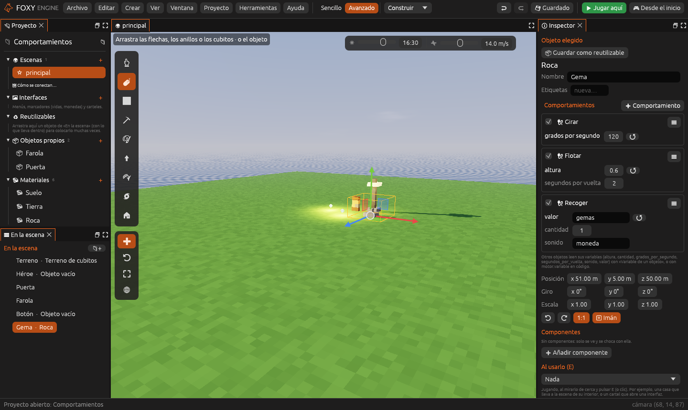
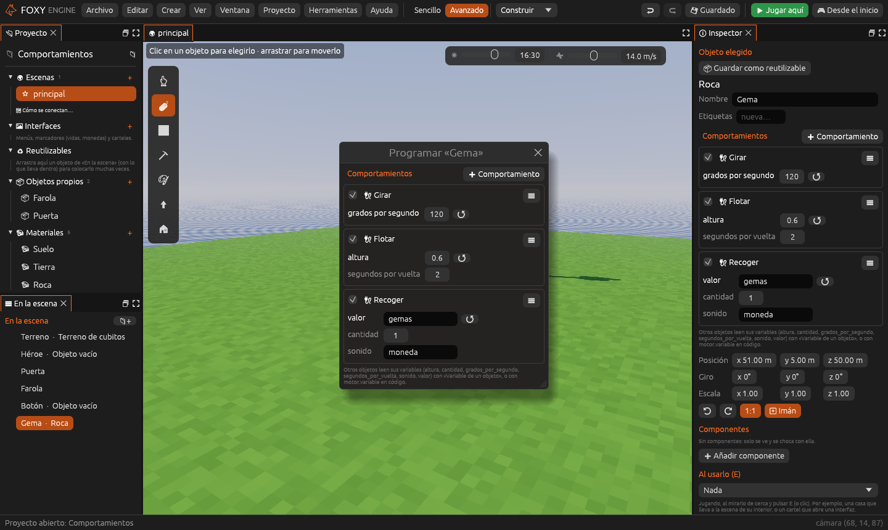
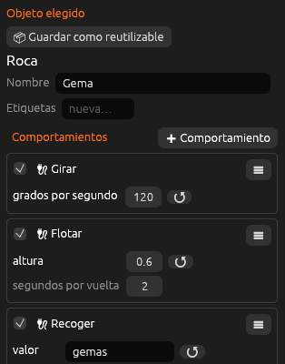
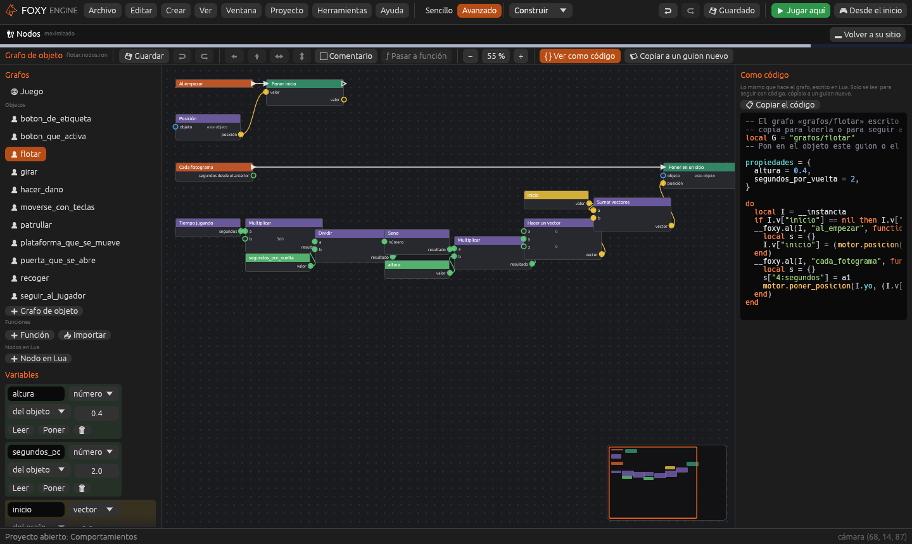

# Comportamientos

Un **comportamiento** es algo que hace un objeto: girar, perseguir al
jugador, abrirse como una puerta, sumar una moneda al tocarlo… Cada objeto
de la escena puede llevar **varios a la vez**, y cada uno tiene sus propios
valores.

Un comportamiento puede estar hecho de tres formas:

| Forma | Qué es | Dónde se guarda |
|---|---|---|
| 🔌 **Nodos** | Un grafo de cajas y cables, sin escribir código. Ver [Nodos](nodos.md) | `grafos/<nombre>.nodos.ron` |
| 📜 **Código** | Un guion Lua. Ver [Guiones de entidad](guiones-entidad.md) | `guiones/<nombre>.lua` |
| ⭐ **Ya hecho** | Uno de los diez grafos que trae el motor, listo para usar y para cambiar | `grafos/<nombre>.nodos.ron` |

Los tres funcionan igual en el juego y se pueden mezclar en el mismo
objeto: una gema puede **girar** y **flotar** con dos comportamientos ya
hechos y, además, llevar un guion propio.

## Darle un comportamiento a un objeto

1. Elige el objeto con <i class="fx fx-cursor"></i> **Elegir**, en la Vista
   o en el panel **En la escena**.
2. En el [Inspector](../interfaz/inspector.md), justo debajo del nombre,
   está la sección **Comportamientos**. Pulsa **➕ Comportamiento** y elige:
   - **🔌 Nodos nuevos**: crea un grafo vacío para el objeto y lo abre en
     el panel [Nodos](../interfaz/nodos.md).
   - **📜 Código nuevo**: crea un guion a partir de una plantilla (vacía,
     enemigo, moneda…) y lo abre en el panel [Código](../interfaz/codigo.md).
   - **⭐ Ya hechos**: uno de la [biblioteca](#los-comportamientos-ya-hechos).
   - **📂 Del proyecto**: un grafo o un guion que ya tienes, por ejemplo el
     de otro enemigo.
3. Ajusta sus valores en el inspector. El botón **↺** de cada valor lo
   devuelve al de serie.
4. Pulsa <i class="fx fx-jugar"></i> **Jugar aquí** para probarlo.

> <i class="fx fx-consejo"></i> **Consejo.** También puedes hacer clic
> derecho en un objeto, en la Vista o en **En la escena**, y elegir
> **✏ Programar este objeto**. Se abre una ventana con sus comportamientos,
> sin tener que buscar el inspector.

## Cada comportamiento en el inspector

Cada comportamiento ocupa un recuadro con:

| Elemento | Para qué sirve |
|---|---|
| **Casilla** | Lo enciende o lo apaga. Apagado, se queda guardado en el objeto pero no hace nada al jugar |
| **Nombre** | Sale del nombre del archivo. **Doble clic** lo abre en Nodos o en Código |
| **☰** | Abrir, **⬆ Subir** y **⬇ Bajar** (el orden en que se ponen en marcha) y **🗑 Quitar del objeto**. Quitar no borra el archivo del proyecto |
| **Valores** | Lo que se puede ajustar en cada objeto: la velocidad, la altura… Dos objetos con el mismo comportamiento pueden tener valores distintos |

Si el archivo de un comportamiento ya no existe, el recuadro avisa con
**⚠ No está …** y el objeto sigue funcionando con los demás.

### De dónde salen los valores

- En un **grafo**, son sus [variables](nodos.md#variables) de la clase
  **de la entidad**.
- En un **guion**, son las de su tabla
  [`propiedades`](guiones-entidad.md#propiedades).

Los comportamientos de un mismo objeto **comparten** esas variables: si
«Patrullar» y un guion tuyo usan los dos `velocidad`, es la misma.

### En los prefabricados

Los comportamientos se guardan también en los
[prefabricados](entidades.md#prefabricados). Cada copia los hereda y puede
cambiar sus valores o encender y apagar alguno; **↺ Como el original**, en
el menú **☰**, deshace ese cambio. **💾 Guardar en el original** pasa los
cambios de la copia al prefabricado.

## Los comportamientos ya hechos

Están hechos con nodos, así que se pueden abrir y cambiar como cualquier
grafo. Al añadir uno se copia a `grafos/` del proyecto (si no estaba ya).

| Comportamiento | Qué hace | Valores |
|---|---|---|
| ⌨ **Moverse con teclas** | Se mueve con las acciones Adelante, Atrás, Izquierda y Derecha. Con `vertical`, Adelante sube (2D visto desde arriba) | `velocidad`, `vertical` |
| 🐾 **Seguir al jugador** | Va hacia el jugador cuando está a menos de `alcance` y se para a `distancia` de él | `velocidad`, `distancia`, `alcance` |
| ↔ **Patrullar** | Va y viene entre su sitio y su sitio más `recorrido` | `recorrido`, `velocidad` |
| ⟳ **Girar** | Da vueltas sobre sí mismo | `grados_por_segundo` |
| 🎈 **Flotar** | Sube y baja despacio | `altura`, `segundos_por_vuelta` |
| 🪙 **Recoger** | Al tocarlo el jugador, suma `cantidad` al valor `valor` (monedas, gemas…), suena y desaparece | `valor`, `cantidad`, `sonido` |
| 💥 **Hacer daño** | Hace daño al jugador cada vez que lo toca | `cantidad` |
| 🚪 **Puerta que se abre** | Se abre al acercarse el jugador y se cierra al irse. Con `con_boton`, solo la abre un botón | `apertura`, `distancia`, `segundos`, `con_boton` |
| ⬍ **Plataforma que se mueve** | Va y vuelve sin parar, con una pausa en cada punta | `recorrido`, `segundos`, `pausa` |
| 🔘 **Botón que activa algo** | Al tocarlo se hunde, suena y manda el evento **activar** al objeto que se llama como `objetivo` | `objetivo`, `sonido` |

### Ejemplo: un botón que abre una puerta

1. Coloca una **Puerta** y llámala «Puerta».
2. Dale el comportamiento ya hecho **Puerta que se abre** y marca
   `con_boton`.
3. Coloca un objeto pequeño para el botón y dale **Botón que activa algo**.
   En `objetivo` escribe `Puerta`.
4. Juega y toca el botón: la puerta se abre y, al tocarlo otra vez, se
   cierra.

La puerta escucha el mensaje con el nodo **Al recibir un mensaje**, así que
cualquier grafo o guion tuyo puede abrirla también mandándole «activar».

## Ver un grafo como código

Un grafo **nunca se pierde** al pasar a código:

- **{ } Ver como código**, en la barra del panel Nodos, enseña al lado del
  grafo el Lua que hace lo mismo, con colores y un botón **📋 Copiar el
  código**. Solo se lee: el grafo sigue siendo el que manda.
- **📜 Copiar a un guion nuevo** (en los grafos de objeto) escribe ese
  código en un guion nuevo de `guiones/` y lo abre en Código. Si el objeto
  elegido usaba el grafo, el grafo se **apaga** en él y el guion se añade con
  los mismos valores. El grafo se queda en el proyecto por si quieres
  volver.

Ver [Depurar y ver como código](nodos-depurar.md#ver-como-código).

## Proyectos de versiones anteriores

Antes, un objeto tenía como mucho un componente **Guion** y un componente
**Grafo de nodos**. Al abrir un proyecto antiguo, el motor:

1. Hace una **copia de seguridad** en `.foxy/copias/`.
2. Convierte esos componentes en comportamientos, con los mismos archivos y
   valores. Si el guion del mundo tenía funciones *al empezar* o *cada
   segundo* para un objeto, pasan a un comportamiento
   `guiones/llamar_al_mundo.lua` que las sigue llamando.
3. Guarda las escenas y los prefabricados ya con la forma nueva y avisa en
   la barra de estado.

No hay que hacer nada más: el juego funciona igual que antes.

## Ver también

- [Nodos](nodos.md)
- [Guiones de entidad](guiones-entidad.md)
- [Entidades y componentes](entidades.md)
- [Eventos y flujo](nodos-flujo.md)
