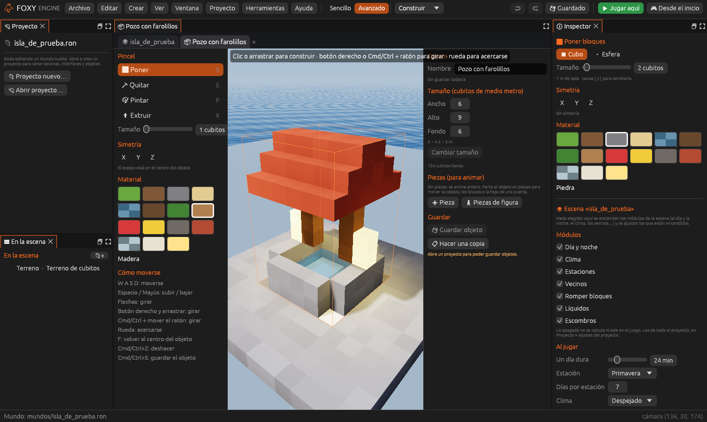

# Crear objetos propios

Además de las casas, árboles y farolas que trae el motor, puedes hacer tus
**propios objetos** de bloques: un farolillo, un barco, una estatua del zorro…
Se modelan una vez y se colocan en cualquier mundo del proyecto tantas veces
como quieras.



## Abrir el creador

- El <i class="fx fx-mas"></i> de <i class="fx fx-objeto"></i> **Objetos
  propios**, en el panel «Proyecto», o **Crear → Objeto nuevo**, abren una
  pestaña con un objeto vacío (empieza con una peana de madera de 3 × 3 m para
  tener algo que tocar).
- Un clic en un objeto de la lista **Objetos propios** lo abre para editarlo.
- Con uno de tus objetos elegido en la escena,
  <i class="fx fx-editar"></i> **Editar este objeto** lo abre en el creador.
- Con un objeto del motor elegido en la escena,
  <i class="fx fx-editar"></i> **Hacer una versión propia** lo copia al
  creador para cambiarlo.

Cada objeto abierto tiene su propia pestaña, así que puedes tener varios a la
vez.

## Trabajar en el creador

En la pestaña solo se ve el objeto, sobre una **peana a cuadros de 1 m** (la
peana no es parte del objeto), y sus opciones:

| Opción | Qué hace |
|---|---|
| **Nombre** | El que se ve en *Mis objetos* |
| **Tamaño** | Ancho, alto y fondo de la caja del objeto, hasta 64 cubitos (32 m) por lado |
| **Pincel** | Poner, quitar, pintar o [extruir](mundo.md#extruir), igual que en el mundo |
| <i class="fx fx-simetria"></i> **Simetría** | X, Y y Z. El espejo está siempre en el centro del objeto: ideal para personajes, barcos o muebles |
| **Material** | Cualquier material del motor |
| <i class="fx fx-guardar"></i> **Guardar objeto** | <kbd>Cmd</kbd>/<kbd>Ctrl</kbd>+<kbd>S</kbd> |
| <i class="fx fx-colocar"></i> **Colocarlo en el mundo** | Vuelve a la escena con este objeto listo para colocar |
| <i class="fx fx-duplicar"></i> **Hacer una copia** | Abre un objeto nuevo igual, para hacer variantes |

La vista se gira con el **botón derecho** o con <kbd>Cmd</kbd>/<kbd>Ctrl</kbd>
+ ratón, y la rueda acerca y aleja. <kbd>Cmd</kbd>/<kbd>Ctrl</kbd>+<kbd>Z</kbd>
deshace.

> <i class="fx fx-consejo"></i> **Consejo.** Si ya tienes modelos hechos en
> MagicaVoxel o Qubicle, [impórtalos](importar.md) y sigue trabajándolos
> aquí.

## Piezas para animar

La sección **Piezas (para animar)** parte el objeto en cajas que se mueven
por separado, como la cabeza y los brazos de un personaje o la hoja de una
puerta. Se explica en [Personajes por piezas](personajes-piezas.md).

## Cambios en vivo

Cuando guardas un objeto, **todas las copias que ya estaban colocadas en el
mundo se actualizan** solas. Si mejoras tu farolillo, se mejoran todos los
farolillos de la isla.

Los objetos guardados salen en el panel «Proyecto» y en el inspector de
*Colocar objetos → Mis objetos*. Una vez colocados, pueden hacer algo
[al usarlos](mundo.md#al-usarlo-e): abrir una tienda, llevar a otra escena…

## Cómo se guarda

Cada objeto es un archivo en `objetos/`, por ejemplo `objetos/farolillo.ron`.
Su formato está en [Archivos del proyecto](../referencia/archivos.md#objetos-propios).
En el mundo se colocan con su nombre de archivo como `tipo`:

```ron
(tipo: "farolillo", nombre: "", pos: (98.0, 16.0, 120.0)),
```

> <i class="fx fx-aviso"></i> **Importante.** Si borras el archivo de un objeto que está colocado en un
> mundo, el editor avisa abajo: «el motor no conoce estos objetos».
