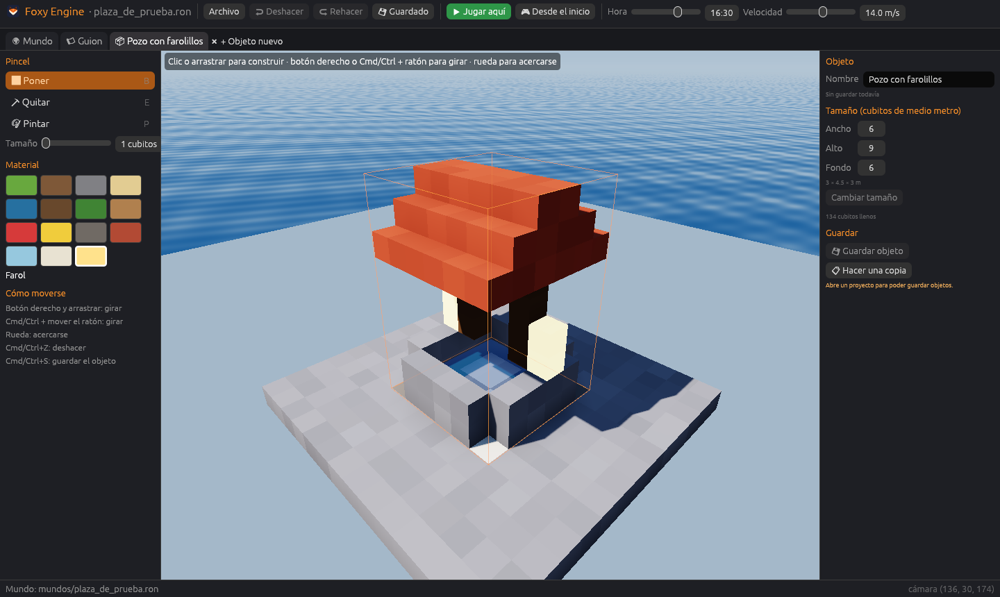

# Crear objetos propios

Además de las casas, árboles y farolas que trae el motor, puedes hacer tus
**propios objetos** de bloques: un farolillo, un barco, una estatua del zorro…
Se modelan una vez y se colocan en cualquier mundo del proyecto tantas veces
como quieras.



## Abrir el creador

- **+ Objeto nuevo** abre una pestaña 📦 con un objeto vacío (empieza con
  una peana de madera de 3 × 3 m para tener algo que tocar).
- En *Colocar objetos → Mis objetos*, el **✏** de un objeto lo abre para
  editarlo.
- Con un objeto del motor elegido en el mundo, **Hacer una versión propia**
  lo copia al creador para cambiarlo.

Cada objeto abierto tiene su propia pestaña, así que puedes tener varios a la
vez.

## Trabajar en el creador

En la pestaña solo se ve el objeto, sobre una **peana a cuadros de 1 m** (la
peana no es parte del objeto), y sus opciones:

| Opción | Qué hace |
|---|---|
| **Nombre** | El que se ve en *Mis objetos* |
| **Tamaño** | Ancho, alto y fondo de la caja del objeto, hasta 16 m por lado |
| **Pincel** | Poner, quitar o pintar, igual que en el mundo |
| **Material** | Cualquier material del motor |
| **Guardar objeto** | <kbd>Cmd</kbd>/<kbd>Ctrl</kbd>+<kbd>S</kbd> |
| **Colocarlo en el mundo** | Vuelve al mundo con este objeto listo para colocar |
| **Hacer una copia** | Abre un objeto nuevo igual, para hacer variantes |

La vista se gira con el **botón derecho** o con <kbd>Cmd</kbd>/<kbd>Ctrl</kbd>
+ ratón, y la rueda acerca y aleja. <kbd>Cmd</kbd>/<kbd>Ctrl</kbd>+<kbd>Z</kbd>
deshace.

## Cambios en vivo

Cuando guardas un objeto, **todas las copias que ya estaban colocadas en el
mundo se actualizan** solas. Si mejoras tu farolillo, se mejoran todos los
farolillos de la isla.

## Cómo se guarda

Cada objeto es un archivo en `objetos/`, por ejemplo `objetos/farolillo.ron`.
Su formato está en [Archivos del proyecto](../referencia/archivos.md#objetos-propios).
En el mundo se colocan con su nombre de archivo como `tipo`:

```ron
(tipo: "farolillo", nombre: "", pos: (98.0, 16.0, 120.0), giro: 0),
```

> **Atención.** Si borras el archivo de un objeto que está colocado en un
> mundo, el editor avisa abajo: «el motor no conoce estos objetos».
