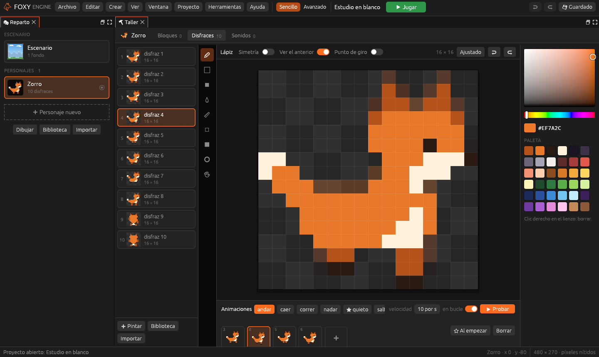
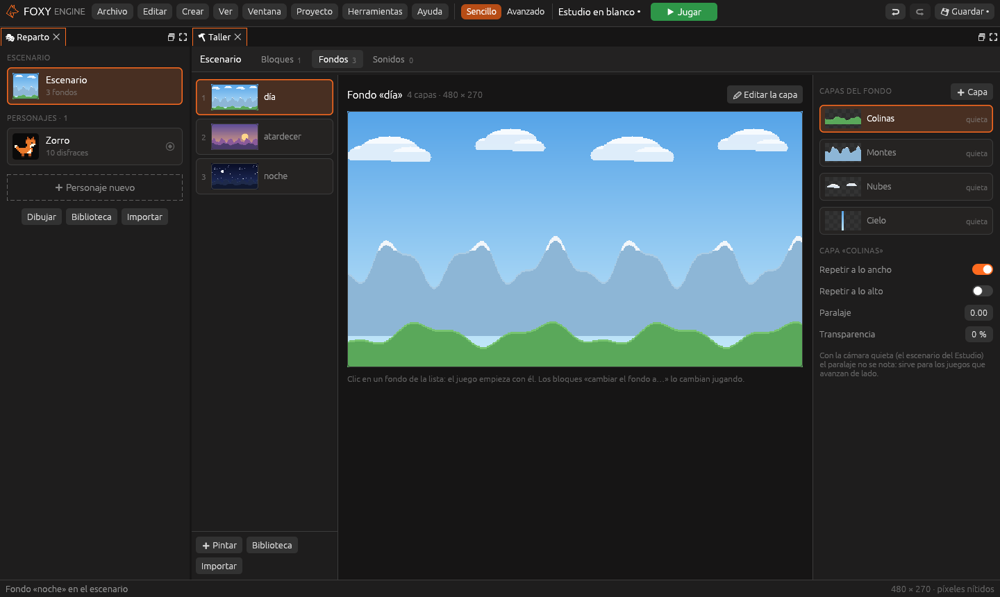
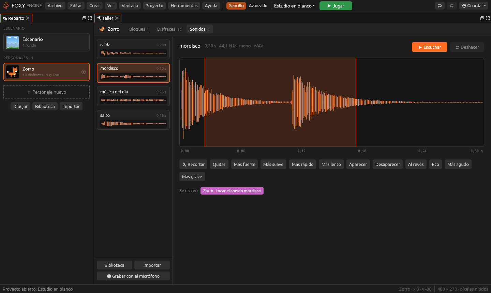
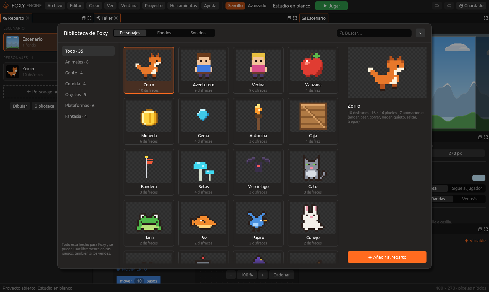
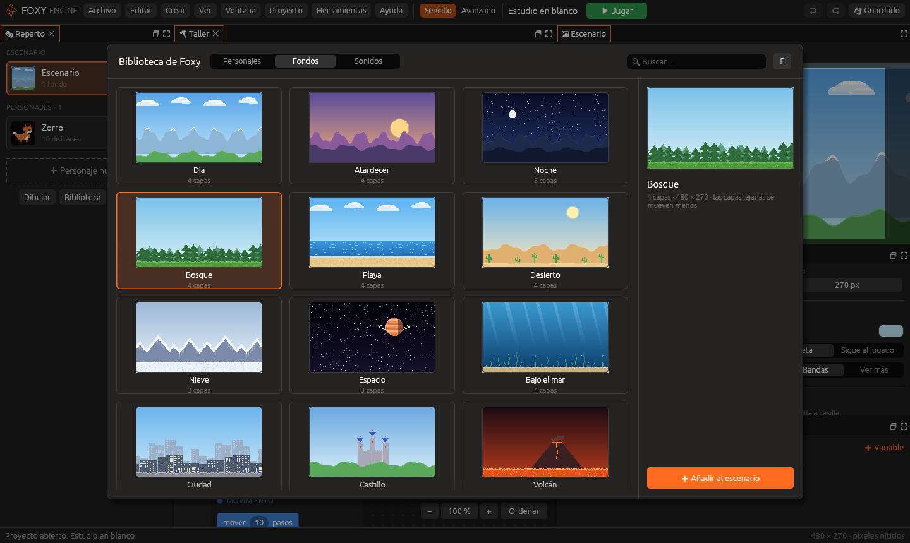
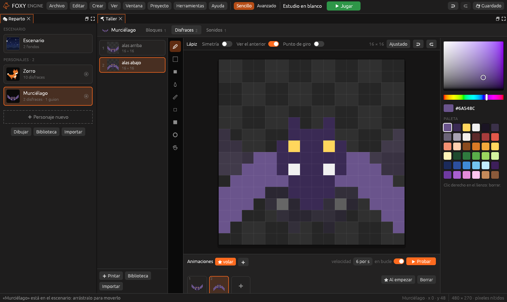
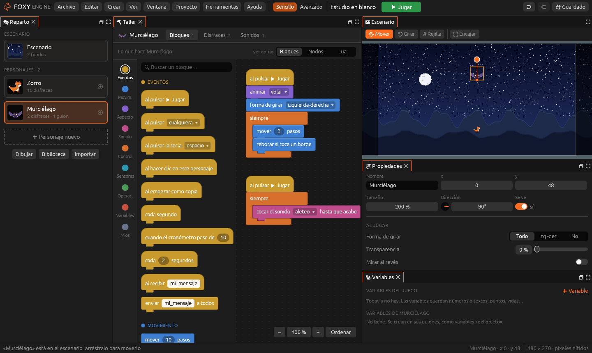
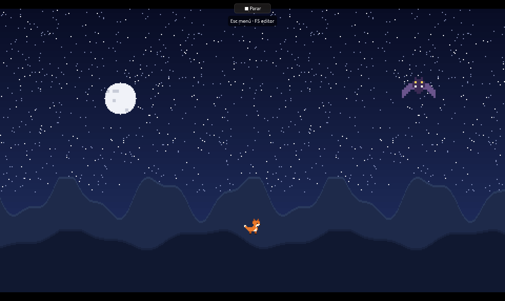

# Disfraces, fondos y sonidos

Las pestañas **Disfraces** y **Sonidos** del Taller sirven para dibujar a
los personajes, preparar los fondos del escenario y retocar los sonidos sin
salir del Estudio. Con el escenario elegido, la pestaña **Disfraces** se
llama **Fondos**. En el modo Sencillo, mientras se usan estas pestañas el
Taller se hace ancho y la columna del escenario se esconde; vuelve al pasar
a **Bloques** o al jugar.

## Disfraces

Los disfraces de un personaje son sus dibujos. Para que ande, salte o
cambie de cara se pasa de un disfraz a otro, a mano con los bloques
**cambiar el disfraz a** y **siguiente disfraz**, o con una animación.

La pestaña tiene tres partes:

- **La lista de disfraces**, a la izquierda. Cada uno tiene su número, su
  dibujo y su nombre (doble clic para cambiarlo). Se arrastran para
  cambiarlos de orden. Abajo están **Pintar**, **Biblioteca** e
  **Importar** (un PNG suelto o una tira de dibujos, que se corta sola).
  Con el botón derecho se duplica, se renombra, se sube, se baja o se
  borra un disfraz.
- **El lienzo**, en el centro, donde se pinta el disfraz elegido con el
  lápiz, la goma, el relleno, el cuentagotas, la línea, el rectángulo
  (vacío o lleno), la elipse y la mano para desplazar el dibujo.
  **Simetría** pinta a la vez en los dos lados, **Anterior** enseña
  flojito el disfraz de antes, que ayuda a animar, y **Punto de giro**
  marca por dónde gira el personaje. Las flechas deshacen y
  rehacen.
- **Los colores**, a la derecha: la paleta del proyecto, un selector de
  color y los últimos colores usados.

Abajo, la fila de **animaciones** junta disfraces seguidos en una
animación con nombre («andar», «saltar»…), con su velocidad y si se
repite. El botón de reproducir la enseña en el lienzo.

## Fondos

Un fondo es lo que se ve detrás de los personajes. El escenario puede
tener varios («día», «atardecer», «noche») y solo se ve el que está
puesto. Cada fondo puede tener varias capas que se mueven a distinta
velocidad cuando se mueve la cámara (el efecto de profundidad o
paralaje).

En la lista de la izquierda se elige un fondo; con el botón derecho se
renombra, se duplica, se sube, se baja o se borra. Abajo hay **Pintar**, **Biblioteca** e **Importar**. En
el centro se ve el fondo con sus capas; cada capa tiene su paralaje, si se
repite a lo ancho o a lo alto, y **Editar la capa** para retocarla con el
lápiz.

Los escenarios de antes, que tenían capas de imagen sin fondo con nombre,
se ven igual: esas capas son el «fondo 1».

## Sonidos

Los sonidos son de todo el proyecto: cualquier personaje y el escenario
pueden tocarlos. Se guardan en la carpeta `sonidos/` del proyecto.

A la izquierda está la lista, con la duración de cada uno. Abajo se añaden
con **Biblioteca**, **Importar** (WAV, OGG o MP3) y **Grabar con el
micrófono**. En el centro se ve la onda del sonido elegido: se escucha con
el botón de reproducir y se arrastra encima para elegir un trozo.

Los botones de retoque cambian todo el sonido o solo el trozo elegido:

| Botón | Qué hace |
|---|---|
| **Recortar** | Se queda solo con el trozo elegido. |
| **Quitar** | Quita el trozo elegido. |
| **Más fuerte** y **Más suave** | Sube o baja el volumen (sin pasarse: no se rompe). |
| **Más rápido** y **Más lento** | Más deprisa y un poco más agudo, o más despacio y un poco más grave, como una cinta. |
| **Aparecer** y **Desaparecer** | El sonido empieza o acaba poco a poco. |
| **Al revés** | Suena de atrás hacia delante. |
| **Eco** | Se repite más flojo, como en una cueva. |
| **Más agudo** y **Más grave** | Cambia el tono sin cambiar lo que dura. |

Cada retoque se puede deshacer. Debajo, la lista **Lo usan** dice qué
bloques tocan ese sonido, para no borrar uno que hace falta. Al borrar un
sonido, el archivo va a la papelera del proyecto (`.foxy/papelera/`).

En el Mac, la primera vez que se graba, el sistema pide permiso para usar
el micrófono.

## La biblioteca

La biblioteca de Foxy trae personajes, fondos y sonidos hechos para usar
en los juegos, sin pedir permiso a nadie. Se abre con el botón
**Biblioteca** de cada pestaña y del Reparto.

Arriba están las pestañas **Personajes**, **Fondos** y **Sonidos** y una
caja para buscar. A la izquierda, los grupos. Al elegir una tarjeta, a la
derecha se ve en grande (los personajes andan, los sonidos se escuchan) y
el botón **Añadir** la trae al proyecto:

- Un personaje nuevo va al escenario. Si la biblioteca se abrió desde los
  disfraces de un personaje, sus dibujos se añaden como disfraces suyos.
- Un fondo se añade al escenario con todas sus capas y se pone.
- Un sonido se añade a la lista de sonidos.

## Los bloques nuevos

| Bloque | Familia | Qué hace |
|---|---|---|
| **cambiar el fondo a** `noche` | Aspecto | Pone ese fondo. También vale `siguiente` o `anterior`. |
| **siguiente fondo** | Aspecto | Pasa al fondo siguiente; después del último vuelve al primero. |
| **nombre del fondo** | Aspecto | El nombre del fondo puesto. |
| **número del fondo** | Aspecto | Su número (el primero es el 1). |
| **tocar el sonido** `salto` **hasta que acabe** | Sonido | Toca el sonido y espera a que termine. |
| **parar todos los sonidos** | Sonido | Calla los sonidos que estén sonando. |
| **fijar el volumen al** `100` **%** | Sonido | El volumen de los sonidos (50 = la mitad). |
| **fijar el tono a** `0` | Sonido | Más agudo con números positivos y más grave con negativos, en semitonos. |

Como todos los bloques, también son nodos y funciones de Lua (ver la
[API de Lua](../referencia/api-lua.md)).

## Ejemplo: el murciélago

Este murciélago se hizo entero sin salir del Estudio:

1. En el Reparto, **Personaje nuevo** y **Pintar**. Se abre la pestaña
   Disfraces con un disfraz vacío.
2. Se pinta el primer disfraz, «alas arriba». Con **Duplicar** (botón
   derecho) y el lápiz, el segundo, «alas abajo». **Anterior** ayuda a que las dos
   poses coincidan.
3. En la fila de animaciones, una animación «volar» con los dos disfraces,
   a 6 dibujos por segundo y repitiéndose.
4. Con el escenario elegido, **Biblioteca** y el fondo «Noche».
5. En Sonidos, **Biblioteca** y el sonido «Aleteo».
6. En Bloques, dos guiones. Uno, al empezar, pone la animación «volar» y,
   para siempre, avanza 2 pasos y rebota en el borde. El otro, para
   siempre, toca el aleteo hasta que acaba.

