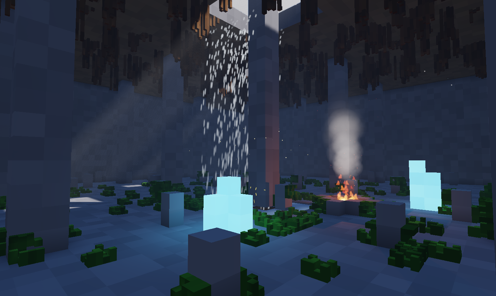
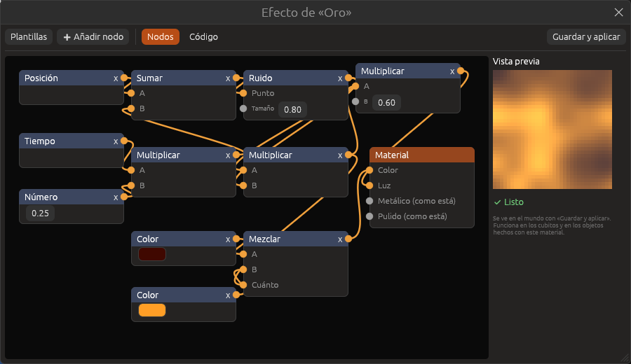

# Efectos de material

Un efecto cambia cómo se ve un material mientras se juega: su color, cuánta
luz da, lo metálico y lo pulido que es. Puede moverse con el tiempo, cambiar
de un sitio a otro o depender de hacia dónde mira la cara. Se hace con
**nodos**, como la lógica del juego, y quien sepa programar puede escribirlo
en **código**.

Funciona en los cubitos y en los objetos hechos con ese material, con el
dibujante nuevo (el de serie) y con el clásico.



## Empezar un efecto

1. Abre la pestaña **Materiales** y elige el material.
2. En la sección **Efecto**, pulsa una plantilla para empezar:

   | Plantilla | Qué hace |
   |---|---|
   | **Lava** | Manchas de rojo oscuro a naranja que se mueven y brillan |
   | **Luz que late** | El material se enciende y se apaga despacio |
   | **Rayas** | Rayas blancas que suben por el material |
   | **Destellos** | Puntitos que brillan y cambian |

   O **Vacío** para hacerlo desde cero.
3. Se abre la ventana del efecto. Cambia lo que quieras y pulsa
   **Guardar y aplicar** para verlo en el mundo.

Más tarde, **Editar efecto…** vuelve a abrir la ventana y **Quitar** lo
borra.



## La ventana del efecto

- **El lienzo**: los nodos y sus cables. Arrastra un nodo por su cabecera
  para moverlo y el fondo para moverlo todo. Para unir dos nodos, tira del
  **círculo naranja** de la derecha de uno hasta un círculo de la izquierda
  de otro. Un clic en un círculo de entrada con cable lo suelta. La **x**
  quita el nodo.
- **Vista previa**: un trozo de 2 × 2 m del material con el efecto,
  moviéndose. Se ve al momento, sin aplicar.
- **Listo** o **Hay un error**: si el efecto tiene un error, el material se
  ve sin efecto hasta que lo arregles. Nunca rompe el juego.

El nodo **Material** es el final: lo que le llega es lo que se pinta. Lo que
no tenga cable se queda como en el material.

| Entrada de Material | Qué cambia |
|---|---|
| **Color** | El color de cada punto |
| **Luz** | La luz propia: 0 no brilla; 1 brilla mucho |
| **Metálico** | De 0 (nada) a 1 (metal) |
| **Pulido** | De 0 (mate) a 1 (espejo) |

## Los nodos

Todos los valores son tres números, como un color o un punto. Un número
solo vale para los tres.

| Nodo | Qué da |
|---|---|
| **Posición** | Dónde está el punto, en metros |
| **Hacia dónde mira** | La dirección de la cara (arriba es Y = 1) |
| **Tiempo** | Los segundos de juego: para que se mueva |
| **Color del material** | El color (y la textura) que ya tiene el material |
| **Sitio en la cara** | Dónde está el punto dentro de su cara, de 0 a 1 |
| **Número**, **Color** | Un valor fijo |
| **Sumar**, **Restar**, **Multiplicar** | Cuentas. Multiplicar sirve para hacer algo más grande, más rápido o más oscuro |
| **Mezclar** | De A (con 0) a B (con 1), según **Cuánto** |
| **Onda** | Sube y baja suave entre 0 y 1, una vez por cada 1 que avanza |
| **Repetir** | Lo de después de la coma (2,3 da 0,3): sirve para hacer rayas |
| **Corte** | 0 por debajo del borde y 1 por encima |
| **Ruido** | Manchas suaves entre 0 y 1, del **Tamaño** que digas |
| **Coger X**, **Coger Y**, **Coger Z** | Uno de los tres números |
| **Juntar** | Junta tres números en uno |

Por ejemplo, la **Luz que late** es: Tiempo × 0,5 → Onda → Luz del
material. Cambia el 0,5 para que lata más deprisa o más despacio.

## En código

La pestaña **Código** enseña el mismo efecto escrito en WGSL, el idioma de
la tarjeta gráfica. Con **Escribir a mano** se puede cambiar: desde
entonces manda el código. Los nodos se guardan y **Volver a los nodos** los
recupera.

El código es el cuerpo de una función que recibe `e` y cambia `s`:

| Recibe | Qué es |
|---|---|
| `e.pos` | Dónde está el punto (metros) |
| `e.normal` | Hacia dónde mira la cara |
| `e.tiempo` | Segundos de juego |
| `e.color` | El color del material (lineal) |
| `e.uv` | El sitio en la cara, de 0 a 1 |

| Cambia | Qué es |
|---|---|
| `s.color` | El color |
| `s.luz` | La luz propia |
| `s.metal` | Lo metálico |
| `s.pulido` | Lo pulido |

Hay tres ayudas: `ef_ruido(punto, tamaño)`, `ef_onda(x)` y
`ef_corte(x, borde)`. Por ejemplo:

```wgsl
    let manchas = ef_ruido(e.pos + vec3<f32>(0.0, e.tiempo * 0.2, 0.0), 0.8);
    s.color = mix(e.color, vec3<f32>(0.1, 0.8, 1.0), manchas);
    s.luz = manchas * 0.5;
```

Si hay un error, la ventana dice en qué línea.

Un proyecto puede tener hasta 15 materiales con efecto.

## Cubitos finos

En la sección **Cubitos finos** del material:

| Opción | Qué hace |
|---|---|
| **Cubito entero** | Lo de siempre |
| **Musgo** | Una alfombra irregular de cubitos finos pegada al suelo, las paredes o el techo de al lado |
| **Raíces** | Hilos de cubitos finos que cuelgan del techo; si hay más raíces debajo, siguen |

Los cubitos finos son cuatro veces más pequeños que los normales. Se
atraviesan, no hacen sombra y de lejos no se dibujan: así se puede llenar
una cueva de musgo sin que el juego vaya más lento.

## Véase también

- [Materiales](materiales.md)
- [Efectos y estilos](efectos.md)
- [Materiales (referencia)](../referencia/materiales.md)
