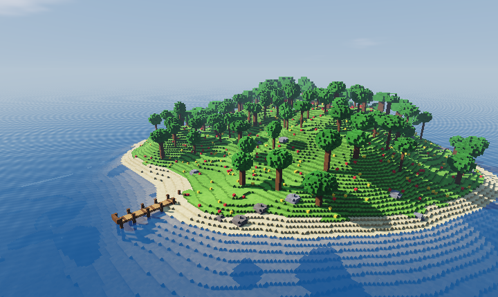
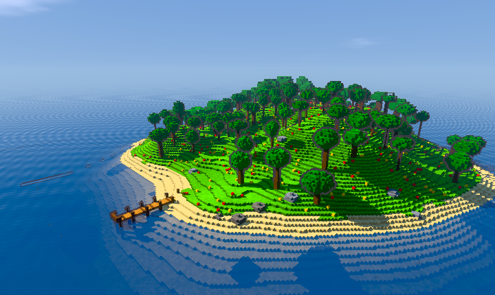
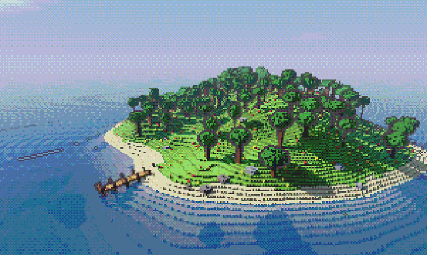
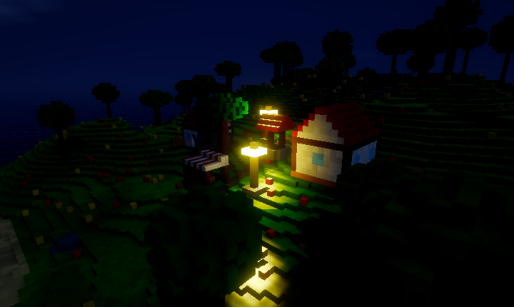
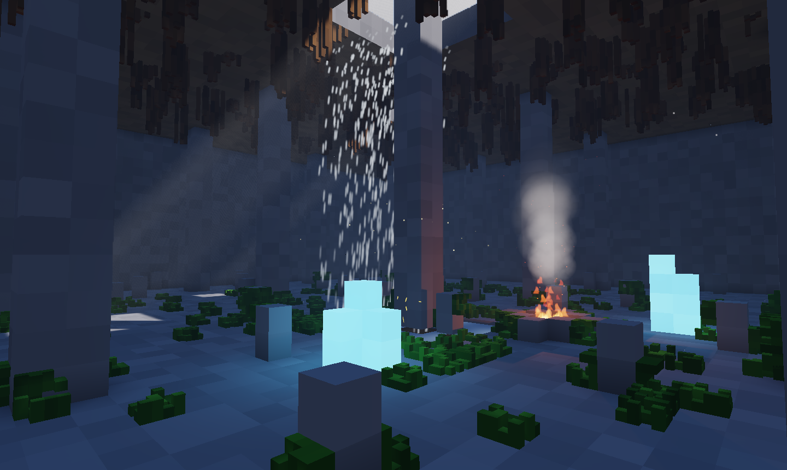

# Efectos y estilos

Foxy Engine no le pone ningún estilo a tu juego: de serie se ve limpio, como
un folio en blanco. Desde aquí puedes darle un aspecto propio con un clic
(los **ambientes**) o pieza a pieza (el **estilo**), y añadir **partículas**
como fuego, humo o una cascada.

Todo esto necesita el dibujante nuevo (el de serie). Con el clásico, la
imagen no cambia.

## Ambientes

Un ambiente es un punto de partida: enciende de una vez varias piezas de
estilo y de [luz y atmósfera](graficos.md#luz-y-atmósfera). Están arriba del
todo en **Proyecto → Ajustes del proyecto → Gráficos**. Ninguno viene puesto.

| Ambiente | Qué hace |
|---|---|
| **Ninguno** | Quita todos los efectos: la imagen de siempre. |
| **Realista** | Luz que rebota, rayos entre la niebla, agua de verdad, destello y suavizado. |
| **Dibujo animado** | Contorno de tinta, luz por bandas y colores vivos. |
| **Neón nocturno** | Lluvia, suelo mojado que refleja las luces y neones con destello. Queda mejor de noche. |
| **Acuarela** | Papel, trazo a mano, colores pastel y bruma suave. |
| **Píxel retro** | Pocos píxeles y una paleta corta con tramado, como una consola antigua. |

Un ambiente solo cambia los ajustes: después puedes tocarlos uno a uno. Si
los cambias, pone **Ajustado a mano** y ningún botón queda marcado.

## Las piezas del estilo

En la sección **Estilo**, debajo de **Luz y atmósfera**. Se pueden mezclar
como quieras: contorno con acuarela, píxeles con neones…

| Pieza | Qué hace |
|---|---|
| **Contorno** | Una línea de tinta alrededor de las cosas y en sus esquinas. El número es el grosor en píxeles; al lado se elige el color de la tinta. De lejos se va apagando. |
| **Bandas** | La luz va por escalones, como en los dibujos animados (*cel*). De 2 a 6 escalones; 0 es la luz suave de siempre. |
| **Acuarela** | Trazo a mano, bordes donde se acumula el agua y textura de papel. |
| **Píxel perfecto** | La imagen se dibuja con pocas líneas de alto (180 es como una consola antigua) y se agranda sin suavizar: cada píxel es un cuadrado nítido. |
| **Colores** | Cuántos tonos hay por color (4 a 8 dan aire retro). Con **Tramado**, los colores intermedios se hacen con puntitos. |
| **Lluvia** | Llueve alrededor de la cámara. Bajo techo y en las cuevas no llueve. |
| **Suelo mojado** | El suelo al aire libre se oscurece, brilla y forma charcos que reflejan las farolas. |
| **Neones** | Lo que brilla (materiales con luz, pantallas, neones) brilla más; con el destello hace halo. |

**Quitar estilo** lo pone todo a cero.

## Partículas

Las partículas son el componente
[Partículas](../referencia/componentes/particulas.md). La forma más rápida de
poner una es **Crear → Efecto** y elegir el tipo: aparece un objeto nuevo
delante de la cámara. El fuego y las ascuas traen también una luz
anaranjada.

En el inspector, el componente tiene:

- Un botón por **tipo** para empezar: polvo, chispas, lluvia, nieve, humo,
  hojas, fuego, ascuas, cascada y destellos. Cada uno pone su cantidad,
  zona y tamaño de siempre.
- Una **vista previa** que se mueve mientras cambias los valores.
- **Color** al nacer y al acabar: cada partícula pasa de un color al otro.
  La flecha vuelve a los colores de su tipo.
- En **Cómo se mueven y brillan**: **Brillo** (0 = no brillan y tapan lo de
  detrás; más = suman luz, y con destello dejan halo), **Velocidad**,
  **Vida**, **Gravedad** (0 = flotan; negativa = suben), **Crecen** y
  **Viento**. **Como su tipo** deshace estos cambios.

Las partículas que brillan (fuego, chispas, ascuas, destellos) se suman a la
luz de la imagen. Las demás (humo, polvo, lluvia, nieve, hojas, agua) se
iluminan con la luz que tengan alrededor: el humo de una hoguera se ve
anaranjado cerca del fuego y oscuro lejos. Ninguna se ve a través de las
paredes.

Mientras eliges un objeto con partículas en el editor, sus partículas se
mueven en la vista para que veas cómo quedan.

## Lo que se lleva en la mano

Para un juego en primera persona: un arma, una herramienta o una antorcha
que va siempre delante de la cámara. Añade al objeto el componente
[En la mano](../referencia/componentes/mano.md). Al jugar en primera persona,
el objeto sigue a la cámara, se balancea al andar y **nunca atraviesa las
paredes**, aunque te pegues a una. Si el objeto lleva una
[Luz](../referencia/componentes/luz.md), alumbra a tu alrededor.

En el editor el objeto se queda donde lo pusiste, para poder editarlo.

## Desde la línea de órdenes

Las capturas aceptan `--ambiente` y `--estilo`. Ver
[Línea de comandos](../referencia/linea-de-comandos.md#gráficos-de-la-captura).

## Véase también

- [Gráficos: luz, sombras y atmósfera](graficos.md)
- [Partículas](../referencia/componentes/particulas.md)
- [En la mano](../referencia/componentes/mano.md)
- [Efectos de material](efectos-de-material.md)
