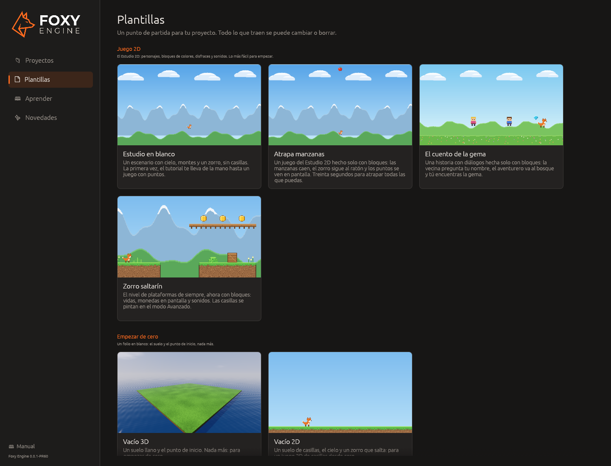
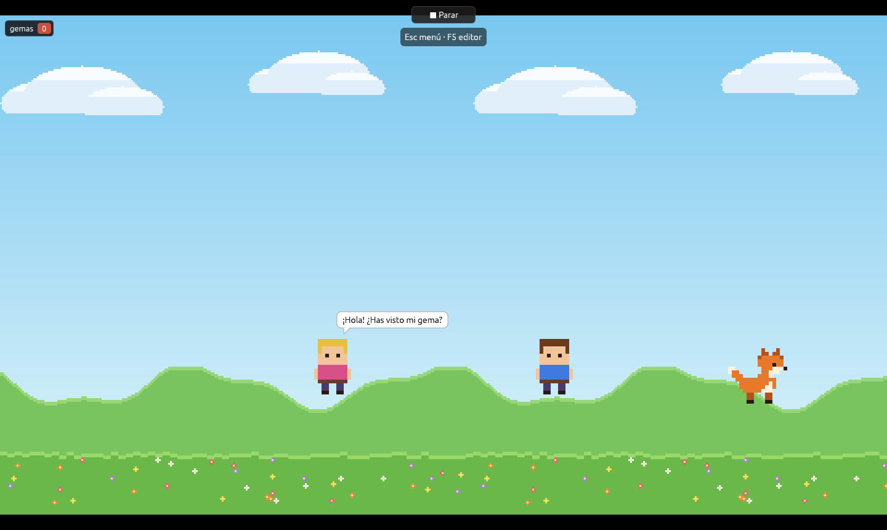
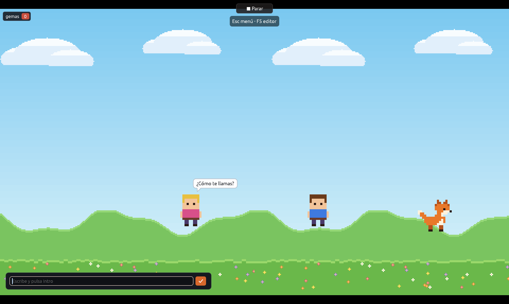
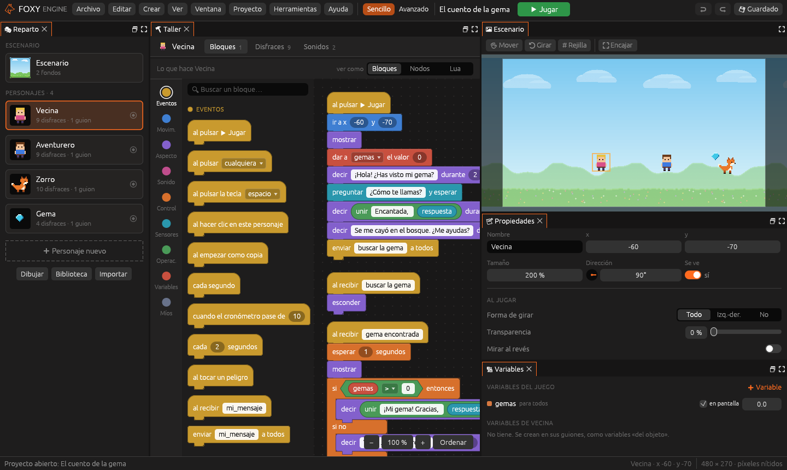
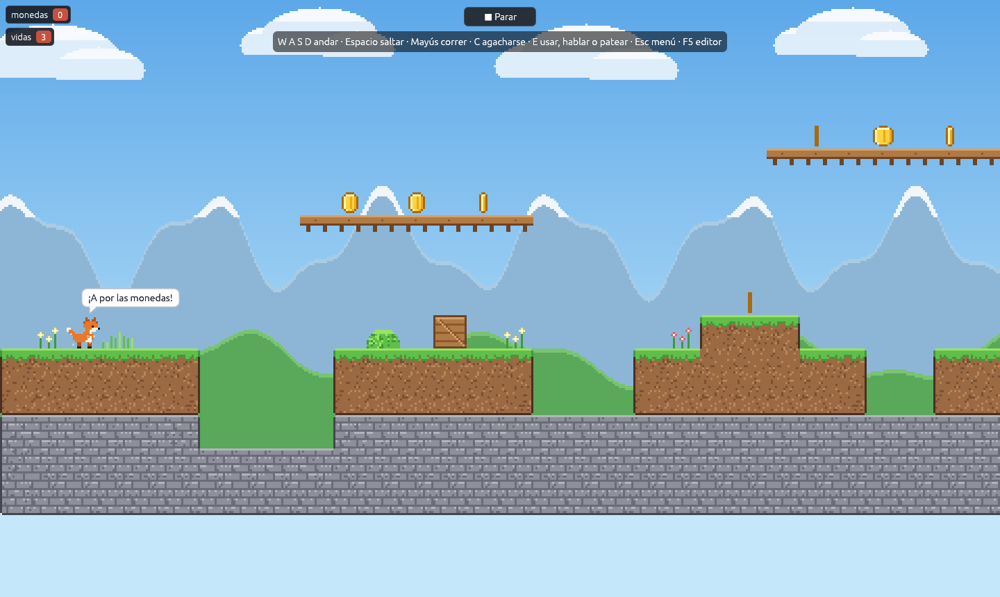
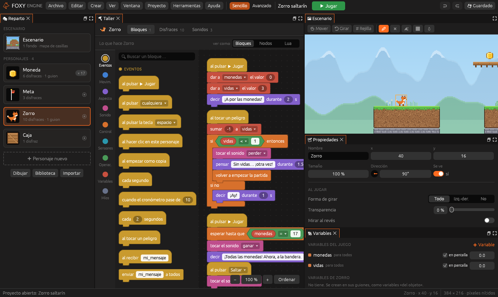

# Tres juegos de ejemplo

La clase **Juego 2D** de la pantalla de inicio trae, además del **Estudio
en blanco**, tres juegos pequeños hechos **solo con bloques**. Cada uno
enseña una forma distinta de hacer un juego en el
[Estudio 2D](estudio-2d.md): ábrelos, pulsa **Jugar** y, después, elige un
personaje en el reparto para ver sus bloques en el Taller.

| Ejemplo | Qué enseña |
|---|---|
| [Atrapa manzanas](bloques-escenario.md#ejemplo-atrapa-manzanas) | Copias, el ratón, el cronómetro y los puntos en pantalla |
| [El cuento de la gema](#el-cuento-de-la-gema) | Diálogos, preguntas, mensajes entre personajes, cambiar de fondo y hacer clic en un personaje |
| [Zorro saltarín](#zorro-saltarín) | Un plataformas completo: el salto y las casillas del motor, con las vidas, las monedas y los sonidos en bloques |

## El cuento de la gema

Una historia sin casillas ni física: solo escenario, personajes y
bocadillos. La vecina saluda, pregunta tu nombre y te contesta con él;
el aventurero va al bosque a buscar la gema, el escenario cambia de fondo
y aparece la gema. Haz clic en ella para encontrarla: todo vuelve a la
pradera y la vecina te da las gracias por tu nombre.

| La vecina saluda | Pregunta tu nombre |
|---|---|
|  |  |

Los personajes se hablan con **mensajes**: **enviar** `buscar la gema`
**a todos** pone en marcha, a la vez, todos los bloques **al recibir**
`buscar la gema` del juego.

| Quién | Sus bloques |
|---|---|
| **Vecina** | **al pulsar ▶ Jugar**: **decir** `¡Hola! ¿Has visto mi gema?`, **preguntar** `¿Cómo te llamas?` **y esperar**, **decir** (**unir** `Encantada,` **respuesta**), y **enviar** `buscar la gema` **a todos**. **al recibir** `buscar la gema`: **esconder**. **al recibir** `gema encontrada`: **mostrar** y **si** **gemas** > `0`, **decir** (**unir** `¡Mi gema! Gracias,` **respuesta**); **si no**, `Vaya… sigue perdida.` |
| **Aventurero** | **al recibir** `buscar la gema`: **decir** `¡Yo te ayudo!`, **deslizar en** `1.5` **s a x y**, **pensar** `¿Dónde estará…?` y **enviar** `aparece la gema`. **al recibir** `gema encontrada`: vuelve y dice `¡Aquí la tienes!` |
| **Gema** | **al pulsar ▶ Jugar**: **esconder**. **al recibir** `aparece la gema`: **ir a x y**, **mostrar** y **animar** `brillar`. **al hacer clic en este personaje**: **sumar** `1` **a gemas**, **tocar el sonido** `magia`, **esconder** y **enviar** `gema encontrada` |
| **Zorro** | **al recibir** `aparece la gema`: **decir** `¡Haz clic en la gema!`. **al hacer clic en este personaje**: **pensar** `Yo sé dónde está…` |
| **Escenario** | **al pulsar ▶ Jugar**: **cambiar el fondo a** `Pradera de flores`. **al recibir** `buscar la gema`: **esperar** y **cambiar el fondo a** `Bosque`. **al recibir** `gema encontrada`: vuelve a la pradera |

Lo que escribe el jugador queda en **respuesta** (en Sensores) hasta la
siguiente pregunta, así que la vecina lo puede usar más tarde. Los dos
fondos y los sonidos son de la [biblioteca de Foxy](disfraces-fondos-sonidos.md).

Ideas para seguir: más preguntas («¿Quieres ayudar? sí o no») con **si
respuesta = sí**, un tercer fondo o un personaje que se esconda y haya que
buscar.

## Zorro saltarín

El nivel de la plantilla **Plataformas 2D**, ahora con bloques. El zorro
es el **jugador de plataformas** del motor, así que el salto variable, las
escaleras, el agua, la caja que se empuja y la vuelta al último sitio
seguro al pisar los pinchos ya funcionan sin un solo bloque. Los bloques
añaden lo que hace que sea un juego: las vidas, las monedas en pantalla y
los sonidos.

**Los bloques del zorro:**

- **al pulsar ▶ Jugar**: **dar a monedas el valor** `0`, **dar a vidas el
  valor** `3` y **decir** `¡A por las monedas!` **durante** `2` **s**.
- **al tocar un peligro**: **sumar** `-1` **a vidas** y **si** **vidas** <
  `1`: **tocar el sonido** `perder`, **pensar** `Sin vidas… ¡otra vez!` y
  **volver a empezar la partida**; **si no**, **decir** `¡Ay!`.
- Otro **al pulsar ▶ Jugar**: **esperar hasta que** **monedas** = `17`,
  **tocar el sonido** `ganar` y **decir** `¡Todas las monedas! Ahora, a la
  bandera.`
- **al pulsar** `Saltar`: **tocar el sonido** `salto`.

Las monedas suben solas al cogerlas: cada moneda tiene el componente
[Recogible](../referencia/componentes/recogible.md), que suma 1 a la
variable `monedas`. Las variables **monedas** y **vidas** están marcadas
**en pantalla** en el panel **Variables**, y la bandera abre el cartel
**Meta** al llegar.

Las casillas del nivel se pintan en el modo **Avanzado**, con los paneles
[Casillas](casillas.md) y [Capas](casillas.md#capas). Los pinchos son
casillas con el choque **Peligro**: el bloque **al tocar un peligro**
salta cada vez que el jugador pisa una.

Ideas para seguir: un enemigo que quite una vida al tocarlo
(**¿tocando Zorro?**), una segunda escena al llegar a la bandera o un
cronómetro para correr contra el tiempo.

## Bloques nuevos

| Bloque | Familia | Qué hace |
|---|---|---|
| **al tocar un peligro** | Eventos | Cuando el jugador de plataformas pisa pinchos, lava o cualquier casilla de **Peligro**. El motor lo devuelve al último sitio seguro; el bloque sirve para quitar una vida o tocar un sonido |
| **volver a empezar la partida** | Control | Empieza otra vez desde el principio, con todo como al pulsar **Jugar** |
