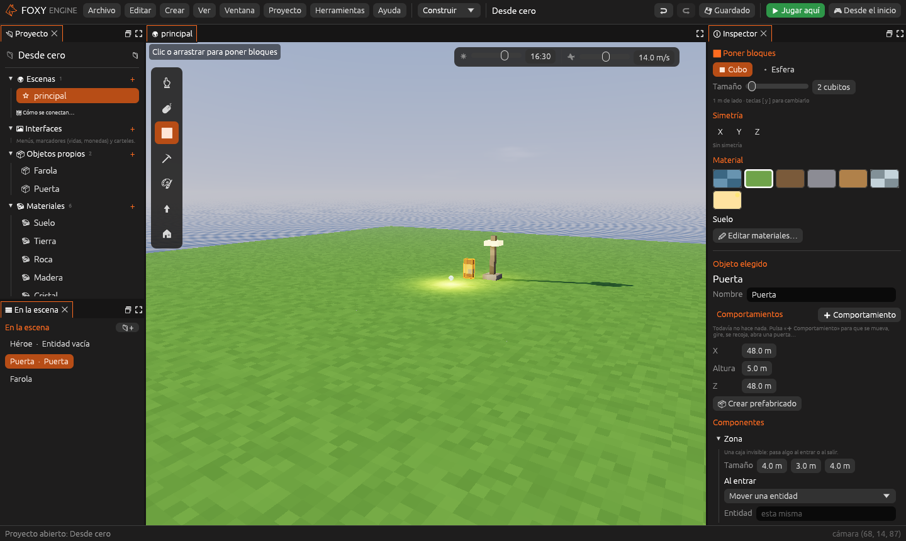
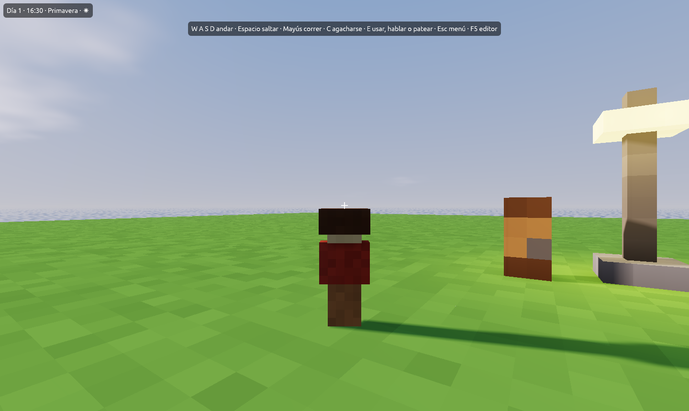

# Entidades y componentes

Esta guía explica cómo dar comportamiento a las entidades de una escena con
componentes y cómo reutilizarlas con prefabricados. Los conceptos se
describen en [Conceptos básicos](../conceptos/basicos.md).

> <i class="fx fx-consejo"></i> **Consejo.** Los componentes dicen lo que
> una entidad **es** (una luz, un cuerpo que cae, una zona). Para lo que
> **hace** por su cuenta (perseguir, girar, abrirse con un botón), usa
> [comportamientos](comportamientos.md).

## Añadir y quitar componentes

1. Con la herramienta <i class="fx fx-cursor"></i> **Elegir**, haz clic en
   una entidad de la Vista o en el panel **En la escena**.
2. En el [Inspector](../interfaz/inspector.md), pulsa
   <i class="fx fx-mas"></i> **Añadir componente** y elige uno de la lista.
   Las clases que la entidad ya tiene aparecen desactivadas.
3. Ajusta sus valores. Los cambios se ven al momento y se deshacen con
   <kbd>Cmd</kbd>/<kbd>Ctrl</kbd>+<kbd>Z</kbd>.
4. Para quitarlo, pulsa <i class="fx fx-borrar"></i> **Quitar** al final del
   componente.

Para una entidad que no debe verse al jugar (un punto de luz, un altavoz, el
personaje cuando se juega en primera persona), usa el objeto **Entidad vacía**
de la paleta de **Colocar objetos**.

## Ejemplo: una puerta que se abre al acercarse

Este ejemplo no necesita código ni la plantilla Isla.

1. Crea un proyecto con la plantilla **Vacío 3D**.
2. Añade el objeto de ejemplo **Puerta**: en la paleta de objetos, pulsa
   **Añadir los objetos de ejemplo** y coloca una puerta.
3. Ponle de nombre «Puerta».
4. Añade el componente **Zona**. Deja el tamaño en 4 × 3 × 4 m.
5. En **Al entrar**, elige **Mover una entidad**, deja *Entidad* vacío (la
   propia puerta) y escribe en *Cuánto* `x 1`: la puerta se desplazará un
   metro hacia un lado en 0,4 segundos.
6. En **Al salir**, elige otra vez **Mover una entidad** con `0, 0, 0`: la
   puerta vuelve a su sitio.
7. Pulsa <i class="fx fx-jugar"></i> **Jugar aquí** y acércate.

> <i class="fx fx-consejo"></i> **Consejo.** El desplazamiento siempre se
> cuenta desde la posición que la entidad tiene en el editor. Por eso
> `0, 0, 0` significa «volver a su sitio» y la misma zona sirve para abrir
> y cerrar.

## Ejemplo: un personaje en tercera persona

1. Coloca una **Entidad vacía** (o cualquier objeto que quieras que sea el
   personaje) y llámala «Héroe».
2. Añade el componente **Controlador de jugador** y elige
   **Tipo: Tercera persona**.
3. Si quieres, añade **Cámara** para cambiar la distancia y la altura.
4. Al jugar, la partida empieza en esa entidad y la cámara va detrás del
   personaje.

Si la escena no tiene ninguna entidad con controlador, el juego empieza en
el **Punto de inicio** en primera persona, como en versiones anteriores.

## Entidades que se mueven o se esconden

Las acciones **Mover una entidad**, **Ocultar una entidad** y **Mostrar una
entidad** (ver [Acciones](../referencia/acciones.md)) y las funciones
`motor.mover`, `motor.ocultar` y `motor.mostrar` de los
[guiones](../referencia/lua.md) cambian las entidades **solo durante la
partida**. Al volver al editor, todo está como se dejó.

Mientras una entidad se mueve, se dibuja aparte del mundo; al detenerse
vuelve a formar parte de los cubitos, y se puede chocar con ella en su
nueva posición.

## Prefabricados

Un prefabricado guarda una entidad (su modelo, sus componentes, sus
[comportamientos](comportamientos.md) y su acción al usarla) en `prefabricados/<id>.ron` para colocarla muchas veces.

### Crear un prefabricado

1. Prepara una entidad con los componentes que quieras.
2. En el Inspector, pulsa **Crear prefabricado**.
3. El prefabricado aparece en la paleta de objetos, en la sección
   **Prefabricados**, y la entidad pasa a ser su primera copia.

### Copias y cambios propios

En una copia, el Inspector indica de qué prefabricado procede. Cada
componente heredado muestra *del prefabricado*; si se cambia en la copia,
muestra *cambiado aquí* y el botón **Como el original** para deshacer ese
cambio. Con los comportamientos pasa lo mismo: **↺ Como el original** está
en su menú **☰**.

| Botón | Qué hace |
|---|---|
| **Guardar en el original** | Pasa los cambios de la copia al prefabricado. Todas las copias cambian |
| **Quitar cambios** | La copia vuelve a ser igual que el original |
| **Desvincular** | La copia deja de seguir al original y se queda como está |

> <i class="fx fx-nota"></i> **Nota.** El nombre, la posición y el giro son
> siempre propios de cada copia.

## Véase también

- [Comportamientos](comportamientos.md): lo que hace cada entidad, con nodos o con código.
- [Referencia de componentes](../referencia/componentes/index.md)
- [Acciones](../referencia/acciones.md)
- [Archivos del proyecto: prefabricados](../referencia/archivos.md#prefabricados)
