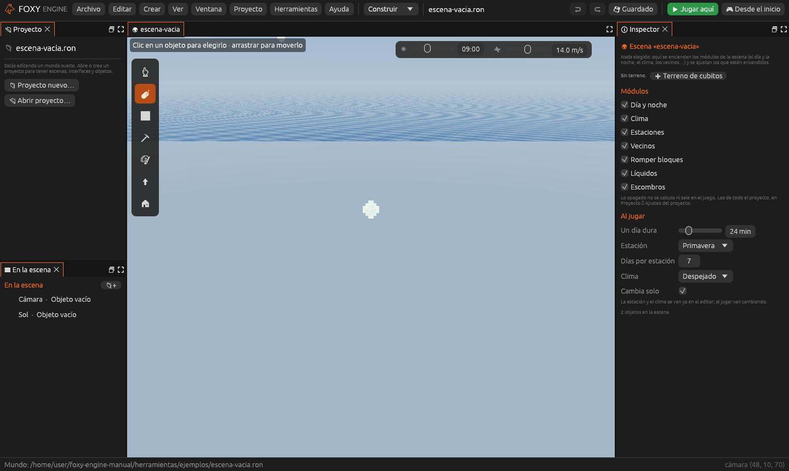
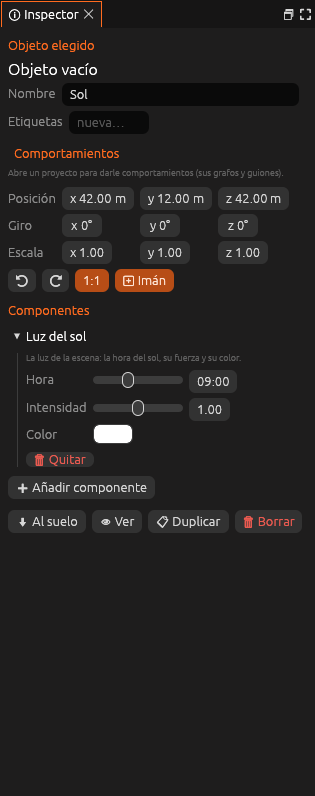

# Empezar una escena desde cero

Una escena no tiene por qué ser una isla. Una escena nueva **empieza vacía**:
solo una **cámara** y la **luz del sol**. Tú decides qué más lleva: un
terreno de cubitos, objetos sueltos, o nada más que una sala construida a
mano.

## Una escena nueva

**Crear → Escena nueva…** (o el <i class="fx fx-mas"></i> del grupo
*Escenas*) y elige con qué empieza:

| Empezar con | Qué trae |
|---|---|
| **Vacía** | Una cámara y la luz del sol. Nada de suelo |
| **Con un terreno de cubitos llano** | Un suelo plano y el punto de inicio |
| **Isla sin objetos** | Una isla con colinas, playa y árboles |
| **Plaza de prueba** | La isla de ejemplo, con casas y vecinos |
| **Una copia de esta escena** | Todo lo que tiene la escena abierta |

## Lo que lleva una escena vacía

| Objeto | Componente | Para qué |
|---|---|---|
| **Cámara** | [Cámara](../referencia/componentes/camara.md) con *Fija* | El juego se ve desde aquí, mirando al jugador |
| **Sol** | [Luz del sol](../referencia/componentes/sol.md) | La hora del sol (y por tanto de dónde llega la luz), su fuerza y su color |

Las dos son **objetos vacíos**: solo se ven en el editor y no se chocan.
Muévelos como cualquier objeto, o bórralos si no los necesitas.

> <i class="fx fx-consejo"></i> **Consejo.** Si añades un personaje con su
> propia cámara (un [Controlador](../referencia/componentes/controlador.md)
> en tercera persona, por ejemplo), borra la cámara fija de la escena: si
> no, el juego se sigue viendo desde ella.

## Más cosas para la escena

En **Crear**, en el apartado *En esta escena*:

| Opción | Qué pone |
|---|---|
| **Terreno de cubitos** | Un suelo de cubitos. Ver [El terreno de cubitos](generadores.md) |
| **Cámara** | Otra cámara fija, delante de la vista |
| **Luz del sol** | La luz del sol, si la escena no tiene |
| **Luz** | Una luz que ilumina alrededor, como una farola |
| **Zona de cambio**, **Punto de entrada** | Para ir y venir entre escenas |
| **Vecino** | Solo si el módulo *Vecinos* está encendido |

## La hora y la luz del sol

Con una **Luz del sol** en la escena, su **Hora** manda: es la hora con la
que se ve la escena en el editor y con la que empieza la partida. La barra
de la vista (☀) cambia la hora del sol directamente, y se deshace.

- Con el módulo **Día y noche** encendido, la partida empieza a esa hora y
  el sol se mueve.
- Sin él, el sol se queda quieto a esa hora: perfecto para un atardecer
  eterno o una escena de noche.

**Intensidad** y **Color** cambian la luz que llega del sol: más tenue,
más cálida, azulada...

## Solo lo que activas

El tiempo, el clima, las estaciones y los vecinos son
[módulos](../referencia/modulos/index.md). Sin nada elegido, el Inspector
enseña los módulos de la escena como casillas, y debajo, en **Al jugar**,
solo los ajustes de los que están encendidos:

| Módulo encendido | Ajustes que aparecen |
|---|---|
| Día y noche | Cuánto dura un día |
| Estaciones | La estación y los días por estación |
| Clima | El clima y si cambia solo |
| Vecinos | *Vecino* en los menús para colocar |

Si un módulo está encendido en el proyecto pero lo apagas en esta escena (o
al revés), sale **solo en esta escena** a su lado.

## Véase también

- [El terreno de cubitos](generadores.md)
- [Escenas](escenas.md)
- [La vida del mundo](vida.md)
- [Módulos](../referencia/modulos/index.md)
