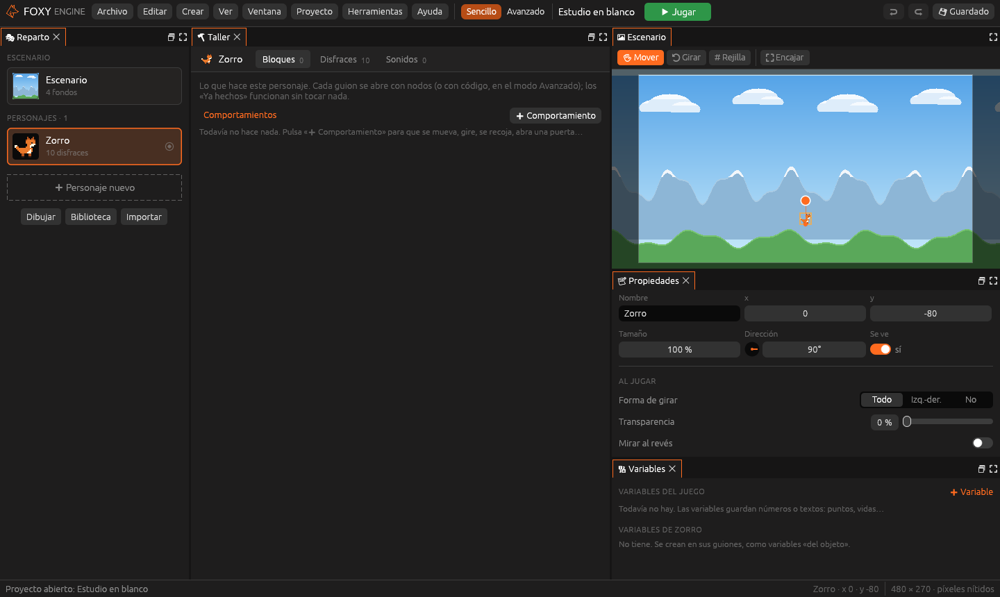
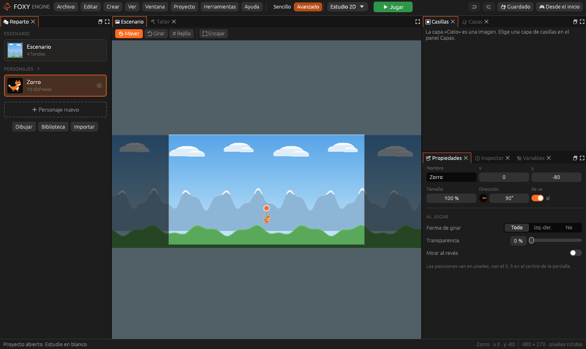

# El Estudio 2D

Todos los proyectos 2D se abren en el **Estudio 2D**, un espacio pensado
para hacer juegos 2D de forma sencilla, parecido a Scratch: a la izquierda
están los personajes, en el centro el escenario y, a la derecha, lo que se
puede cambiar del que está elegido.

## Empezar con un escenario en blanco

1. En la pantalla de inicio, pulsa **Nuevo proyecto**.
2. En **¿Qué juego quieres hacer?**, elige **Estudio en blanco** (en
   *Empezar de cero*).
3. Pulsa **Crear proyecto**.

El proyecto trae un escenario de 480 × 270 píxeles, con cielo, nubes,
montañas y colinas, y un zorro en el centro. No tiene casillas: los
personajes se colocan donde quieras.

Los proyectos 2D que ya tenías (Plataformas 2D, Aventura cenital, Vacío
2D…) se abren también en el Estudio, sin cambiar nada de ellos. Sus mapas
de casillas se siguen pintando desde la barra del escenario y el panel
**Casillas**.

## Las partes del Estudio

| Panel | Qué hay |
|---|---|
| **Reparto** | El escenario y una tarjeta por cada personaje, con su dibujo, cuántos disfraces y guiones tiene, y un ojo para esconderlo. Las copias de un mismo personaje (por ejemplo, veinte monedas) van juntas en una tarjeta con «× 20». |
| **Escenario** | La pantalla del juego. Lo que queda fuera se ve más oscuro. Arriba tiene la barra con **Mover**, **Girar**, **Rejilla** y, si hay mapa de casillas, los pinceles. A la derecha de la barra se ven las coordenadas del ratón. |
| **Taller** | Lo del personaje elegido, en tres pestañas: **Bloques** (lo que hace, con [bloques que encajan](bloques.md)), **Disfraces** (sus dibujos; en el escenario se llaman **Fondos**) y **Sonidos** (ver [Disfraces, fondos y sonidos](disfraces-fondos-sonidos.md)). |
| **Propiedades** | Su nombre, dónde está, su tamaño, hacia dónde mira, si se ve y sus comportamientos «Ya hechos». Con el escenario elegido: el tamaño de la pantalla, el color de fondo y la cámara. |
| **Variables** | Las variables del juego (puntos, vidas…), que ven todos, y las del personaje elegido. Se crean con **Variable** y se cambia el valor con el que empiezan. Las del juego marcadas **en pantalla** se ven arriba a la izquierda al jugar. |

En el modo **Avanzado** el Estudio añade, en pestañas, los paneles técnicos:
**Casillas**, **Capas** e **Inspector**. Los espacios de antes siguen en la
lista de espacios de la barra de arriba.

## Coordenadas en píxeles

En el Estudio, las posiciones van en **píxeles**, con el **0, 0 en el
centro** de la pantalla:

- `x` crece hacia la derecha y `y` hacia arriba.
- En la pantalla de 480 × 270, los bordes están en `x = -240` y `x = 240`,
  y en `y = -135` y `y = 135`.

## Dirección, tamaño y transparencia

Cada personaje tiene una **dirección** en grados:

| Dirección | Mira hacia |
|---|---|
| 90 | la derecha (la de siempre) |
| -90 | la izquierda |
| 0 | arriba |
| 180 | abajo |

Para girarlo:

- Arrastra el **asa** redonda que sale encima del personaje elegido.
- O elige **Girar** en la barra y arrastra cualquier personaje.
- O cambia el número de **Dirección** en Propiedades, o arrastra su dial.

Mantén pulsada <kbd>Mayús</kbd> para girar de 15 en 15 grados.

En **Al jugar**, la **forma de girar** dice cómo se dibuja según su
dirección:

| Forma de girar | Qué hace |
|---|---|
| **Todo** | El dibujo gira entero |
| **Izq.-der.** | No gira: solo se da la vuelta cuando mira a la izquierda |
| **No** | Se dibuja siempre igual |

Además:

- **Tamaño** lo agranda o lo achica (100 % es el tamaño de sus píxeles).
- **Transparencia** lo hace más o menos transparente (100 % no se ve).
- **Se ve** lo esconde. En el escenario, un personaje escondido se ve
  tenue para que lo puedas seguir moviendo; al jugar no aparece.

## Personajes nuevos

Pulsa **Personaje nuevo** en el reparto para elegir uno:

- de los dibujos del proyecto,
- de la **biblioteca de Foxy** (el zorro, monedas, cajas, enemigos…),
- **Dibujar uno nuevo**, que abre el editor de [pixel art](pixel-art.md)
  con un dibujo en blanco,
- o **Importar PNG**, para traer un dibujo de tu ordenador.

Doble clic en una tarjeta abre el personaje en el Taller.

## Jugar

Pulsa **Jugar** en el centro de la barra de arriba (o <kbd>F5</kbd>). El
juego ocupa la ventana, con un botón **Parar** arriba para volver al
Estudio. Si la ventana es estrecha, **Jugar** pasa a la barra del
escenario.
