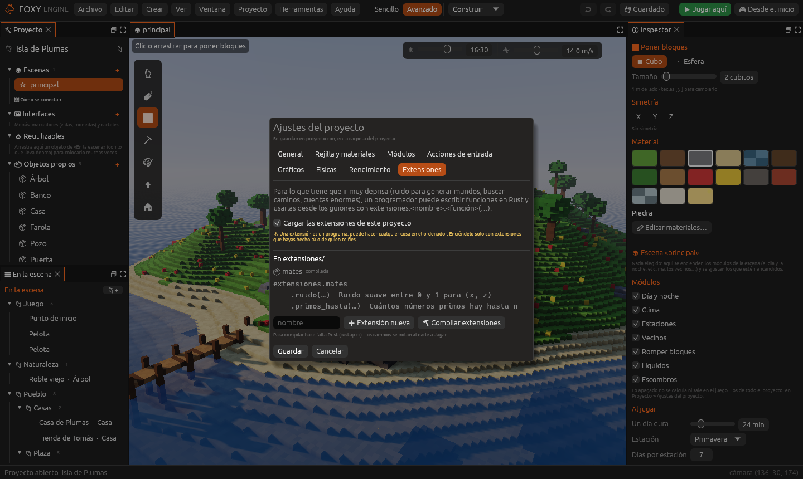

# Extensiones en Rust

Lua es cómodo, pero hay cosas que tienen que ir **muy deprisa**: generar el
ruido de un mundo entero, buscar caminos para cientos de personajes, hacer
cuentas enormes. Para eso, un programador puede escribir funciones en
**Rust** (el idioma en que está hecho el motor) y usarlas desde los
guiones como si fueran de Lua:

```lua
local altura = extensiones.mates.ruido(x, z)
```

Una función en Rust suele ir **decenas de veces más rápido** que la misma
en Lua.

> <i class="fx fx-aviso"></i> **Cuidado.** Una extensión es un programa: puede
> hacer cualquier cosa en el ordenador. Por eso vienen **apagadas** y cada
> proyecto tiene que permitirlas. Usa solo extensiones que hayas hecho tú o
> de alguien de quien te fíes.

## Lo que hace falta

[Rust](https://rustup.rs), instalado en el ordenador. Solo lo necesita
quien compila la extensión: quien juega no necesita nada.

## Crear una

1. **Proyecto → Ajustes del proyecto…**, página **Extensiones**.
2. Marca **Cargar las extensiones de este proyecto**.
3. Escribe un nombre (por ejemplo `mates`) y pulsa **Extensión nueva**. Se
   crea la carpeta `extensiones/mates/` con un ejemplo de dos funciones:
   `ruido(x, z)` y `primos_hasta(n)`.
4. Pulsa **Compilar extensiones**. La primera vez tarda un poco.
5. Pulsa **Guardar** y después **Jugar**.



En la página salen las extensiones que hay, si están compiladas y las
funciones de cada una, con su ayuda.

## Escribir funciones

El código está en `extensiones/<nombre>/src/lib.rs`. Ábrelo con tu editor
de Rust favorito. Cada función recibe los valores que le pasa Lua y
devuelve uno, o un error:

```rust
#[macro_use]
mod foxy;
use foxy::{Args, Valor};

fn doble(a: &Args) -> Result<Valor, String> {
    Ok(Valor::Numero(a.numero(0)? * 2.0))
}

extension!("mates", {
    "doble" => doble: "El doble de un número",
});
```

- `a.numero(0)`, `a.texto(1)`, `a.si_no(2)` y `a.vector(3)` leen los
  valores (empiezan en 0).
- Se devuelve `Valor::Numero`, `Valor::Texto`, `Valor::SiNo`,
  `Valor::Vector(x, y, z)` o `Valor::Nada`.
- Un `Err("texto")` sale en Lua como error, con el nombre de la función.
  Si la función falla del todo (un *pánico* de Rust), el motor no se cae:
  también sale como error.
- La macro `extension!` pone el nombre de la extensión y la lista de
  funciones, cada una con su ayuda.

No cambies `src/foxy.rs`: es lo que permite al motor y a la extensión
entenderse. Si una versión futura del motor lo cambia, te avisará de que
hay que volver a crear la extensión.

Después de cambiar el código, **Compilar extensiones** otra vez. También se
puede compilar a mano con `cargo build --release` dentro de su carpeta.

## Publicar

Al [publicar](../publicar/publicar.md), el juego lleva las extensiones ya
compiladas (no su código). Una extensión compilada vale **solo para el
sistema en que se compiló**: para publicar para Windows, compílala y
publica desde Windows (el motor lo avisa).

## Véase también

- [Paneles y herramientas propias](herramientas-propias.md)
- [Referencia de la API de Lua](../referencia/api-lua.md#extensiones-en-rust)
- [Programar en Lua](programar-lua.md)
