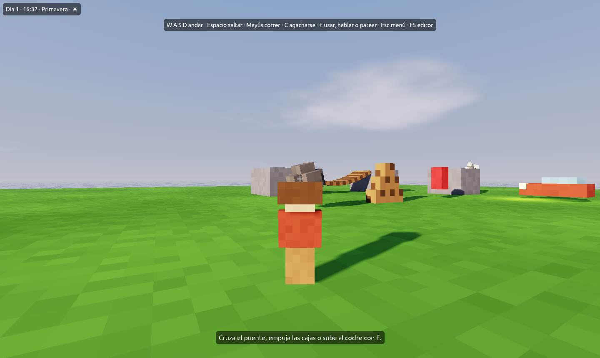
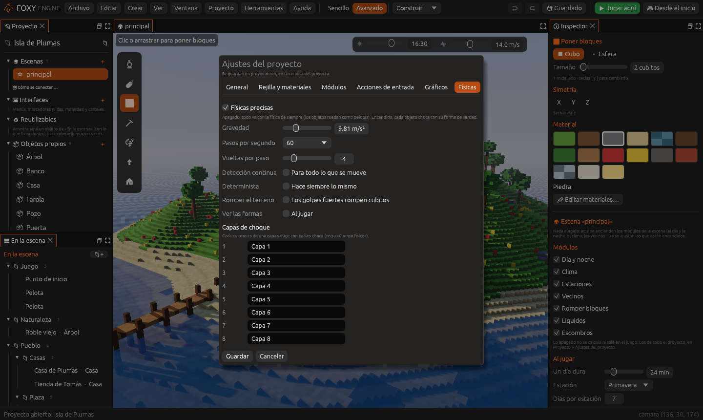
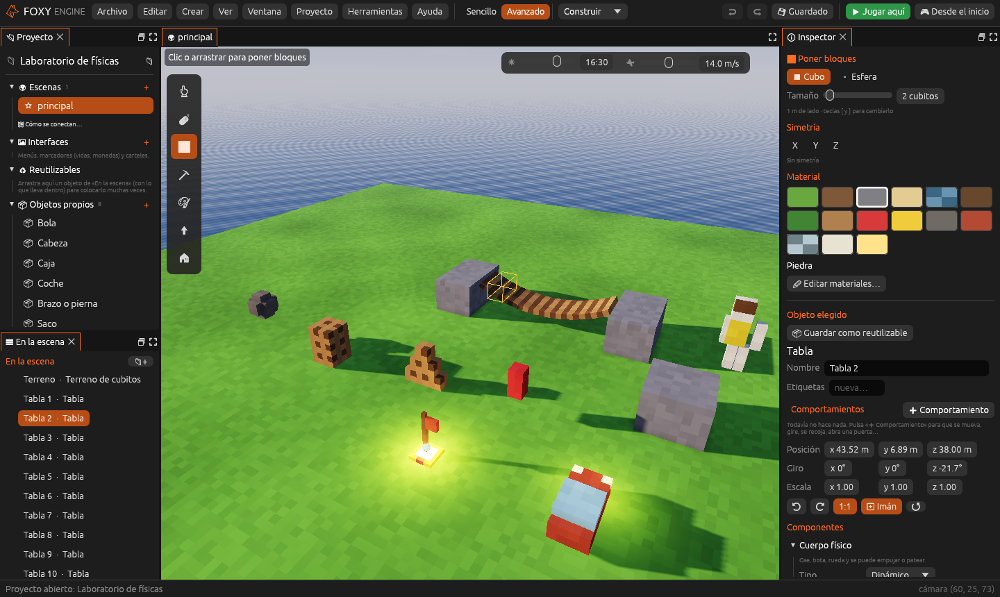
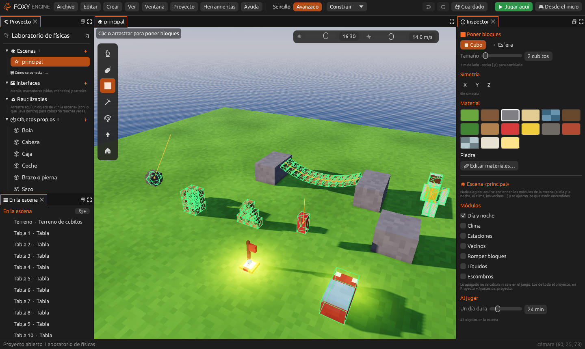

# Físicas precisas

Con las **físicas precisas** cualquier objeto puede tener un cuerpo físico
de verdad: cae, choca, se apila, rueda, se une a otros con bisagras,
muelles o cuerdas, se conduce como un coche y se rompe en pedazos. Todo se
monta desde el inspector, sin escribir código, y en el modo determinista
hace siempre lo mismo.



## 1. Encenderlas

Vienen apagadas: así los proyectos de antes funcionan igual que siempre.

1. Abre **Proyecto → Ajustes del proyecto…** y ve a la página **Físicas**.
2. Marca **Físicas precisas**.



| Opción | Descripción |
|---|---|
| **Gravedad** | Cuánto tira hacia abajo, en m/s². La de la Tierra es 9,81 |
| **Pasos por segundo** | Cuántas veces por segundo se calcula la física. Más pasos, más exacta y más trabajo |
| **Vueltas por paso** | Cuántas veces se repasa cada paso. Sube si las pilas de cajas tiemblan o las cadenas se estiran |
| **Detección continua** | Que nada atraviese las paredes aunque vaya muy rápido (para todo lo que se mueve) |
| **Determinista** | Hace siempre exactamente lo mismo: si el ordenador va lento, el juego va a cámara lenta en vez de saltarse pasos |
| **Romper el terreno** | Los golpes muy fuertes contra el suelo rompen los cubitos que se pueden romper |
| **Ver las formas** | Dibuja las formas de física al jugar |
| **Capas de choque** | Los nombres de las ocho capas (ver más abajo) |

La plantilla [Laboratorio de físicas](../tu-primer-juego/laboratorio-fisicas.md)
ya las trae encendidas, con el modo determinista.

## 2. Dar cuerpo a un objeto

Elige el objeto y, en el inspector, pulsa **➕ Componente → Cuerpo físico**.
Las propiedades están en la
[referencia del componente](../referencia/componentes/cuerpo-fisico.md);
las más importantes son:

- **Tipo**: **Dinámico** (cae y choca), **Cinemático** (lo mueven tus
  nodos, tus guiones o sus animaciones, y empuja a los demás) o **Fijo**
  (no se mueve nunca, como una pared).
- **Forma**: con qué forma choca. **Automática** suele acertar.
- **Masa**: cuánto pesa en kilos. Sin marcar, se calcula de su tamaño.
- **Rozamiento** y **Rebote**: si resbala como el hielo o se agarra, y si
  bota o se queda quieto.
- **Rompible** y **Resistencia**: se parte en pedazos con un golpe fuerte.



En el modo **Sencillo** solo salen las propiedades básicas; el resto
aparece en el modo **Avanzado**.

## 3. Unir objetos

El componente [Articulaciones](../referencia/componentes/articulaciones.md)
une un objeto con otro (por su nombre) o con el mundo:

| Tipo | Para qué |
|---|---|
| **Bisagra** | Puertas, ruedas, puentes, péndulos |
| **Rótula** | Hombros y caderas de un muñeco de trapo, cadenas |
| **Deslizadera** | Pistones, ascensores, cajones |
| **Muelle** | Trampolines, sacos de boxeo, suspensiones |
| **Cuerda** | Bolas de demolición, columpios, cosas colgadas |
| **Fija** | Pegar dos objetos que se rompen al recibir un golpe |

Cada unión tiene su **ancla** (dónde está, desde el centro del objeto),
su **eje**, sus **límites** y, si quieres, un **motor** que la hace girar
sola. Con **Se rompe con** la unión se suelta si tira demasiado.

> <i class="fx fx-consejo"></i> **Consejo.** Los objetos se unen tal como
> están colocados en el editor. Para un puente que cuelga, colócalos ya
> colgando.

## 4. Vehículos

El componente [Vehículo](../referencia/componentes/vehiculo.md) convierte
un objeto en un coche de cuatro ruedas. Con **Lo conduce: Jugador**, al
jugar acércate y pulsa **Usar** (<kbd>E</kbd>) para subir y bajar.

## 5. Capas de choque

Hay ocho capas. Cada cuerpo está en una (**Capa**) y elige con cuáles choca
(**Choca con**). Por ejemplo, las balas en la capa «Balas» que no chocan
entre ellas, o los fantasmas que atraviesan las paredes pero no al
jugador. Los nombres se ponen en la página **Físicas** de los ajustes.

## 6. Ver las formas

Con **Ver → Formas de física** se dibujan las formas con las que choca
cada objeto, en el editor y jugando: en verde los cuerpos, en gris los
que están escondidos y en amarillo las articulaciones. Es la forma más
rápida de ver por qué algo no choca como esperabas.



## 7. Con nodos y con Lua

En la paleta de nodos, la categoría **Física** tiene **Empujar un cuerpo**,
**Velocidad de un cuerpo**, **Lanzar un rayo**, **Mover una
articulación**, **Soltar las articulaciones**, **Romper un objeto**,
**Conducir un vehículo** y más, y los eventos **Al romperse** y **Al
soltarse una articulación**. En Lua son las mismas funciones:

```lua
function al_hacer_clic(caja)
  motor.empujar(caja, 0, 6, 0)   -- un salto hacia arriba
end

function cada_segundo()
  local quien, distancia = motor.rayo(motor.posicion("jugador"),
                                      motor.vector(0, -1, 0), 3)
  if quien then print("Debajo hay algo a " .. distancia .. " m") end
end

function al_romperse(objeto)
  motor.sonar("campana")
end
```

Todas están en la [referencia de nodos](../referencia/nodos.md) y en la
[referencia de la API de Lua](../referencia/api-lua.md).

## Véase también

- [Laboratorio de físicas](../tu-primer-juego/laboratorio-fisicas.md)
- [Cuerpo físico](../referencia/componentes/cuerpo-fisico.md)
- [Articulaciones](../referencia/componentes/articulaciones.md)
- [Vehículo](../referencia/componentes/vehiculo.md)
- [Valle enorme con físicas](../demos/valle-enorme.md): el laboratorio en un mundo de dos kilómetros
