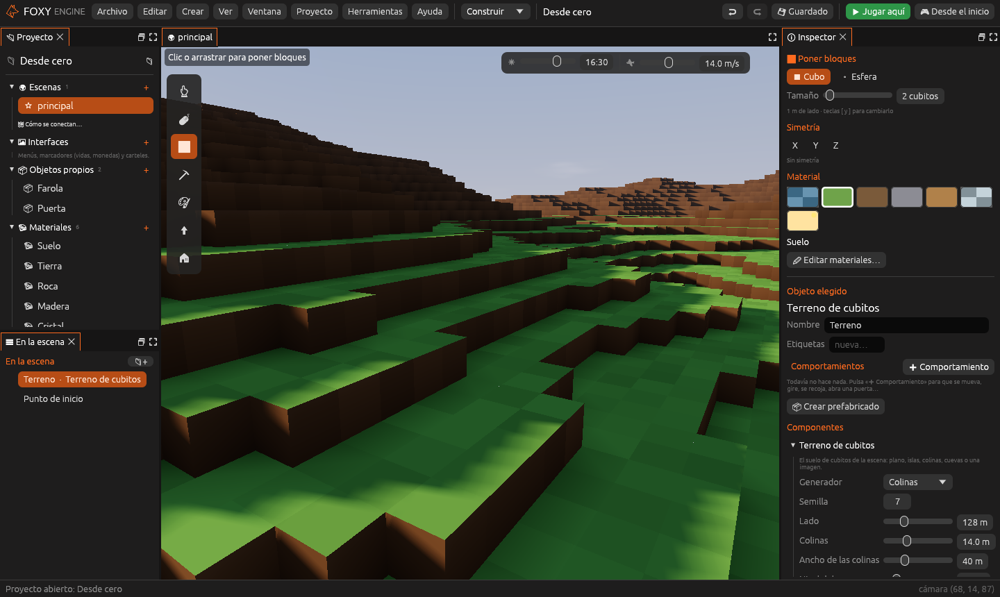
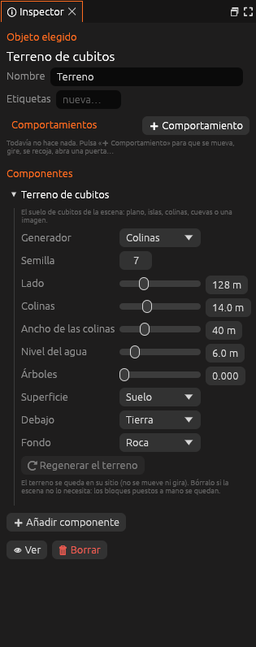

# El terreno de cubitos

El suelo de cubitos de una escena es un **objeto más**: el
**Terreno de cubitos**. Sale en *En la escena* como cualquier otro objeto, y
al elegirlo el [Inspector](../interfaz/inspector.md) muestra su
**generador**: la receta con la que se crea el terreno a partir de unos
pocos parámetros. Encima se guardan los cambios hechos con el pincel, de
modo que el archivo de la escena sigue siendo pequeño.



Una escena **no tiene por qué llevar terreno**. Una escena nueva vacía
empieza solo con una cámara y la luz del sol (ver
[Empezar una escena desde cero](escena-desde-cero.md)), y puedes borrar el
terreno de cualquier escena: lo que hayas construido a mano con el pincel
se queda.

## Poner o quitar el terreno

- Para ponerlo: **Crear → Terreno de cubitos** (o, sin nada elegido, el
  botón **➕ Terreno de cubitos** del Inspector). Empieza como un suelo
  plano. Una escena lleva un terreno o ninguno.
- Para quitarlo: elígelo en *En la escena* y pulsa **Borrar**. Se deshace
  con <kbd>Cmd/Ctrl</kbd>+<kbd>Z</kbd>.

El terreno no se mueve, no gira y no se duplica: siempre ocupa el mundo de
cubitos de la escena.

## Elegir el generador



1. Elige el objeto **Terreno** en *En la escena*.
2. En su componente **Terreno de cubitos**, elige un **Generador**.
3. Ajusta sus parámetros. Solo aparecen los que usa ese generador.
4. Pulsa **Regenerar el terreno**. Las entidades y los bloques puestos a
   mano se conservan. **Descartar** vuelve a lo que había.

> <i class="fx fx-consejo"></i> **Consejo.** Regenerar el terreno se deshace
> con <kbd>Cmd/Ctrl</kbd>+<kbd>Z</kbd>, como cualquier otro cambio.

## Generadores

| Generador | En el archivo | Descripción |
|---|---|---|
| **Vacío** | `Vacio` | Ningún terreno. Con *Plataforma*, una plataforma de 6 × 6 m en el centro para no caer |
| **Plano** | `Llano` | Un suelo llano con agua opcional |
| **Colinas** | `Colinas` | Colinas suaves por todo el mundo, con agua en los valles |
| **Cuevas** | `Cuevas` | Colinas con cuevas por dentro |
| **Islas** | `Isla` | Una isla rodeada de mar, con colinas, árboles y un muelle |
| **Imagen de alturas** | `Alturas` | El relieve sale de una imagen en grises del proyecto: el blanco, alto; el negro, bajo |

## Imagen de alturas

Con **Imagen de alturas** dibujas el relieve como una imagen:

1. Pinta una imagen en grises en [Pixel art](pixel-art.md) (o copia un PNG
   en la carpeta `imagenes/` del proyecto). Lo blanco serán montañas y lo
   negro, valles. Los grises intermedios quedan a media altura.
2. Elige el terreno, pon el generador en **Imagen de alturas** y elige la
   imagen en **Imagen**.
3. Ajusta **Del negro al blanco** (cuántos metros sube el blanco sobre el
   negro), el **Lado** del mundo y el **Nivel del agua**.
4. Pulsa **Regenerar el terreno**.

La imagen se estira para cubrir todo el mundo, con la fila de arriba al
norte. Si la cambias, pulsa **Volver a leer la imagen** para rehacer el
relieve. Una imagen pequeña (64 × 64, por ejemplo) basta: el motor
suaviza entre píxel y píxel.

## Parámetros

| Parámetro | Campo | Generadores | Descripción |
|---|---|---|---|
| Semilla | `semilla` | Islas, Colinas, Cuevas, Imagen | Con la misma semilla sale el mismo terreno |
| Lado | `lado` | Todos | Tamaño del mundo, en metros |
| Imagen | `imagen` | Imagen | La imagen en grises, como `imagenes/relieve.png` |
| Tamaño de la isla | `radio` | Islas | Radio de la isla |
| Colinas / Del negro al blanco | `altura` | Islas, Colinas, Cuevas, Imagen | Altura de las colinas, o lo que sube el blanco |
| Ancho de las colinas | `escala` | Colinas, Cuevas | Distancia entre una colina y la siguiente |
| Cuevas | `cuevas` | Cuevas | De 0 (pocas) a 1 (muchas) |
| Nivel del agua | `nivel_del_mar` | Todos menos Vacío | Altura del agua |
| Árboles | `arboles` | Islas, Colinas, Cuevas, Imagen | De 0 (ninguno) a 1 (bosque) |
| Muelle | `muelle` | Islas | Un muelle de madera en la playa del sur |
| Plataforma | `plataforma` | Vacío | La plataforma del centro |
| Superficie, Debajo, Fondo | `suelo`, `relleno`, `roca` | Todos menos Islas | Los materiales de cada capa |

Los materiales de cada capa se eligen entre los del proyecto. Un proyecto
vacío usa sus propios materiales (*Suelo*, *Tierra* y *Roca*).

## En el archivo

El terreno es un objeto de tipo `terreno` con el componente
[`Terreno`](../referencia/componentes/terreno.md). Solo se escriben los
campos que usa su generador:

```ron
(tipo: "terreno", nombre: "Terreno", id: 1, pos: (0.0, 0.0, 0.0),
 componentes: [Terreno((tipo: Colinas, semilla: 7, lado: 128.0, altura: 14.0,
     nivel_del_mar: 6.0, suelo: Propio(16), relleno: Propio(17), roca: Propio(18),
     escala: 40.0))]),
```

> <i class="fx fx-nota"></i> **Nota.** Las escenas de versiones
> anteriores guardaban el generador aparte, en `generador:` (o `isla:`). Al
> abrir el proyecto, el motor hace una copia de seguridad y lo convierte en
> el objeto *Terreno*, el primero de la lista.

## Véase también

- [Empezar una escena desde cero](escena-desde-cero.md)
- [Construir el mundo](mundo.md)
- [Terreno de cubitos (referencia)](../referencia/componentes/terreno.md)
- [Rejilla y materiales](../editor/ajustes-proyecto.md#rejilla-y-materiales)
