# Gráficos: luz, sombras y atmósfera

Foxy Engine dibuja con **luz de verdad**: el sol, una antorcha o la lava
pueden dar mucha más luz que el blanco de la pantalla, como en la vida real.
Luego, igual que una cámara, el motor decide cuánta luz deja pasar (la
**exposición**) y cómo la convierte en colores (el **tono**).

Nada viene preparado para un estilo: un proyecto nuevo se ve como siempre, y
tú cambias solo lo que quieras. Pero conseguir algo realista es fácil, porque
los materiales y las luces funcionan como en Blender.

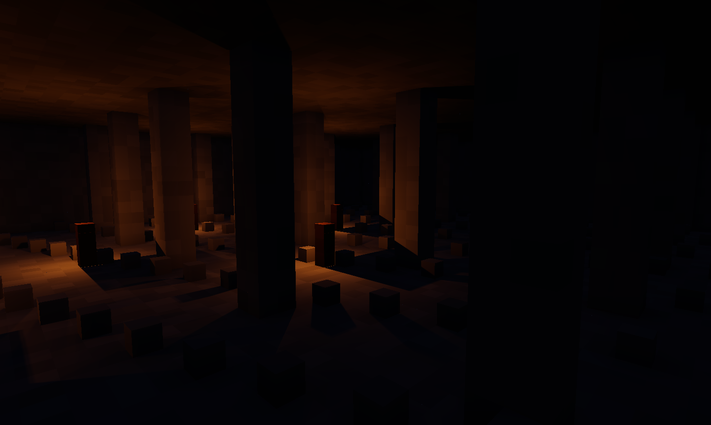

## Dónde se cambia cada cosa

| Qué | Dónde | Para quién |
|---|---|---|
| Exposición, tono, luz y atmósfera y piezas del dibujo | **Proyecto → Ajustes del proyecto → Gráficos** | Todo el juego |
| Niebla y rayos de luz | Un objeto con el componente [Niebla](../referencia/componentes/niebla.md) | Esa escena |
| Calidad con la que empieza el juego | **Ajustes del proyecto → Gráficos** | Los jugadores, al abrirlo por primera vez |
| Calidad del juego de cada jugador | **Opciones → Gráficos**, dentro del juego | Ese jugador |
| Calidad en el editor y el dibujante | **Editar → Preferencias** | Tu ordenador |

Los cambios en los ajustes del proyecto se ven **al momento** en la escena,
antes de pulsar **Guardar**.

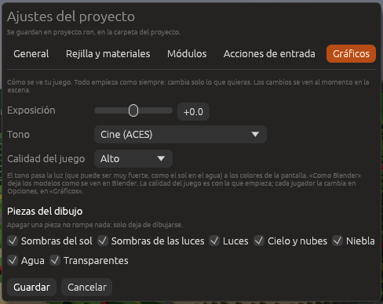

## Exposición

Más luz (+) o menos (−), en pasos de cámara: **+1** es el doble de luz y
**−1** la mitad. Va de −4 a +4. Úsala cuando la escena entera se vea oscura
(una cueva, una noche) o quemada (un desierto a mediodía).

## Tono

El tono pasa la luz, que puede ser muy fuerte, a los colores que la pantalla
sabe mostrar.

| Tono | Cómo se ve |
|---|---|
| **Cine (ACES)** | El de siempre: contraste y colores vivos, como en el cine. Viene puesto |
| **Como Blender (AgX)** | Igual que el que usa Blender. Elígelo si haces los modelos en Blender y quieres que se vean exactamente igual |
| **Neutro** | Respeta los colores tal cual (bueno para productos o arte con colores exactos) |
| **Ninguno** | Sin curva: lo que pasa de blanco se corta |

| Cine (ACES) | Como Blender (AgX) |
|---|---|
| 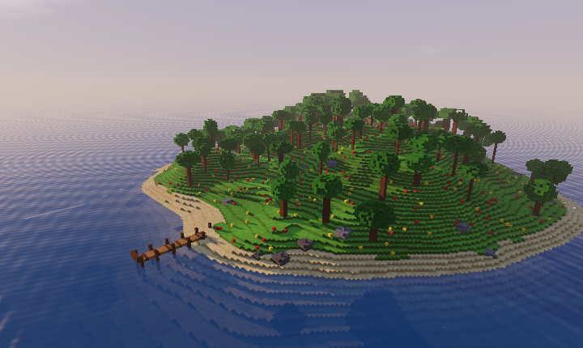 | 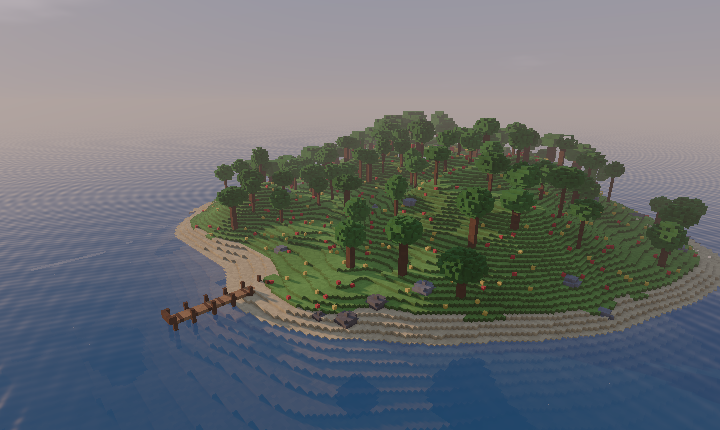 |
| **Neutro** | **Ninguno** |
| 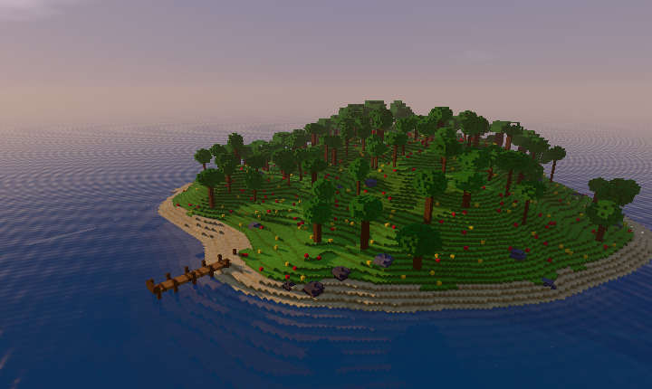 | 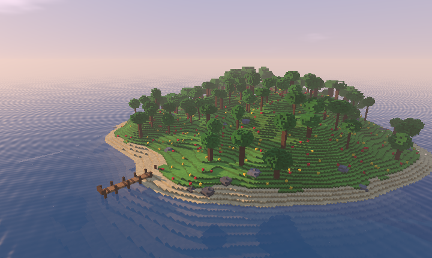 |

## Calidad

Cinco niveles. Cuanto más alto, más bonito y más trabajo para el ordenador.

| Calidad | Sombras | Luces a la vez | Luces con sombra |
|---|---|---|---|
| **Bajo** | Sencillas | 64 | Ninguna |
| **Medio** | Normales | 256 | 2 |
| **Alto** | Finas (viene puesta) | 1.024 | 4 |
| **Ultra** | Muy finas | 1.024 | 8 |
| **Cine** | Las mejores, para capturas y vídeos | 1.024 | 16 |

Cuando hay más luces con sombra de las que permite la calidad, hacen sombra
las más cercanas a la cámara; las demás siguen iluminando.

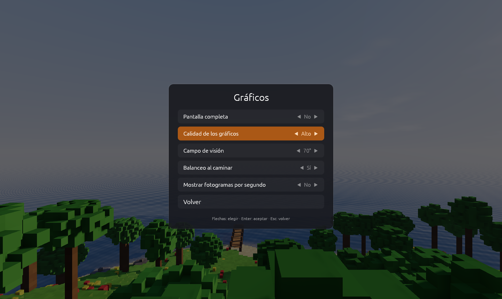

## Luces y sombras

Un objeto con el componente [Luz](../referencia/componentes/luz.md) ilumina
alrededor. Marca su casilla **Sombras** en el inspector y además **hace
sombras**: una antorcha en una cueva dibuja la sombra de cada columna y
cada roca. Pueden encenderse **cientos de luces** a la vez sin que el juego
vaya más lento.

> <i class="fx fx-consejo"></i> **Consejo.** Las sombras de las luces cuestan
> más que la luz sola. Ponlas en las luces que importan (la antorcha del
> jugador, la lámpara de una sala) y deja sin sombra las de adorno.

## Materiales de los modelos (PBR)

Los modelos glTF que hagas en Blender se ven con **todo su material**:
color, relieve (mapa de normales), rugosidad, metal, oclusión (los rincones
más oscuros) y brillo. Lo que brilla con fuerza, como la lava, **ilumina lo
que tiene alrededor**. Ver
[Modelos 3D](modelos-3d.md#materiales-y-texturas).

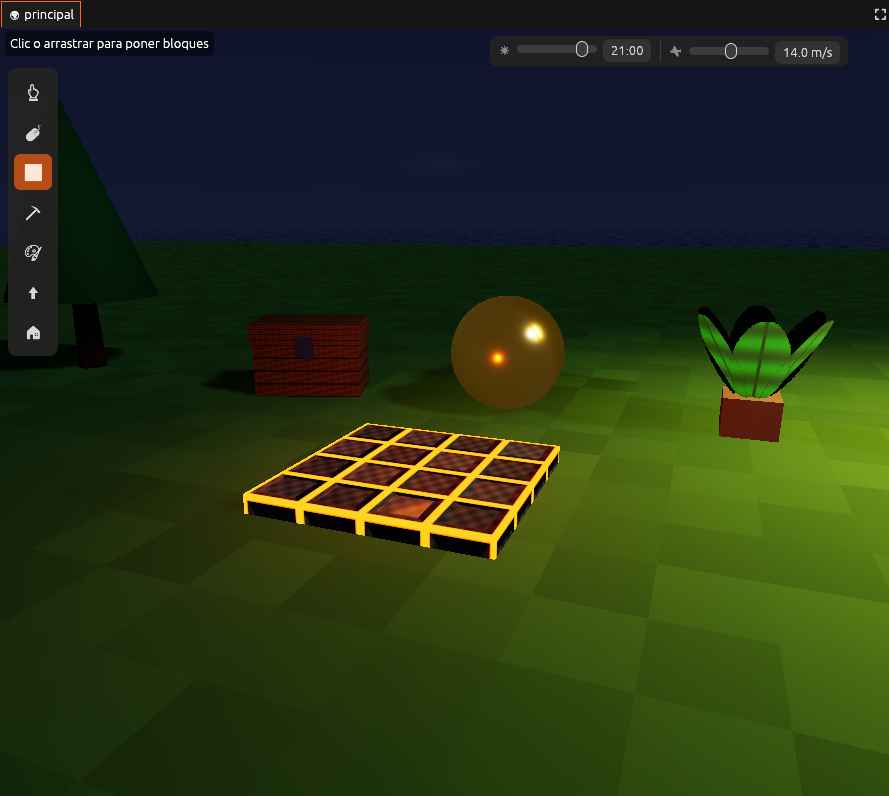

## Luz y atmósfera

Estas piezas hacen que la escena parezca de verdad. Todas vienen
**apagadas**: un proyecto nuevo se ve igual que siempre. El botón
**Realista** las enciende de una vez con unos valores que quedan bien, y
**Apagar todo** las quita.

| Isla con el tono Cine | La misma isla con **Realista** |
|---|---|
|  | 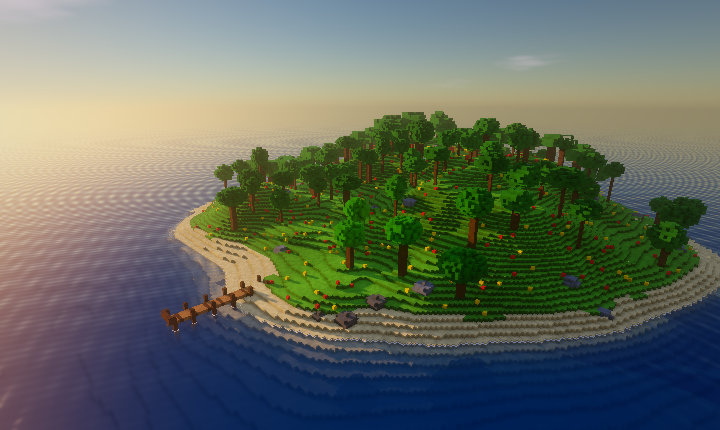 |

| Pieza | Qué hace |
|---|---|
| **Luz que rebota** | La luz del sol rebota en el terreno de cubitos. Una cueva cerrada se queda a oscuras, y la luz que entra por un agujero aclara la sala |
| **Rincones más oscuros** | Las juntas y los rincones reciben menos luz (oclusión ambiental). De 0 a 1 |
| **Agua de verdad** | Se ve el fondo torcido por las olas, el agua honda se vuelve azul, refleja lo que tiene alrededor y hace espuma en la orilla |
| **Cielo físico** | El color del cielo sale de cómo el aire esparce la luz: azul a mediodía y rojo al atardecer |
| **Destello** | Lo muy brillante, como el sol o una antorcha, deja un halo |
| **Desenfoque** | Lo que no está enfocado se ve borroso, como en una cámara. **Enfoque** dice a qué distancia se ve nítido (0 es lo que haya en el centro) |
| **Suavizado temporal** | Quita los dientes de sierra de los bordes mezclando cada fotograma con el anterior |
| **Escala del dibujo** | Con el suavizado temporal, dibuja a menos resolución y la vuelve a agrandar: más fotogramas por segundo. Solo al jugar; en el editor se ve siempre entero |
| **Color** | Contraste, saturación, temperatura (más cálido o más frío) y viñeta (bordes más oscuros) |

Estas piezas solo funcionan con el dibujante nuevo.

### Rayos de luz con la niebla

Para que salgan rayos de luz no hay que tocar ningún ajuste técnico. Basta
con tres cosas:

1. Un sol: el objeto **Sol** que trae cada escena, o **Crear → Luz del sol**.
2. Un hueco por donde entre la luz: un agujero en el techo de una cueva, una
   ventana o los árboles de un bosque.
3. Niebla: **Crear → Niebla**.

La niebla se ilumina donde le da el sol, y se ven los rayos que entran por
el agujero. Las antorchas y las demás luces también hacen un halo en la
niebla. Dentro de una cueva cerrada, la niebla se queda oscura.

| Con la niebla de fábrica | Con la niebla y **Realista** |
|---|---|
| 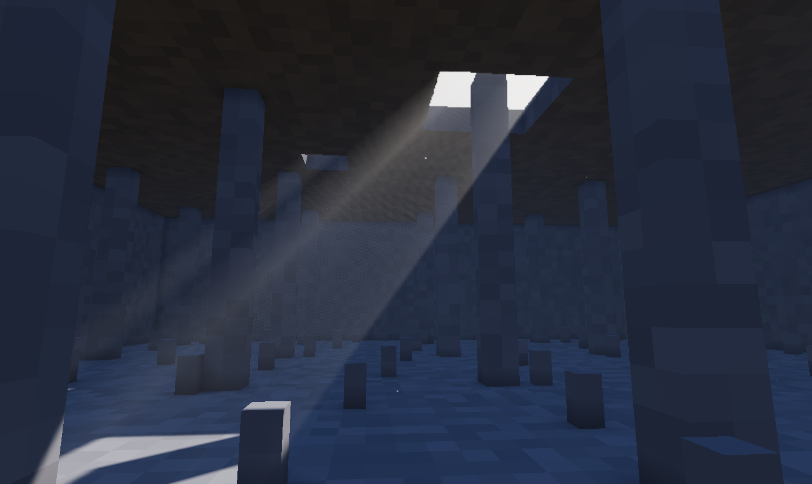 | 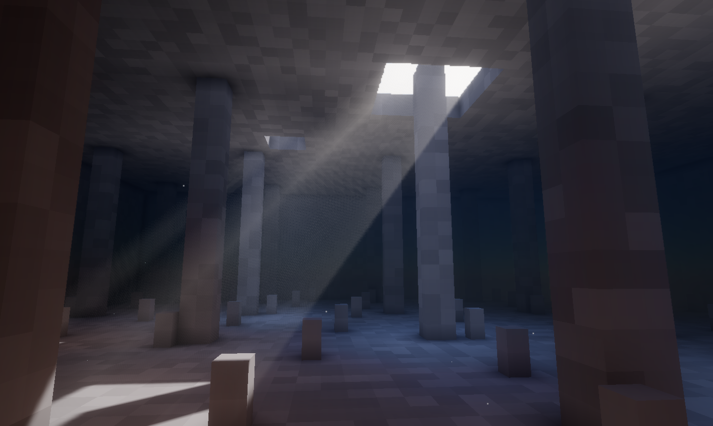 |

En el inspector de la niebla se cambian su **Densidad**, la fuerza de los
**Rayos**, la **Altura** a la que se aclara (para hacer niebla de valle) y su
**Color**. Ver [Niebla](../referencia/componentes/niebla.md).

> <i class="fx fx-consejo"></i> **Consejo.** La luz que rebota y la niebla
> gastan más en las calidades altas, porque miran más lejos y con más
> detalle. Si el juego va lento, baja la **Calidad** o la **Escala del
> dibujo** antes de apagar piezas.

## Mar, viento y reflejos

En la misma página, la sección **Mar, viento y reflejos** añade lo que hace
que un paisaje parezca de verdad. También viene **apagada**; **Encender
todo** la pone con unos valores que quedan bien.

| Ajuste | Qué hace |
|---|---|
| **Reflejos en lo pulido** | El mármol pulido, el oro y los suelos brillantes reflejan lo que tienen delante (las columnas, una estatua, una persona), no solo el cielo. Funciona con los materiales que tienen **Pulido** alto o son metálicos |
| **Mar hasta el horizonte** | El mar no se acaba en el borde del mundo: sigue hasta donde se pierde la vista |
| **Olas** | Altura de las olas, en metros. Las crestas hacen espuma y el oleaje llega a la orilla |
| **Viento** | Cuánto se mecen los árboles, la hierba, las velas y las banderas. Lo de abajo (el tronco, el casco) se queda quieto |
| **Sopla hacia** | Hacia dónde va el viento, y con él las olas |

El viento mueve los árboles del motor y los [objetos propios](creador.md)
que tengan **Viento** en el creador. Todo esto solo funciona con el
dibujante nuevo.

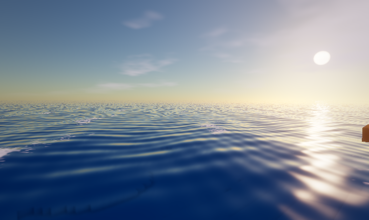

## Piezas del dibujo

Cada parte del dibujo se puede apagar: **Sombras del sol**, **Sombras de las
luces**, **Luces**, **Cielo y nubes**, **Niebla**, **Agua** y
**Transparentes**. Apagar una pieza no rompe nada: solo deja de dibujarse.
Sirve para juegos con un estilo propio (sin niebla, sin agua) o para ver qué
es lo que más cuesta en un ordenador lento.

**Volver a como venía** deja toda la página como al principio.

## El dibujante clásico

En **Editar → Preferencias → Dibujante** puedes elegir el **Clásico**, el
que tenía el motor antes. No tiene exposición, tono, materiales completos,
luces con sombra ni luz y atmósfera. Úsalo solo si el nuevo da problemas en tu ordenador, y
cuéntalo para que se pueda arreglar.

## Véase también

- [Ajustes del proyecto](../editor/ajustes-proyecto.md#gráficos)
- [Preferencias](preferencias.md#gráficos)
- [Rendimiento](rendimiento.md)
- [Luz](../referencia/componentes/luz.md)
- [Niebla](../referencia/componentes/niebla.md)
- [Efectos y estilos](efectos.md)
- [La cueva](../demos/cueva.md): rayos de sol en la bruma, luz que rebota y antorchas con sombra, todo junto
