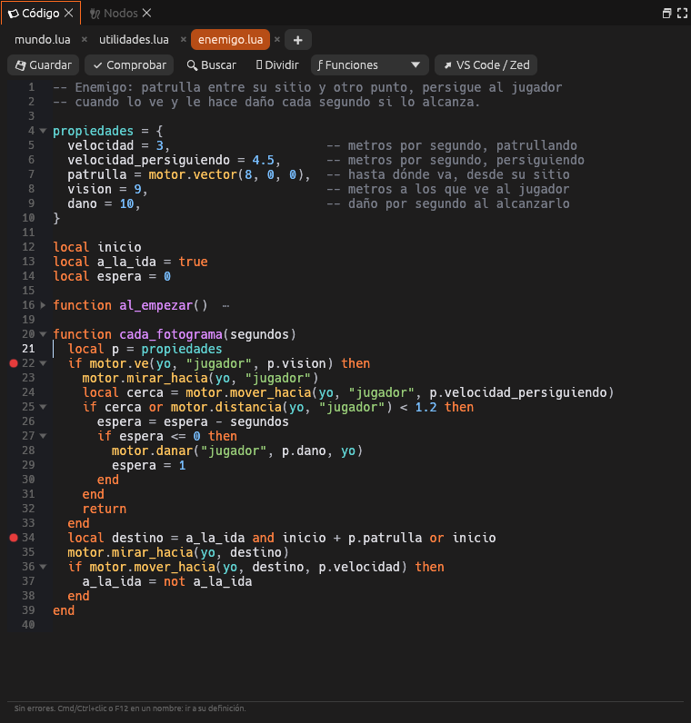
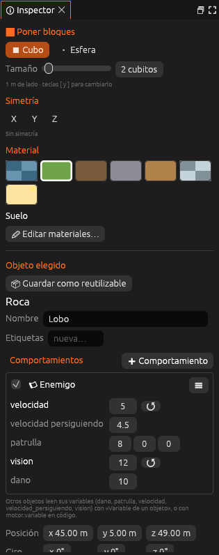

# Guiones de objeto

Un **guion de objeto** describe el comportamiento de un solo objeto: un
enemigo que patrulla, una puerta que se abre, una moneda que se recoge. El
mismo archivo se puede usar en muchos objetos, y **cada uno tiene su propia
copia**, con sus propias variables.



## Crear un guion

La forma más rápida es desde el propio objeto:

1. Elige el objeto en la escena.
2. En el inspector, pulsa **➕ Comportamiento → 📜 Código nuevo** y elige
   una plantilla. El guion se crea en `guiones/`, se le pone al objeto como
   [comportamiento](comportamientos.md) y se abre en el panel **Código**.

También puedes crearlo antes, con **Guion nuevo** en el grupo **Guiones**
del panel **Proyecto** o con el botón **+** de las pestañas de **Código**, y
después ponérselo al objeto con **➕ Comportamiento → 📂 Del proyecto**.
Un objeto puede llevar varios guiones y grafos a la vez.

| Plantilla | Qué hace |
|---|---|
| **Objeto vacío** | Las funciones principales vacías y una tabla de propiedades |
| **Enemigo** | Patrulla, persigue al jugador cuando lo ve y le hace daño al alcanzarlo |
| **Puerta** | Se abre al acercarse el jugador y se cierra al irse, con sonido |
| **Recogible** | Al tocarlo desaparece, suena y suma a un valor del juego (por ejemplo, `monedas`) |
| **Módulo** | Funciones para usar desde otros guiones con `require` |

## `yo` y las funciones del motor

Dentro de un guion de objeto, **`yo`** es el objeto que lo lleva. Se pasa a
las funciones de `motor` como cualquier otro objeto:

```lua
function al_empezar()
  inicio = motor.posicion(yo)
end
```

Las funciones que llama el motor son las mismas que en el
[guion del mundo](guiones.md), con dos diferencias:

- **Choques, zonas y daño** (`al_chocar`, `al_entrar_zona`, `al_salir_zona` y
  `al_recibir_dano`) solo llegan cuando afectan a **esta** objeto, y no
  reciben el objeto como primer argumento: `al_chocar(otro)`,
  `al_recibir_dano(cantidad, de)`.
- **`al_recibir(evento, valor, de)`** recibe los eventos propios enviados
  con `motor.emitir` o `motor.emitir_a`.

La lista completa está en la
[referencia de la API de Lua](../referencia/api-lua.md#funciones-que-llama-el-motor).

## Propiedades

La tabla **`propiedades`**, al principio del guion, declara los valores que
se ajustan desde el inspector. El comentario de cada línea es su ayuda:

```lua
propiedades = {
  velocidad = 3,                     -- metros por segundo, patrullando
  patrulla = motor.vector(8, 0, 0),  -- hasta dónde va, desde su sitio
  vision = 9,                        -- metros a los que ve al jugador
  agresivo = true,                   -- si persigue al jugador
  saludo = "¡Alto!",                 -- lo que dice al verte
}
```



El inspector enseña un campo para cada propiedad, según su tipo: número,
**sí/no**, texto o vector. El botón **↺** devuelve el valor del guion. Cada
objeto guarda sus propios valores en la escena, así que dos lobos con el
mismo guion pueden ir a velocidades distintas.

En el código, los valores se leen con `propiedades.velocidad`. Son los
mismos que las **variables del objeto** de los [nodos](nodos.md): otra
objeto los lee con `motor.variable(entidad, "velocidad")` y los cambia con
`motor.poner_variable`.

> <i class="fx fx-consejo"></i> **Consejo.** Si cambias el valor de una
> propiedad en el código, los objetos que tenían el valor anterior y no lo
> habían cambiado en el inspector toman el nuevo, también con el juego en
> marcha.

## Variables del guion

Las variables `local` declaradas fuera de las funciones son de cada objeto y
duran toda la partida. Sirven para recordar cosas entre fotogramas:

```lua
local a_la_ida = true

function cada_fotograma(segundos)
  if motor.mover_hacia(yo, destino, propiedades.velocidad) then
    a_la_ida = not a_la_ida
  end
end
```

Al [recargar el guion](lua-depurar.md#recargar-sin-reiniciar) con el juego
en marcha, estas variables **conservan su valor**.

## Módulos

Un **módulo** es un archivo de `guiones/` que devuelve una tabla de
funciones. Se carga desde cualquier guion con `require` y el nombre del
archivo sin `.lua`:

```lua
-- guiones/utilidades.lua
local M = {}

function M.saludar(nombre)
  motor.decir("¡Hola, " .. nombre .. "!")
end

return M
```

```lua
-- guiones/enemigo.lua
local utilidades = require("utilidades")

function al_chocar(otro)
  utilidades.saludar("viajero")
end
```

Los módulos pueden estar en subcarpetas: `require("ia.patrulla")` carga
`guiones/ia/patrulla.lua`. Al guardar un módulo con el juego en marcha, se
recargan también los guiones que lo usan.

## Hablar con otros objetos

- `motor.emitir("alarma", valor, yo)` avisa a todos: a los nodos *Al recibir
  un mensaje* y a la función `al_recibir` de todos los guiones de objeto.
- `motor.emitir_a("Puerta", "abrir")` avisa solo a ese objeto.
- `motor.emitir_etiqueta("enemigo", "alarma")` avisa a todas las que llevan
  esa etiqueta.
- `al_chocar_objeto(otro)`, `al_entrar_objeto_zona(quien)` y
  `al_hacer_clic()` dicen cuándo toca a otro objeto, cuándo entra alguien
  en su zona y cuándo el jugador le hace clic. Ver
  [Objetos que se hablan](objetos-que-se-hablan.md).
- `motor.danar(entidad, cantidad, yo)` llama a `al_recibir_dano` de la otra
  objeto.

```lua
function al_recibir(evento, valor, de)
  if evento == "alarma" then
    propiedades.vision = 20
  end
end
```

## Véase también

- [Programar en Lua](programar-lua.md)
- [Comportamientos](comportamientos.md)
- [Objetos que se hablan](objetos-que-se-hablan.md)
- [Tutorial: el enemigo en Lua](tutorial-enemigo-lua.md)
- [Recargar, consola y depurador](lua-depurar.md)
