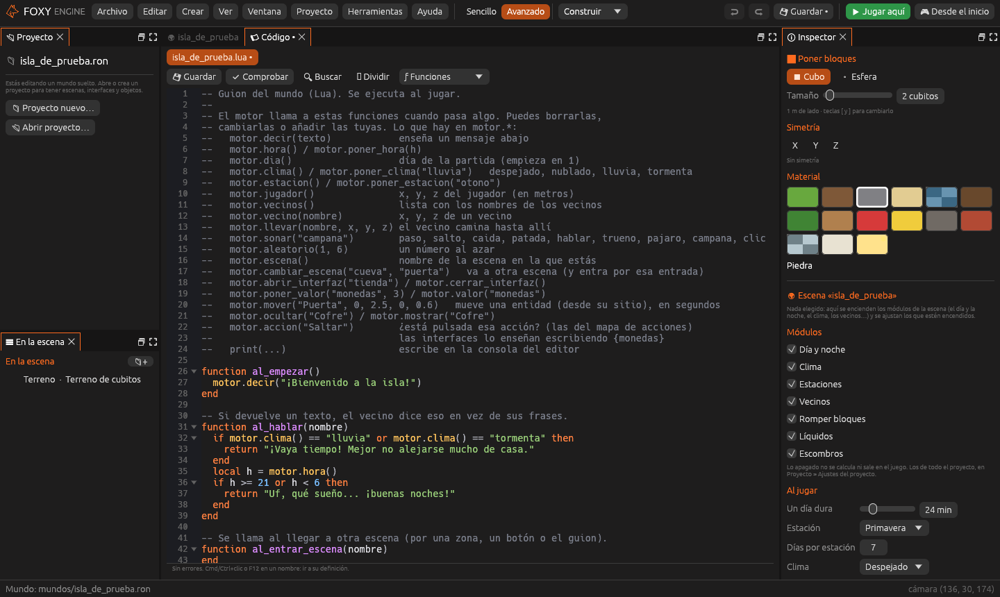

# Guion del mundo

El **guion del mundo** (`guiones/mundo.lua`) controla lo que afecta a todo el
juego. Para el comportamiento de una sola entidad, usa un
[guion de entidad](guiones-entidad.md).

Casi todo se hace con el ratón, pero cuando quieras que el mundo **reaccione**
(que un vecino diga algo distinto cuando llueve, que suene una campana cada
mañana, que una puerta abra una tienda) usa un **guion**.

Los guiones se escriben en [Lua](https://www.lua.org/manual/5.4/es/), un
lenguaje pequeño y fácil que se usa en muchísimos juegos. Si prefieres no
escribir, lo mismo se puede hacer con [nodos](nodos.md).



## Dónde está el guion

Cada proyecto tiene su guion en `guiones/mundo.lua`. Se abre con un clic en
<i class="fx fx-guion"></i> **mundo.lua**, en el grupo *Guion* del panel
«Proyecto», y se edita en el panel **Código**, que tiene:

- **Comprobar**: busca errores sin jugar.
- La **[Consola](../interfaz/consola.md)**, donde salen los errores al jugar
  y lo que escribas con `print()`, y donde se ejecuta Lua contra el juego.

Un **proyecto vacío** empieza con las funciones `al_empezar`, `al_hablar`,
`al_entrar_escena` y `al_nuevo_dia` vacías, y una lista al principio con todo
lo que se puede usar. La *Isla sin objetos* y la *Plaza de prueba* traen un
guion de ejemplo que ya hace cosas.

Si el guion tiene errores, su nombre lleva un <i class="fx fx-aviso"></i> en
el panel «Proyecto».

## Cómo funciona

El guion no tiene un «principio» que se ejecute de arriba abajo. Tiene
**funciones con nombres especiales** que el motor llama cuando pasa algo:

```lua
function al_empezar()
  motor.decir("¡Bienvenido a la isla!")
end

function al_nuevo_dia(dia)
  motor.sonar("campana")
  motor.decir("Empieza el día " .. dia)
end
```

| Función | Cuándo la llama el motor |
|---|---|
| `al_empezar()` | Al empezar a jugar: partida nueva, partida cargada o *Jugar aquí* |
| `al_hablar(nombre)` | Al hablar con un vecino. Si devuelve un texto, el vecino dice eso en vez de sus frases |
| `al_nuevo_dia(dia)` | Cuando empieza un día nuevo |
| `al_cambiar_hora(hora)` | Al empezar cada hora del juego. Recibe la hora en punto, de 0 a 23 |
| `cada_segundo()` | Una vez por segundo |
| `cada_fotograma(segundos)` | Unas 60 veces por segundo. Recibe los segundos desde el anterior |
| `al_entrar_escena(nombre)` | Al llegar a otra escena |
| `al_pulsar(accion)` | Al pulsar una [acción de entrada](acciones-entrada.md) |
| `al_chocar(entidad)` | Cuando el jugador toca una entidad |
| `al_entrar_zona(entidad)`, `al_salir_zona(entidad)` | Cuando el jugador entra o sale de una [zona](../referencia/componentes/zona.md) |
| `al_recibir_dano(entidad, cantidad, de)` | Cuando algo hace daño a una entidad con `motor.danar` o con el nodo *Hacer daño* |

No hace falta escribirlas todas: si una no está, el motor no hace nada.

Desde esas funciones se usa la tabla **`motor`** para preguntar cosas o
pedirlas: `motor.hora()`, `motor.poner_clima("lluvia")`,
`motor.llevar("Plumas", 90, 16, 120)`… La lista completa está en
[API de Lua](../referencia/lua.md).

## Ejemplos

### Un vecino que habla según el tiempo

```lua
function al_hablar(nombre)
  if nombre == "Plumas" and motor.clima() == "lluvia" then
    return "¡Qué día más feo! Me quedo en casa."
  end
  local h = motor.hora()
  if h >= 21 or h < 6 then
    return "Uf, qué sueño... ¡buenas noches!"
  end
  -- sin return: dice una de sus frases de siempre
end
```

### Una tormenta los viernes

```lua
function al_nuevo_dia(dia)
  if dia % 7 == 5 then
    motor.poner_clima("tormenta")
    motor.decir("Se acerca una tormenta...")
  end
end
```

### Un vecino que va al pozo por la mañana

```lua
function al_cambiar_hora(hora)
  if hora == 8 then
    motor.llevar("Tomás", 100.5, 18, 121)
  end
end
```

### Botones y zonas que llaman al guion

Un botón de una interfaz, una zona del mundo o un objeto (con
[*Al usarlo*](mundo.md#al-usarlo-e)) con la acción **Llamar al guion**
llaman a la función que digas. La función recibe el **nombre** del botón, la
zona o el objeto que la llamó:

```lua
function abrir_cofre(quien)
  motor.sonar("campana")
  motor.poner_valor("monedas", (motor.valor("monedas") or 0) + 10)
  motor.decir("¡Has encontrado 10 monedas!")
end
```

## Esperar sin parar el juego

Las funciones que llama el motor pueden usar `motor.esperar(segundos)`:
esa función se detiene y sigue después, pero el juego no se para.

```lua
function al_entrar_zona(entidad)
  motor.decir("La trampa se activa…")
  motor.esperar(2)
  motor.danar("jugador", 20)
end
```

## Guiones y nodos juntos

Los guiones y los [nodos](nodos.md) funcionan a la vez y pueden hablar
entre ellos:

- Las variables **del juego** de los nodos son valores: léelas con
  `motor.valor("vida")` y cámbialas con `motor.poner_valor`.
- `motor.emitir("alarma", valor)` pone en marcha los nodos
  *Al recibir un evento* con ese nombre.
- **{ } Ver como código**, en el panel Nodos, enseña el Lua de cualquier
  grafo para copiarlo a `mundo.lua`, sin borrar el grafo. Ver
  [Depurar y ver como código](nodos-depurar.md#ver-como-código).

## Autocompletado

El panel **Código** completa todo lo de `motor` mientras escribes y enseña la
ayuda de cada función. Para usar VS Code o Zed, mira
[Editores externos](lua-editor-externo.md).

## Errores

Un error en el guion **no cierra el juego**: sale en pantalla y en la consola
del editor, con la línea donde está. El motor también para los bucles que no
terminan nunca («el guion tarda demasiado»).

> <i class="fx fx-consejo"></i> **Consejo.** Pulsa **Comprobar** antes de jugar: encuentra las faltas de
> escritura, como un `end` olvidado.

## Buenas prácticas

- Usa `local` para las variables de dentro de una función.
- `cada_segundo()` se llama muy a menudo: deja ahí solo lo que de verdad tenga
  que comprobarse cada segundo.
- Los guiones **piden** cosas al motor; el motor las hace al terminar el
  fotograma. Por eso, después de `motor.poner_hora(8)`, `motor.hora()` todavía
  devuelve la hora de antes hasta el siguiente fotograma.
- Guarda lo que tenga que durar entre partidas con `motor.poner_valor`: se
  guarda con la partida. Las variables normales de Lua se pierden al cerrar.
- `al_empezar()` también se llama al **cargar** una partida. No pongas ahí a
  cero valores que el jugador ya tenía; usa `motor.valor("x") or 0`.
