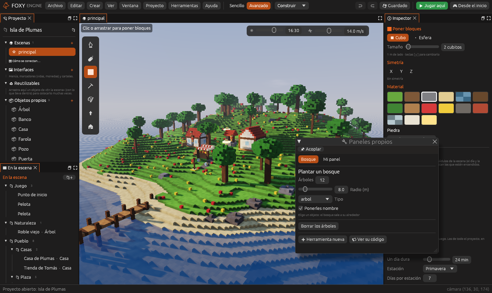

# Paneles y herramientas propias

Si sabes un poco de Lua, puedes añadir al editor **tus propios paneles y
órdenes**: un panel para plantar un bosque, una orden que ordena los
objetos en fila, un contador de objetos... Viven en el proyecto, así que
cada juego puede tener las suyas.



## Crear una

**Herramientas → Herramienta nueva…** (en modo Avanzado) crea el archivo
`herramientas/mis_herramientas.lua` con un ejemplo y lo abre en el panel
[Código](../interfaz/codigo.md). Cada vez que lo guardas, el editor lo
vuelve a leer: no hace falta cerrar nada.

- Los **paneles** salen en **Ventana → Paneles propios** (también en
  **Herramientas → Paneles propios**), cada uno en su pestaña.
- Las **herramientas** salen en el menú **Herramientas**, bajo *Tus
  herramientas*.

Un archivo puede tener varios paneles y varias herramientas, y la carpeta
`herramientas/` puede tener varios archivos.

## Un panel

```lua
panel("Bosque", function(ui)
  ui.titulo("Plantar un bosque")
  cuantos = ui.numero("Árboles", cuantos or 12)
  radio = ui.deslizador("Radio (m)", radio or 8, 2, 40)
  local centro = editor.elegido()
  if centro == nil then
    ui.nota("Elige un objeto: el bosque sale a su alrededor")
  elseif ui.boton("Plantar") then
    for i = 1, cuantos do
      local a = math.random() * math.pi * 2
      local r = math.sqrt(math.random()) * radio
      editor.crear("arbol",
        centro.posicion.x + math.cos(a) * r,
        centro.posicion.y,
        centro.posicion.z + math.sin(a) * r)
    end
    editor.aviso("Plantados " .. cuantos .. " árboles")
  end
end)
```

La función del panel se llama **cada vez que se dibuja**. Por eso cada
control recibe su valor y devuelve el nuevo: guárdalo en una variable
(`radio = ui.deslizador(...)`) y se acordará de él.

## Una herramienta

```lua
herramienta("Contar objetos por tipo", function()
  local cuenta = {}
  for _, o in ipairs(editor.objetos()) do
    cuenta[o.tipo] = (cuenta[o.tipo] or 0) + 1
  end
  for tipo, n in pairs(cuenta) do
    editor.aviso(tipo .. ": " .. n)
  end
end, "Cuenta los objetos de la escena de cada tipo")
```

El tercer valor es la ayuda que sale al pasar el ratón por el menú.

## Qué pueden hacer

**Leer la escena**: `editor.objetos()` da todos los objetos, cada uno con
`id`, `nombre`, `tipo`, `posicion`, `giro`, `escala` y `etiquetas`;
`editor.elegido()` el que está elegido, y `editor.tipos()` los tipos que se
pueden crear.

**Cambiarla**: `editor.crear`, `mover`, `girar`, `escalar`, `borrar`,
`nombrar`, `etiquetar` y `elegir`. Todo lo que cambian se puede
**deshacer** con <kbd>Cmd</kbd>/<kbd>Ctrl</kbd>+<kbd>Z</kbd>, como si lo
hubieras hecho a mano. `editor.aviso(texto)` escribe en la barra de abajo.

**Dibujar**: `ui.titulo`, `ui.texto`, `ui.nota`, `ui.separador`,
`ui.boton`, `ui.casilla`, `ui.deslizador`, `ui.numero`, `ui.campo`,
`ui.lista` y `ui.fila`.

La lista completa está en la
[Referencia de la API de Lua](../referencia/api-lua.md#herramientas-del-editor).

## Bueno saber

- Son **del editor**, no del juego: no van en el juego publicado y no
  pueden usar `motor.*`.
- Si un guion tiene un error, sale en el panel y en
  [Registro](../interfaz/registro.md), y el resto sigue funcionando.
- Un bucle sin fin se para solo.

## Véase también

- [Programar en Lua](programar-lua.md)
- [Extensiones en Rust](extensiones-rust.md)
