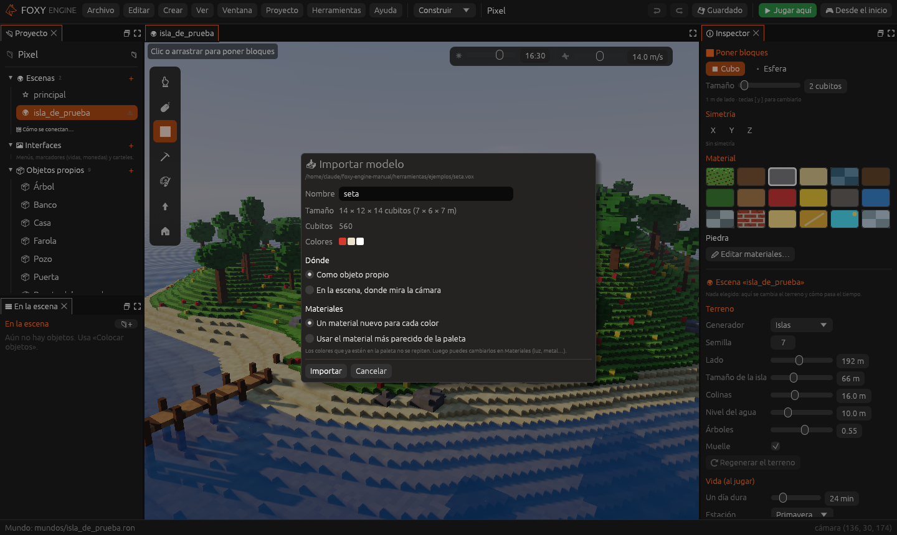
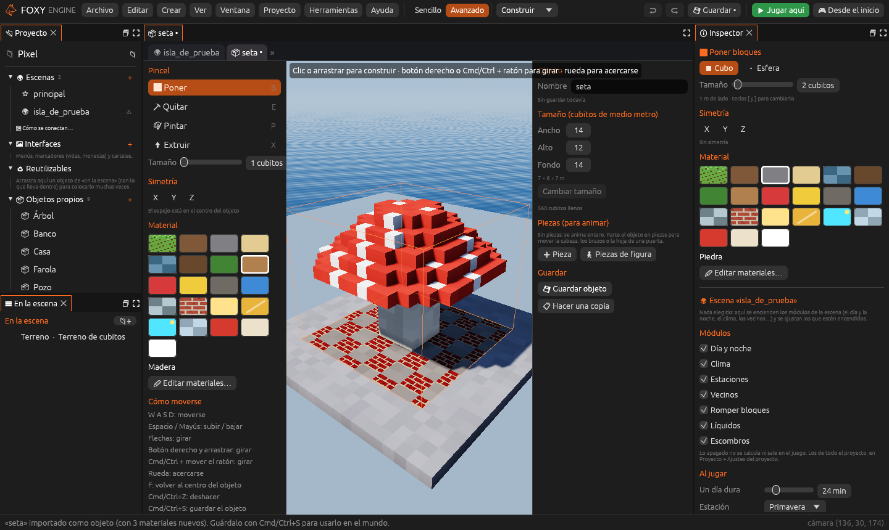
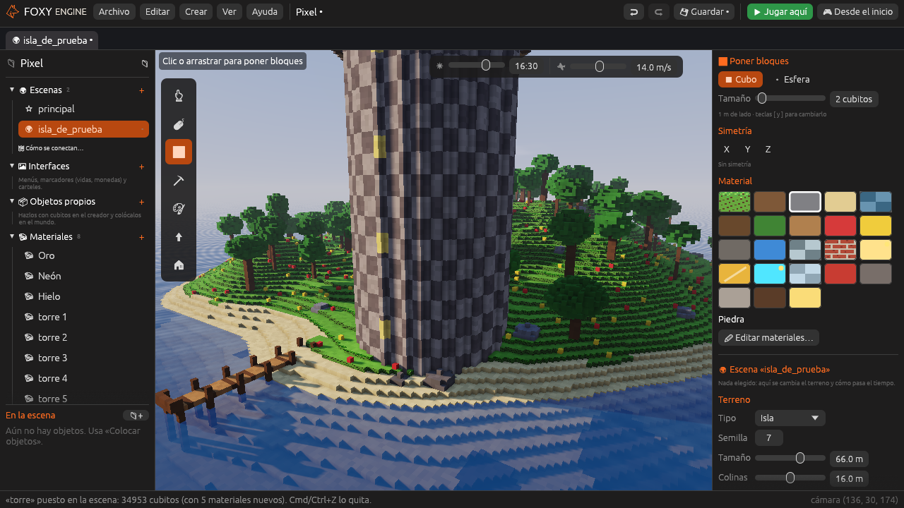

# Importar modelos

Foxy Engine lee los modelos de cubitos de otros programas (esta página) y
también **modelos 3D normales**, de triángulos, en glTF (`.glb`, `.gltf`) u
OBJ: esos se ven con su forma y sus texturas, sin pasar a cubitos. Ver
[Modelos 3D (glTF y OBJ)](modelos-3d.md).

Los modelos de cubitos que lee son:

| Programa | Archivo | Qué se lee |
|---|---|---|
| **MagicaVoxel** | `.vox` | Todos los modelos del archivo, colocados como en su escena (con sus giros), y su paleta de colores |
| **Qubicle** | `.qb` | Todas las matrices, cada una en su sitio, con o sin comprimir |

Cada cubito del modelo es un cubito del motor, es decir, **medio metro**.
Un modelo de 40 cubitos de alto mide 20 m.

## Cómo se importa

Hay tres formas:

- <i class="fx fx-mas"></i> **Crear → Importar modelo…** y
  elegir el archivo.
- **Soltar el archivo** sobre la ventana del editor.
- Abrirlo desde [Archivos del proyecto](archivos.md), si ya está dentro del
  proyecto.

Se abre la ventana **Importar modelo**, con el nombre, el tamaño, cuántos
cubitos tiene y sus colores.

## Dónde

- **Como objeto propio**: se abre en el [creador de objetos](creador.md),
  sin guardar todavía. Ponle nombre, cámbialo si quieres y guárdalo con
  <kbd>Cmd</kbd>/<kbd>Ctrl</kbd>+<kbd>S</kbd>. Desde ese momento sale en
  *Mis objetos* para colocarlo cuantas veces quieras. Solo se puede si el
  modelo cabe en un objeto: **64 cubitos de lado** como mucho.
- **En la escena, donde mira la cámara**: los cubitos pasan a ser parte del
  terreno, apoyados sobre lo que hay en el centro de la pantalla. Es lo
  mejor para modelos grandes, como un castillo o una ciudad. Un solo
  <kbd>Cmd</kbd>/<kbd>Ctrl</kbd>+<kbd>Z</kbd> lo quita entero.

| Como objeto | En la escena |
|---|---|
|  |  |

## Materiales

Los modelos traen **colores**; el motor construye con **materiales**. Al
importar se elige cómo pasar de unos a otros:

- **Un material nuevo para cada color**: crea un
  [material propio](materiales.md) por cada color del modelo, llamados como
  el modelo y un número («zorro 1», «zorro 2»…). Si un color ya está en la
  paleta, se usa ese y no se repite. Después puedes darles luz propia, brillo
  metálico o transparencia en el panel Materiales: por ejemplo, que las
  ventanas de un castillo brillen de noche.
- **Usar el material más parecido de la paleta**: no crea nada; cada color
  usa el material de la paleta que más se le parece.

Un proyecto puede tener hasta 240 materiales propios. Si un modelo tiene más
colores que huecos libres, los que no caben usan el más parecido.

> <i class="fx fx-consejo"></i> **Consejo.** MagicaVoxel pone el eje Z hacia
> arriba; el motor lo gira solo para que lo de arriba quede arriba, sin que
> el modelo salga como en un espejo.
