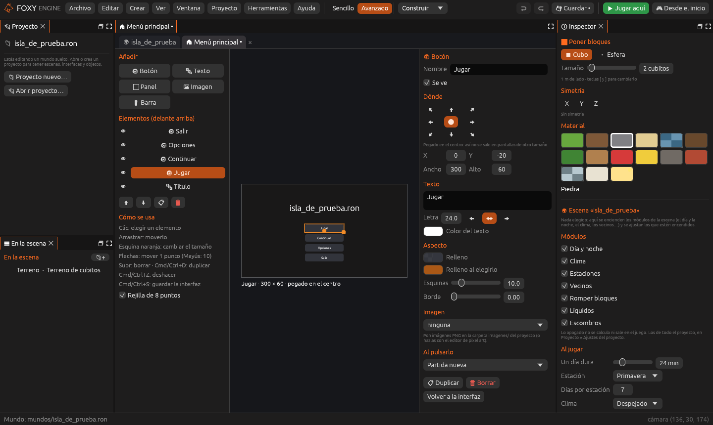
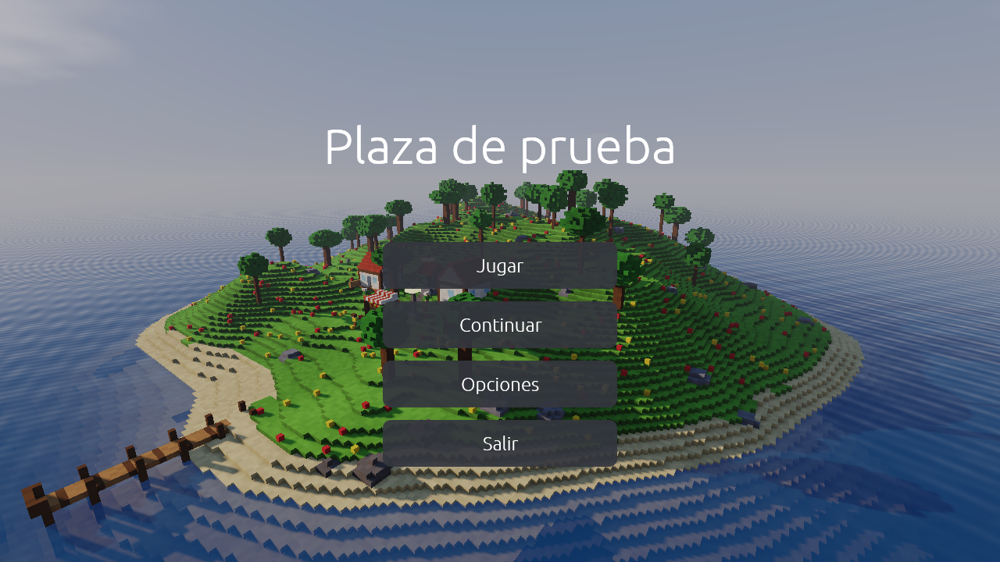
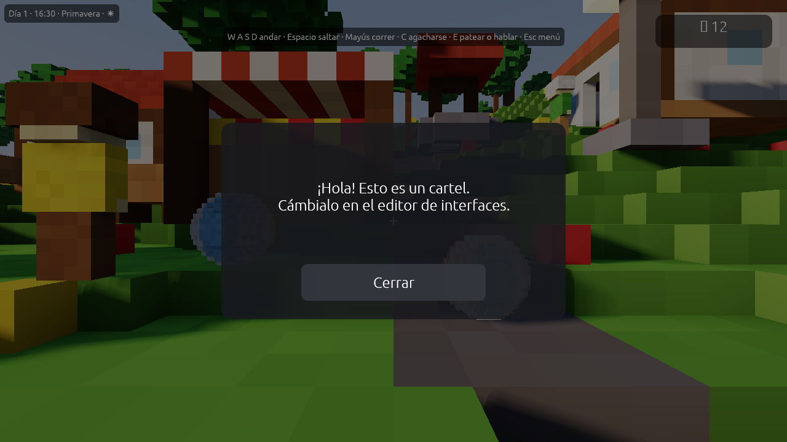

# Interfaces

Con las **interfaces** diseñas todo lo que va *encima* del juego: el menú
principal, el menú de pausa, el marcador de monedas, el cartel de una tienda,
un diálogo… Sin escribir código.

| Editor de interfaces | Menú principal propio | Cartel y marcador |
|---|---|---|
|  |  |  |

## Crear una interfaz

El <i class="fx fx-mas"></i> del grupo <i class="fx fx-interfaz"></i>
**Interfaces** del panel «Proyecto» (o **Crear → Interfaz nueva…**) pide un
nombre y una plantilla:

| Plantilla | Trae |
|---|---|
| **Cartel** | Un mensaje y un botón *Cerrar* |
| **Menú principal** | Botones *Jugar*, *Continuar*, *Opciones* y *Salir* |
| **Marcador** | Un contador de monedas arriba a la derecha |
| **Vacía** | Nada; empiezas de cero |

Cada interfaz se abre en su pestaña y se guarda en
`interfaces/<nombre>.ron`. Un clic en el panel «Proyecto» vuelve a abrirla.
Un <i class="fx fx-aviso"></i> al lado de su nombre avisa de que **nada la
abre todavía** en el juego.

## El lienzo

En el centro se ve la **pantalla del juego** (1280 × 720 puntos) con el mundo
detrás, visto desde la cámara del editor.

| Para | Haz |
|---|---|
| Elegir un elemento | Clic |
| Moverlo | Arrastrar, o flechas (1 punto; con <kbd>Mayús</kbd>, 10) |
| Cambiar su tamaño | Arrastrar la **esquina naranja** |
| Borrarlo | <kbd>Supr</kbd> |
| Duplicarlo | <kbd>Cmd</kbd>/<kbd>Ctrl</kbd>+<kbd>D</kbd> |
| Deshacer | <kbd>Cmd</kbd>/<kbd>Ctrl</kbd>+<kbd>Z</kbd> |
| Guardar | <kbd>Cmd</kbd>/<kbd>Ctrl</kbd>+<kbd>S</kbd> |

La **rejilla de 8 puntos** ayuda a alinear. La lista de **elementos** va de
delante (arriba) a atrás (abajo).

<i class="fx fx-jugar"></i> **Probarla** abre el juego con la interfaz a la vista,
aunque todavía no esté guardada.

## Los elementos

| Elemento | Para qué |
|---|---|
| <i class="fx fx-panel"></i> **Panel** | Un rectángulo de color o con imagen: fondos, marcos |
| <i class="fx fx-texto"></i> **Texto** | Un texto, que puede cambiar solo (mira abajo) |
| <i class="fx fx-boton"></i> **Botón** | Algo que se pulsa y hace una acción |
| <i class="fx fx-imagen"></i> **Imagen** | Una imagen del proyecto |

Cada elemento tiene **nombre**, posición, tamaño, y su **aspecto**: relleno,
relleno al elegirlo (en los botones), color del texto, tamaño de letra,
alineación, esquinas redondeadas, borde, imagen y si **se ve** o está
escondido.

### Pegar a un borde

Cada elemento está **pegado** a una esquina, a un borde o al centro de la
pantalla. Así no se sale en pantallas de otro tamaño: un marcador pegado
*arriba a la derecha* se queda siempre en esa esquina.

### Imágenes

Las imágenes salen de `imagenes/*.png` (las que haces en
[Pixel art](pixel-art.md)). Si tienen **bordes**, se estiran en nueve partes
sin deformar las esquinas; **Tamaño del píxel** dice cuántos puntos de pantalla
ocupa cada píxel de esas esquinas. *No deformarla* hace que la imagen quepa
entera sin estirarse.

## Para qué es cada interfaz

| Uso | Cuándo se ve |
|---|---|
| **Pantalla o cartel** | Al abrirla con **su tecla**, un botón, una zona, un objeto (*Al usarlo*) o `motor.abrir_interfaz("tienda")`. Puede **pausar el juego** y **oscurecer el fondo**. <kbd>Esc</kbd> la cierra |
| **Marcador** | Siempre encima del juego: vidas, monedas… Puede **esconder el reloj del motor** |
| **Menú principal** | Sustituye al menú principal del motor |
| **Menú de pausa** | Sustituye a la pausa del motor |

## Cómo se abre en el juego

Una interfaz que nada abre no se verá nunca al jugar. Por eso, en el panel de
la derecha, el apartado **Cómo se abre en el juego** dice qué la abre y
ayuda a conectarla:

- Un **marcador** se ve siempre; un **menú principal** sale al abrir el juego
  (<i class="fx fx-mando"></i> *Desde el inicio* para verlo), y un **menú de
  pausa**, al pulsar <kbd>Esc</kbd> jugando.
- Una **pantalla o cartel** puede tener su propia **tecla**: <kbd>I</kbd>,
  <kbd>M</kbd>, <kbd>J</kbd>, <kbd>K</kbd>, <kbd>L</kbd>, <kbd>N</kbd>,
  <kbd>Q</kbd>, <kbd>R</kbd>, <kbd>T</kbd>, <kbd>U</kbd>, <kbd>G</kbd> o
  <kbd>Tab</kbd>. Jugando, esa tecla la abre y la vuelve a cerrar, como un
  inventario o un mapa.
- Debajo salen, con <i class="fx fx-flecha"></i>, **todas las cosas que la
  abren**: botones de otras interfaces, zonas, objetos con *Al usarlo* y
  llamadas del guion.
- Si nada la abre, sale el aviso <i class="fx fx-aviso"></i> *Nada la abre
  todavía*.
- <i class="fx fx-zona"></i> **Zona que la abre** pone en la escena, delante
  de la cámara, una zona de cambio que la abre al entrar. Así queda conectada
  al momento.

## Acciones de los botones

Cada botón hace una **acción** que se elige de una lista: ir a otra escena,
abrir o cerrar una interfaz, volver al juego, partida nueva, continuar,
cargar o guardar partida, opciones, menú principal, salir o llamar a una
función del guion. Las explica [Acciones](../referencia/acciones.md).

Los botones funcionan con el **ratón**, con las **flechas** e <kbd>Intro</kbd>
y con el **mando**.

## Textos que cambian

Un texto puede llevar valores entre llaves, que se rellenan al jugar:

| Escribe | Sale |
|---|---|
| `{hora}` | La hora del juego, por ejemplo *08:30* |
| `{dia}` | El día de la partida |
| `{estacion}` | La estación |
| `{clima}` | El tiempo que hace |
| `{escena}` | La escena actual |
| `{proyecto}` | El nombre del proyecto |
| `{lo_que_quieras}` | Cualquier valor que ponga el guion con `motor.poner_valor` |

Por ejemplo, un marcador con el texto `Monedas: {monedas}` y este guion:

```lua
-- La llama una zona o un botón con la acción «Llamar al guion».
function coger_moneda(quien)
  local monedas = motor.valor("monedas") or 0
  motor.poner_valor("monedas", monedas + 1)
end
```

Los valores del guion **se guardan con la partida**.
