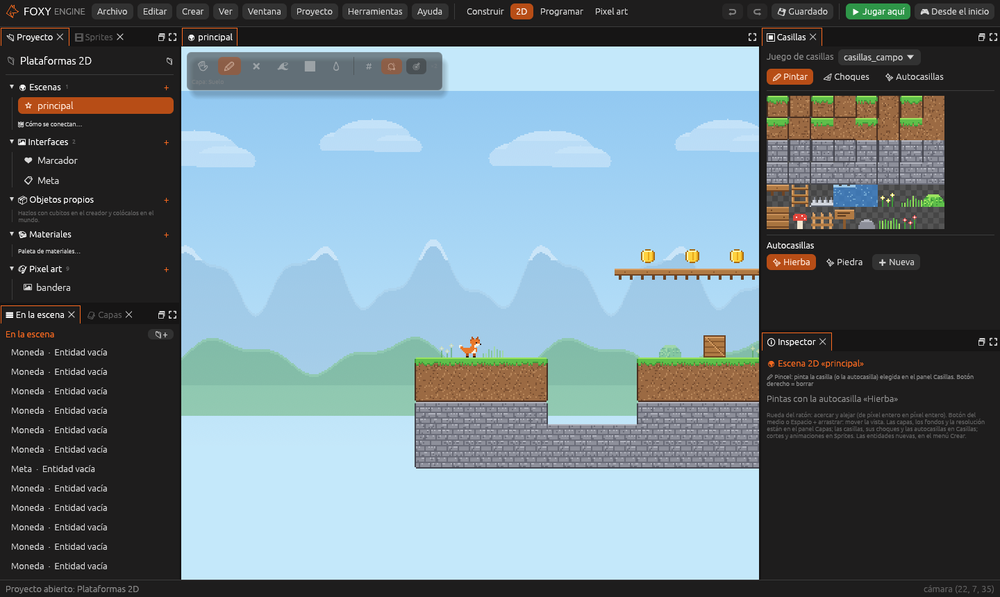
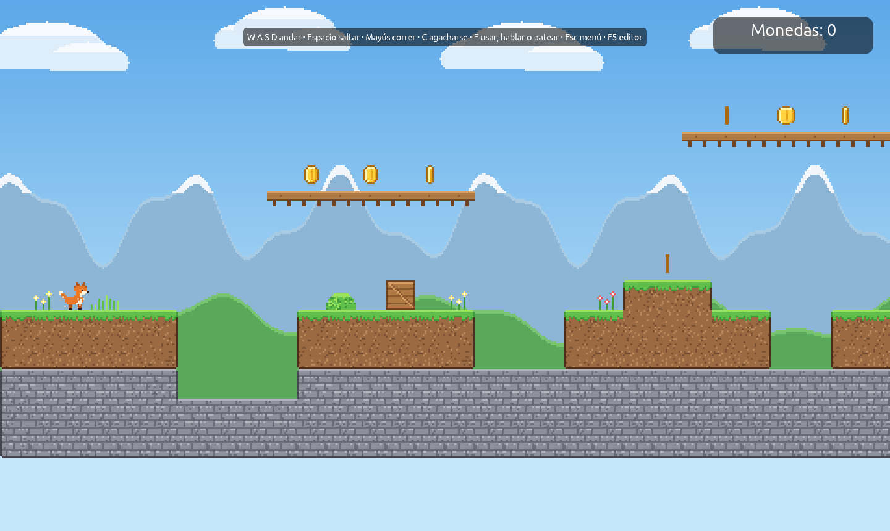
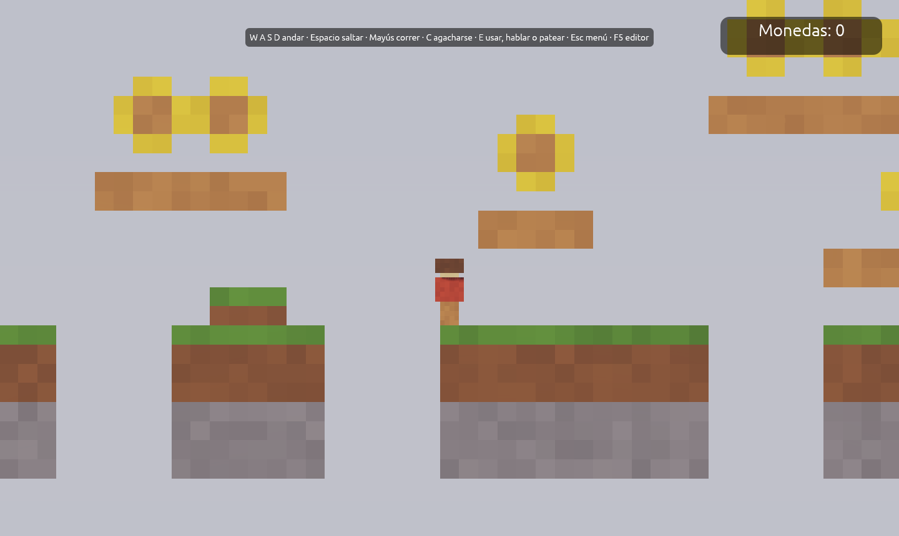

# Juegos 2D

Foxy Engine hace juegos 2D de dos clases: de **pixel art**, con sprites y
mapas de casillas, y de **cubitos vistos de lado**, con la cámara sin
perspectiva. Los dos usan las mismas entidades, componentes, guiones y
nodos que los juegos 3D.

| Jugando a Plataformas 2D | Jugando a Plataformas vóxel |
|---|---|
|  |  |

## Empezar un juego 2D

1. En la pantalla de inicio, pulsa **Nuevo proyecto**.
2. En **Tipo**, elige **2D pixel art** o **2D con vóxeles**.
3. Elige una plantilla y pulsa **Crear proyecto**.

| Plantilla | Qué incluye |
|---|---|
| **Vacío 2D** | Un suelo de casillas, el cielo y un zorro que salta |
| **Plataformas 2D** | Un nivel con monedas, escaleras, pinchos, agua, una caja que se empuja y una bandera de meta |
| **Aventura cenital** | Un prado visto desde arriba, con camino, lago, una vecina, antorchas y gemas que buscar |
| **Plataformas vóxel** | Un nivel de cubitos visto de lado, con cámara fija y monedas en el camino |

Los proyectos 2D se abren en el espacio **2D**: el panel **Proyecto** y
**En la escena** a la izquierda, la vista en el centro, y
[Casillas](casillas.md), [Capas](casillas.md#capas),
[Sprites](sprites.md) e **Inspector** a la derecha.

## La escena 2D

Una escena 2D se mide en **casillas**. La posición de cada entidad va en
casillas, con `y` hacia arriba, y la escena se dibuja con la cámara
**pixel perfect**: cada píxel del juego ocupa siempre un número entero de
píxeles de la pantalla, así que el pixel art se ve nítido.

Los ajustes de la escena están en el panel **Capas**, en el apartado
**Escena 2D**.

| Ajuste | Qué hace |
|---|---|
| **Casilla (px)** | El lado de una casilla, en píxeles (16 de fábrica) |
| **Resolución** | Los píxeles de pixel art que se ven en el juego (384 × 216 de fábrica) |
| **Pantalla** | **Llenar** muestra algo más de escena por los lados; **Bandas** muestra siempre lo mismo, con bandas negras si sobra sitio |
| **Fondo** | El color que hay detrás de todas las capas |
| **Luz ambiente** | 1 lo ilumina todo; con menos, solo se ve cerca de las [luces](../referencia/componentes/luz.md) |
| **Cámara** | Con **sin salirse del mapa**, la cámara no enseña nada fuera de las casillas de la escena |

## La vista

La vista 2D tiene una barra de herramientas arriba a la izquierda.

| Herramienta | Qué hace |
|---|---|
| **Elegir** | Elige una entidad para verla en el Inspector. Arrástrala para moverla (<kbd>Mayús</kbd>: de media en media casilla) |
| **Pincel** | Pinta la casilla o la autocasilla elegida en el panel **Casillas**. El botón derecho borra |
| **Goma** | Borra casillas de la capa activa |
| **Relleno** | Llena el hueco del mismo tipo que hay bajo el ratón |
| **Rectángulo** | Arrastra para llenar un rectángulo. Con el botón derecho, lo vacía |
| **Cuentagotas** | Coge la casilla que hay bajo el ratón |

A la derecha de las herramientas están la **rejilla**, **ver la luz y la
oscuridad** de la escena y **volver a centrar la cámara**.

- Acerca y aleja con la **rueda del ratón**, de píxel entero en píxel entero.
- Mueve la vista con el **botón del medio**, con <kbd>Espacio</kbd> y
  arrastrar, o con el botón derecho en **Elegir**.

## Entidades 2D

Las entidades nuevas se ponen con el menú **Crear**, en el centro de la
vista.

| Entidad | Qué es |
|---|---|
| **Personaje** | El jugador: salta (o anda, en vista cenital) y la cámara lo sigue |
| **Moneda** | Se recoge al tocarla y suma 1 al valor `monedas` |
| **Caja** | Un cuerpo que cae y se empuja |
| **Zona** | Hace algo cuando el jugador entra: abrir una interfaz, ir a otra escena… |
| **Luz** | Alumbra a su alrededor cuando la luz ambiente es baja |
| **Partículas** | Polvo, chispas, lluvia, nieve, humo u hojas |

Cada entidad se ve con su [Sprite](../referencia/componentes/sprite.md). Las
que no tienen sprite se muestran con su nombre en el editor.

## El jugador

El jugador es la entidad con
[Controlador de jugador](../referencia/componentes/controlador.md). En 2D
hay dos tipos:

- **Plataformas 2D**: de lado, con gravedad. Corre, salta, trepa escaleras,
  nada y atraviesa las plataformas desde abajo.
- **Cenital**: desde arriba, sin gravedad. Anda en las cuatro direcciones.

El salto de plataformas tiene dos ayudas que se ajustan en el Inspector:

- **Coyote time**: se puede saltar un momento después de salir de un borde.
- **Salto variable**: soltar **Saltar** pronto hace el salto más bajo.

Se juega con teclado o con mando: el stick o la cruceta para andar, y el
botón de abajo (A en Xbox, ✕ en PlayStation) para saltar.

### Animaciones del jugador

El motor elige solo la animación del jugador según lo que hace, si su hoja
de sprites tiene animaciones con estos nombres:

| Animación | Cuándo |
|---|---|
| `quieto` | Parado |
| `andar` / `correr` | Andando o con **Correr** |
| `saltar` / `caer` | Subiendo o bajando en el aire |
| `trepar` | En una escalera |
| `nadar` | En el agua |
| `andar_abajo`, `andar_arriba`, `andar_lado` | En vista cenital, según hacia dónde anda (y `quieto_abajo`…, parado) |

Si falta una, se usa la más parecida. Mirando a la izquierda, el sprite se
da la vuelta solo.

## Recoger cosas

Una entidad con [Recogible](../referencia/componentes/recogible.md)
desaparece al tocarla, suena y suma a un valor del juego. Una interfaz
enseña ese valor escribiendo su nombre entre llaves en un texto, como
`Monedas: {monedas}`. El evento **Al recoger** avisa a los guiones y a los
nodos.

## Partículas y luces

- El componente [Partículas](../referencia/componentes/particulas.md) suelta
  polvo, chispas, lluvia, nieve, humo u hojas. Funciona igual en 3D.
- Con la **luz ambiente** por debajo de 1, las entidades con
  [Luz](../referencia/componentes/luz.md) alumbran a su alrededor. En 2D el
  alcance va en casillas.

## Cubitos vistos de lado

La plantilla **Plataformas vóxel** es una escena 3D normal hecha de
cubitos. El jugador tiene el controlador **Plataformas 2D** y la cámara es
**Ortográfica**: sin perspectiva, lo lejano se ve igual de grande que lo
cercano. **Alto visible** dice cuántos metros de alto se ven. El nivel se
construye con las herramientas de siempre (ver
[Construir el mundo](mundo.md)).

## En guiones y nodos

La categoría **2D** de los nodos y las funciones de `motor` en Lua hacen lo
mismo:

| Función | Qué hace |
|---|---|
| `motor.animar(entidad, nombre)` | Pone una animación de la hoja de sprites |
| `motor.voltear(entidad, si)` | Da la vuelta al sprite |
| `motor.impulsar(entidad, x, y)` | Empuja un cuerpo o al jugador |
| `motor.casilla(x, y, capa)` | Qué casilla hay en un sitio |
| `motor.poner_casilla(x, y, casilla, capa)` | Pone o quita una casilla mientras se juega |
| `motor.particulas(entidad, si)` | Enciende o apaga sus partículas |
| `motor.soltar_particulas(tipo, x, y, z, cantidad)` | Suelta unas partículas de golpe |

Los detalles de cada una están en la
[Referencia de la API de Lua](../referencia/api-lua.md) y en la
[Referencia de nodos](../referencia/nodos.md).

## Véase también

- [Sprites](sprites.md)
- [Mapas de casillas](casillas.md)
- [Entidades y componentes](entidades.md)
- [Pixel art](pixel-art.md)
