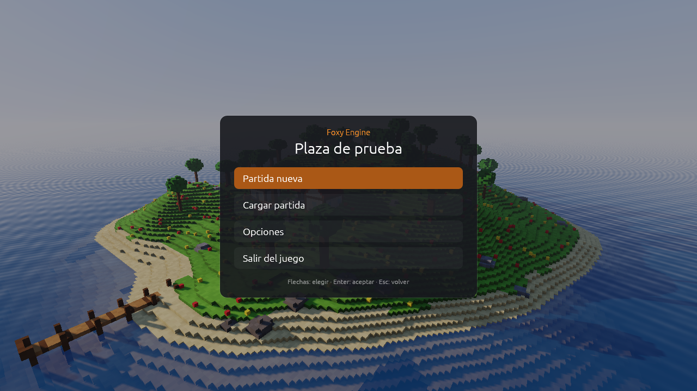
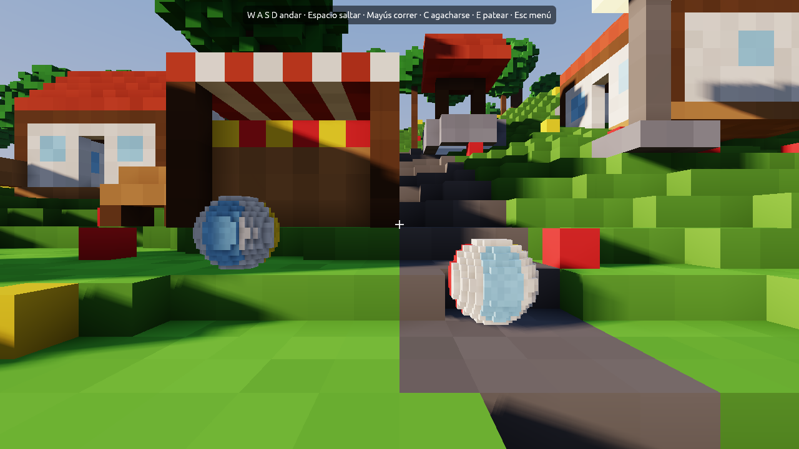
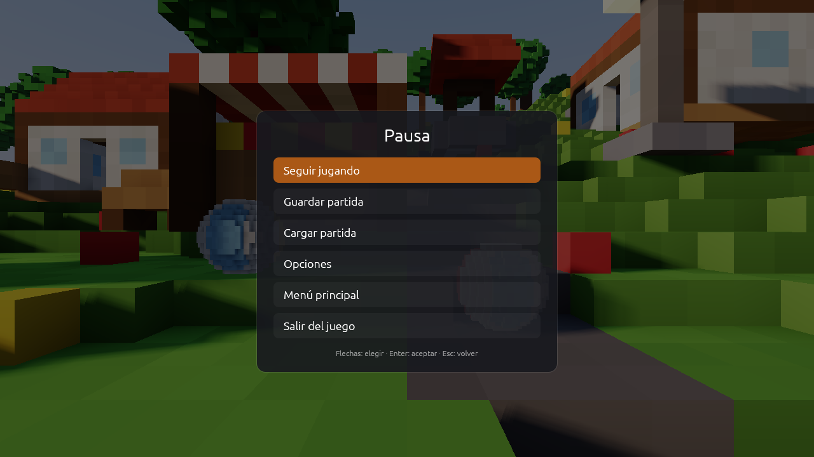
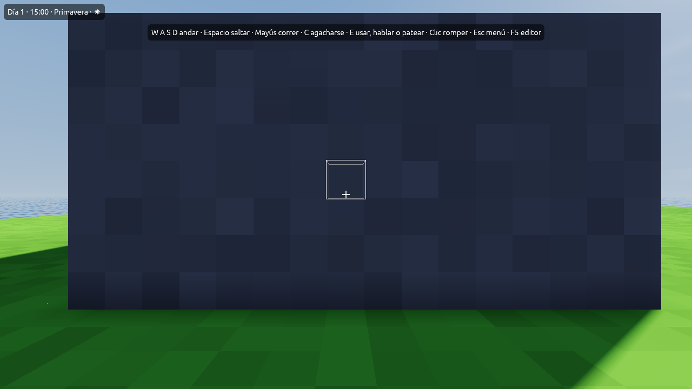
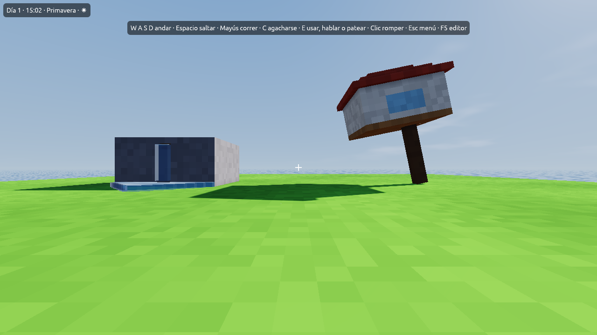
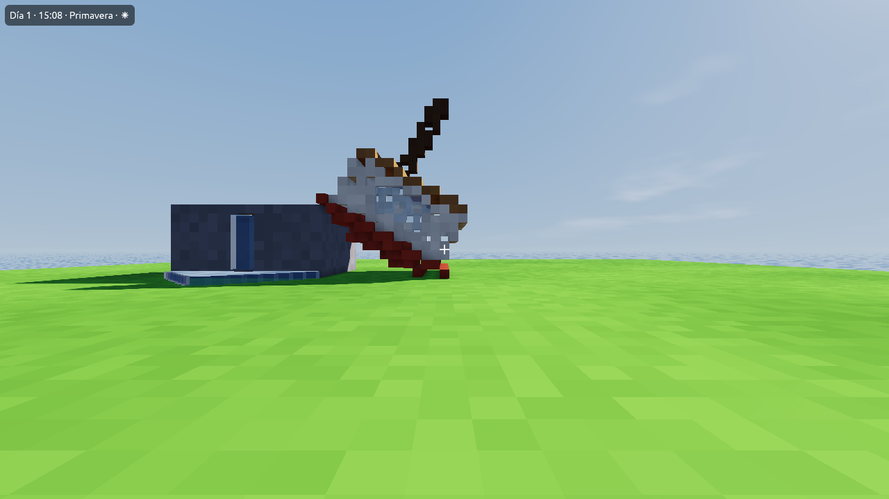

# Probar el juego

Hay dos maneras de probar lo que haces, y una tercera para abrir solo el
juego.

| | Qué hace | Para qué |
|---|---|---|
| <i class="fx fx-jugar"></i> **Jugar aquí** (<kbd>F5</kbd>) | Te pone de pie donde mira la cámara. <kbd>F5</kbd> vuelve al editor, justo donde estabas | Probar algo al momento |
| <i class="fx fx-mando"></i> **Desde el inicio** | Abre el juego completo, con su menú principal, en el punto de inicio de la escena inicial | Probar el juego como lo verá quien lo juegue |
| `foxy-engine --juego` | Solo el juego, sin editor | Así será el juego exportado (Fase 6) |

| Menú principal | Jugando | Pausa |
|---|---|---|
|  |  |  |

## Controles

| Acción | Teclado y ratón | Mando (Xbox / PlayStation) |
|---|---|---|
| Andar | <kbd>W</kbd> <kbd>A</kbd> <kbd>S</kbd> <kbd>D</kbd> o flechas | Stick izquierdo |
| Mirar | Ratón | Stick derecho |
| Correr | <kbd>Mayús</kbd> | Stick a fondo, L3 o gatillo izquierdo |
| Saltar (y nadar hacia arriba) | <kbd>Espacio</kbd> | A / <i class="fx fx-ps-cruz" title="Cruz"></i> |
| Agacharse | <kbd>C</kbd> o <kbd>Ctrl</kbd> | B / <i class="fx fx-ps-circulo" title="Círculo"></i> o R3 |
| Usar un objeto, hablar o patear una pelota | <kbd>E</kbd> o clic | X / <i class="fx fx-ps-cuadrado" title="Cuadrado"></i> o gatillo derecho |
| [Romper el bloque que se mira](#romper-bloques) (apretado, sigue) | Clic | Gatillo derecho o X / <i class="fx fx-ps-cuadrado" title="Cuadrado"></i> |
| Abrir o cerrar una pantalla con tecla propia | La suya (<kbd>I</kbd>, <kbd>M</kbd>, <kbd>Tab</kbd>…) | |
| Menú de pausa | <kbd>Esc</kbd> | Start |
| Moverse por los menús | Flechas, <kbd>Intro</kbd>, <kbd>Esc</kbd> o el ratón | Cruceta o stick, A, B |

En el mando, A y B son los botones de Xbox; los símbolos son los de
PlayStation (<i class="fx fx-ps-cruz"></i> cruz, <i class="fx fx-ps-circulo"></i>
círculo y <i class="fx fx-ps-cuadrado"></i> cuadrado).

## Usar objetos

Al mirar de cerca (a menos de 4 m) un objeto que hace algo
[al usarlo](mundo.md#al-usarlo-e), abajo aparece una pista, como
<kbd>E</kbd> *Casa: ir a «interior»* o <kbd>E</kbd> *Puesto: abrir
«tienda»*. Pulsa <kbd>E</kbd> (o haz clic) para usarlo. Si a la vez tienes
delante un vecino o una pelota, <kbd>E</kbd> habla con el vecino o patea la
pelota primero.

## Física

- Los escalones de medio metro se suben solos.
- Agachado no te caes por los bordes.
- Se puede saltar un instante después de salir de un borde.
- Las **pelotas** caen, botan, ruedan, flotan en el agua, chocan entre ellas y
  se empujan al andar contra ellas.

## Romper bloques

El bloque que miras de cerca (a menos de 4,5 m) sale con un **borde
blanco**. Cada clic es un golpe y la cara se va oscureciendo; cuando lleva
los [golpes](materiales.md#atributos) de su material, se rompe. Si mantienes
el botón apretado, sigue golpeando. Los materiales con 0 golpes no se rompen.

Si un objeto que se usa o un vecino está delante, el clic lo usa o habla con
él, y no rompe nada.

### Derrumbes

Al romper un bloque, el motor mira todo lo que estaba pegado a él. Si ya no
llega al suelo, **se cae entero**: vuelca, choca y rueda con física de
verdad, y pesa según sus materiales. Cuando se para, sus bloques vuelven al
mundo donde han quedado, así que un derrumbe deja ruinas.

| Cae | Se queda |
|---|---|
|  |  |

> **Nota:** una pieza de más de 4096 cubitos se da por apoyada aunque no
> toque el suelo: se entiende que es parte del terreno.

### Agua que corre

El agua que ya estaba en la escena (el mar, los lagos, un depósito) es una
**fuente** que no se acaba. Si le abres un hueco, el agua entra: cae todo lo
que puede y luego se extiende por el suelo hasta 7 cubitos (3,5 m). Si tapas
la salida, el agua que corría se retira.

### Se juega en una copia

Lo que rompes jugando no cambia la escena. Al volver al editor, al empezar
una partida nueva o al cargar una, el mundo vuelve a estar como lo
construiste. Lo roto todavía no se guarda en las partidas.

Para un juego en el que no se deba romper nada, apaga **Romper bloques** en
los [ajustes de la vida](vida.md#ajustes-de-la-vida).

## El punto de inicio

El objeto **Punto de inicio** marca dónde empieza una partida nueva, mirando
hacia donde apunta su flecha. Solo se ve en el editor. Si una escena tiene
[puntos de entrada](escenas.md#puntos-de-entrada), se llega a ellos desde
otras escenas.

## Partidas guardadas

- **Tres ranuras** y una **automática**, que se guarda cada dos minutos y al
  salir.
- **Continuar** carga la partida más reciente.
- Cada partida guarda la escena, la posición del jugador, la hora, el día, el
  clima, la estación, las pelotas y los valores del guion.
- Son archivos de texto en la carpeta `partidas/<escena>/` del proyecto
  (`ranura_1.ron`, `ranura_2.ron`, `ranura_3.ron` y `auto.ron`).

## Opciones

En el menú **Opciones**:

- Sensibilidad del ratón y del mando.
- Invertir arriba/abajo.
- Campo de visión.
- Balanceo al caminar.
- Mostrar los fotogramas por segundo.
- Volumen de la música y de los efectos.

Se guardan para todas las partidas en `Documentos/Foxy Engine/ajustes.ron`.
