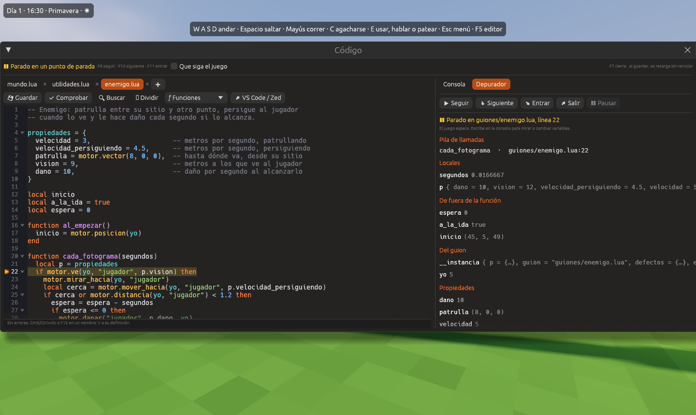
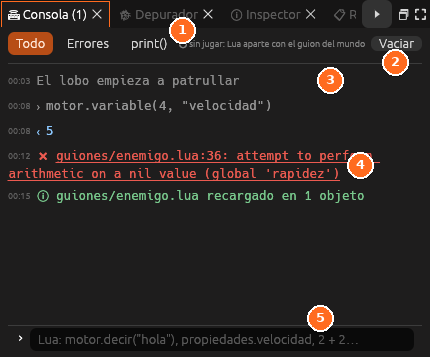

# Recargar, consola y depurador

Los guiones se corrigen **con el juego en marcha**: al guardar se recargan
sin reiniciar, la consola ejecuta Lua contra el juego y el depurador lo para
en una línea para ver todas las variables.



## La ventana Código mientras juegas

Al jugar, el editor se oculta. Pulsa <kbd>F7</kbd> para abrir la ventana
**Código** encima del juego. Tiene el editor de guiones a la izquierda y, a
la derecha, las pestañas **Consola** y **Depurador**.

- Mientras la ventana está abierta, **el juego se detiene** para que puedas
  escribir. Marca **Que siga el juego** si quieres ver los cambios al momento.
- <kbd>F7</kbd> la cierra y el juego sigue donde estaba.
- La ventana se abre sola cuando el juego se para en un punto de parada.

## Recargar sin reiniciar

1. Con el juego en marcha, abre el guion en la ventana **Código**
   (<kbd>F7</kbd>) o en tu editor externo.
2. Cámbialo y guárdalo con <kbd>Cmd</kbd>/<kbd>Ctrl</kbd>+<kbd>S</kbd>.
3. La consola confirma «enemigo.lua recargado en 3 objetos» y el juego
   sigue con el código nuevo.

Al recargar:

- Las **variables locales** del guion (`local espera = 0`, fuera de las
  funciones) **conservan su valor**.
- Las **propiedades** que no se habían cambiado en el inspector toman el
  valor nuevo del código.
- Si el guion tiene la función **`al_recargar()`**, se llama justo después.
- Si el código nuevo tiene un error, **se queda el anterior** y el error
  sale en la consola. Al guardar la versión arreglada, se recarga.
- Al guardar un **módulo**, se recargan también los guiones que lo usan.

> <i class="fx fx-nota"></i> **Nota.** Los cambios hechos fuera del editor,
> por ejemplo en VS Code, también se recargan solos. Ver
> [Editores externos](lua-editor-externo.md).

## La consola



La [Consola](../interfaz/consola.md) enseña lo que escriben los guiones con
`print()` y los errores, con la hora. **Un clic en un error abre el guion en
su línea.** Los botones **Todo**, **Errores** y **print()** filtran la lista.

Abajo se escribe Lua. Con el juego en marcha, se ejecuta **contra el juego**;
sin jugar, en un Lua aparte con el guion del mundo, para probar cosas:

```lua
motor.decir("hola")             -- lo dice en el juego
motor.posicion("Lobo")          -- (45, 5, 49)
motor.poner_variable("Lobo", "velocidad", 8)
2 + 2                           -- 4
```

El resultado de cada línea sale debajo. Las flechas <kbd>↑</kbd> y
<kbd>↓</kbd> recuperan lo que escribiste antes.

> <i class="fx fx-consejo"></i> **Consejo.** Si el juego está parado en un
> punto de parada, la consola ve las variables de esa función: escribe
> `espera` o `p.velocidad` para leerlas, o `espera = 0` para cambiarlas.

## El depurador

### Poner un punto de parada

1. Abre el guion en el panel **Código**.
2. Haz clic a la izquierda del número de línea. Sale un punto rojo.
3. Juega. Cuando el guion llega a esa línea, el juego se para y se abre la
   ventana **Código** con la línea marcada con un triángulo.

Otro clic en el punto lo quita. La lista **Puntos de parada** del
[Depurador](../interfaz/depurador.md) los enseña todos, con **Quitar** y
**Quitar todos**.

### Seguir paso a paso

| Botón | Tecla | Qué hace |
|---|---|---|
| **Seguir** | <kbd>F6</kbd> | Sigue jugando hasta el siguiente punto de parada |
| **Siguiente** | <kbd>F10</kbd> | La siguiente línea de esta función |
| **Entrar** | <kbd>F11</kbd> | La siguiente línea, entrando en las funciones que se llamen |
| **Salir** | <kbd>Mayús</kbd>+<kbd>F11</kbd> | Hasta volver a la función que llamó a esta |
| **Pausar** | — | Para en la siguiente línea de un guion que se ejecute |

### Ver las variables

Con el juego parado, el depurador enseña:

| Sección | Qué contiene |
|---|---|
| **Pila de llamadas** | Las funciones por las que se ha llegado a esta línea. Un clic abre cada una |
| **Locales** | Las variables de la función, con sus argumentos |
| **De fuera de la función** | Las variables `local` del guion que usa la función |
| **Del guion** | Las variables globales del guion, como `yo` |
| **Propiedades** | Los valores del objeto |

> <i class="fx fx-nota"></i> **Nota.** Mientras el juego está parado en un
> guion, el mundo se queda quieto, igual que con los puntos de parada de los
> [nodos](nodos-depurar.md).

## Errores mientras escribes

El panel **Código** comprueba el guion mientras escribes, sin jugar:

- Los **errores de sintaxis**, como un `end` olvidado, se subrayan en rojo y
  salen abajo, con la línea.
- Las funciones de `motor` que no existen se marcan en amarillo, con una
  sugerencia: «motor.mober no existe: ¿querías decir motor.mover?».
- Los errores que se producen al jugar se marcan en su línea con una barra
  roja.

## Véase también

- [Programar en Lua](programar-lua.md)
- [Consola](../interfaz/consola.md) y [Depurador](../interfaz/depurador.md)
- [Depurar los nodos](nodos-depurar.md)
